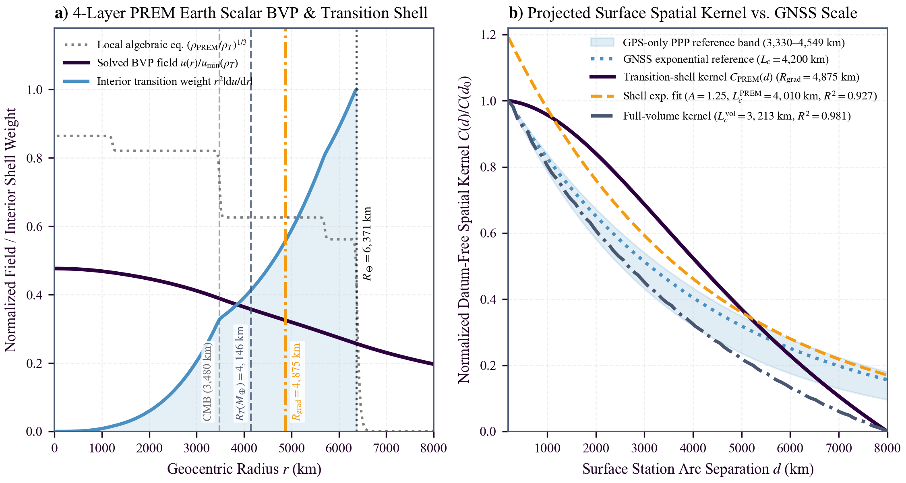
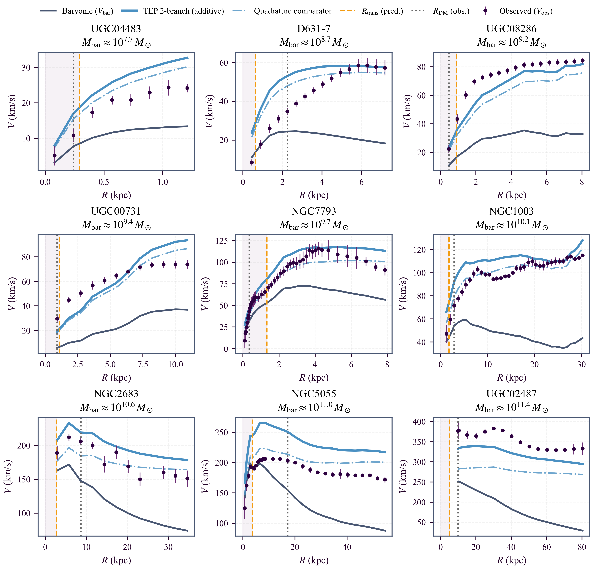
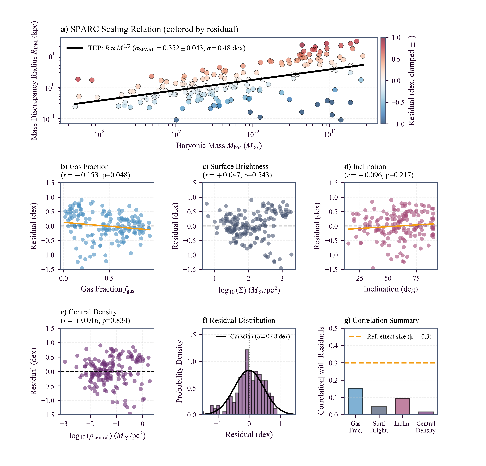
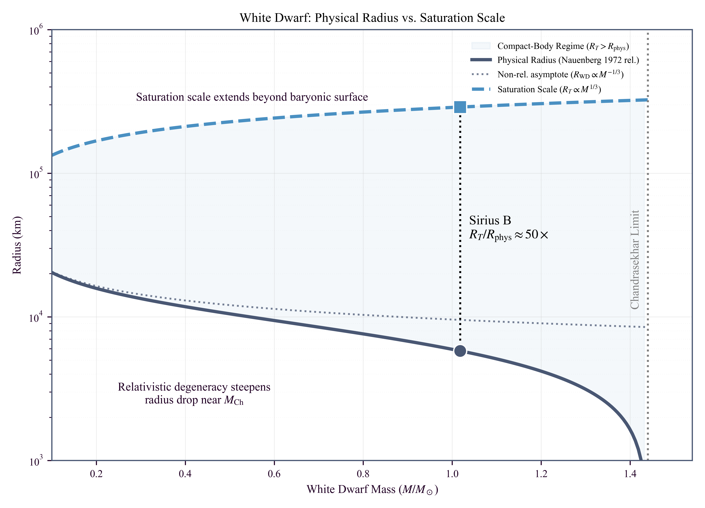
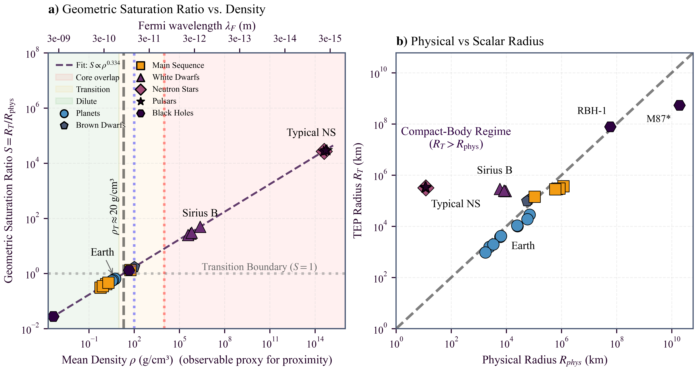
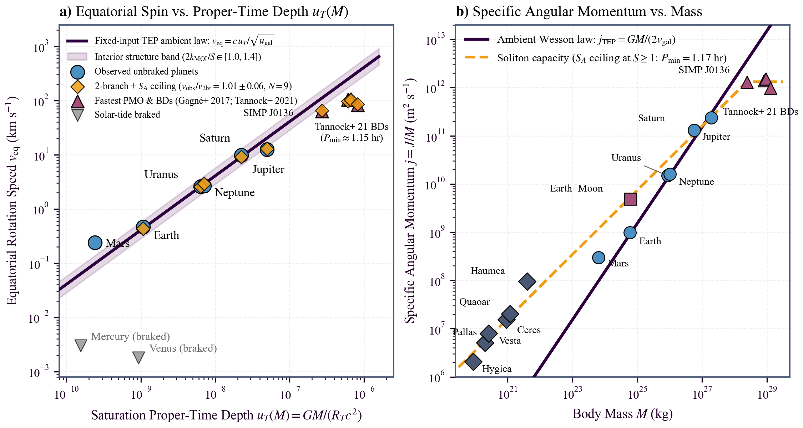
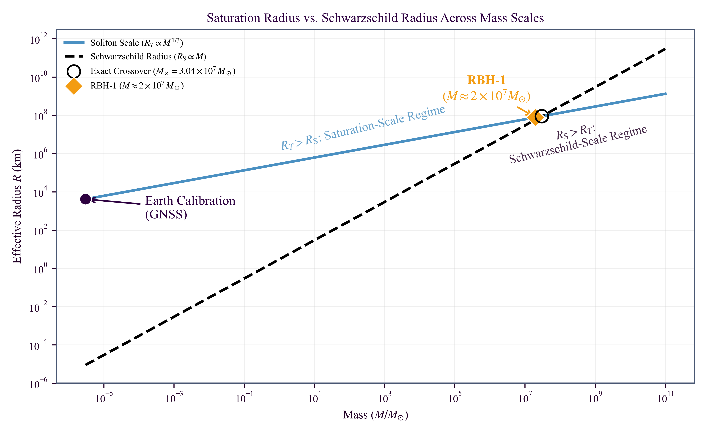

# Temporal Topology Saturation Scale: Cross-Scale Consistency of ρ_T
Matthew Lukin Smawfield
Version: v0.10 (New Delhi)
First published: 28 December 2025 · Last updated: 25 October 2026
DOI: 10.5281/zenodo.18064365

---

## Abstract

Gravitational anomalies across astrophysical scales exhibit an empirical regularity: the radius at which Newtonian dynamics fails scales as $R \propto M^{1/3}$ in the compact saturation regime and $R \propto M^{1/2}$ in the low-acceleration galactic regime, organized by a candidate saturation/proximity density scale $\rho_T$ in the Temporal Equivalence Principle (TEP) conformal time-field sector. The 25-year GNSS atomic-clock correlation length $L_c \approx 4{,}200$ km (CODE, IGS, ESA; raw-RINEX validated) establishes an Earth-scale correlation structure consistent with $R_T(M_\oplus) = (3M_\oplus/4\pi\rho_T)^{1/3} = 4{,}146$ km at $\rho_T \approx 20$ g/cm³ ($\rho_T \in [8,\,70]$ g/cm³ conditional mapping under $L_c \leftrightarrow R_T(M_\oplus)$). A 4-layer PREM Earth boundary-value integration confirms an order-unity geometric projection ($L_c^{\rm PREM} = 4{,}010$ km shell; $3{,}213$ km volume) governed by Earth's $R_{\rm CMB}$ and $R_\oplus$ structure, while Monte Carlo network injection–recovery simulations across $L_c^{\rm true} \in [1{,}000,\,6{,}000]$ km demonstrate that 1-constellation GPS-only processing recovers $L_c^{\rm true} = 4{,}200$ km ($\hat L_c^{\rm GPS} = 4{,}036 \pm 113$ km; white-noise null $|C(d)| = 0.009$; correlated orbital/datum dipole null concave-down with $d^2C/dd^2 < 0$), whereas 4-constellation multi-GNSS inter-system-bias (ISB) projection compresses the same field to $\hat L_c^{\rm MGEX} = 2{,}277 \pm 47$ km per-epoch ($1.77\times$) and $2{,}485 \pm 45$ km daily-constant ($1.62\times$, matching the empirical $1.90\times$ MGEX offset).

Because the canonical terrestrial BVP is shaped by Earth's fixed geometry, quantitative calibration of $\rho_T \approx 20$ g/cm³ rests on direct $R_\oplus$-free cross-mass tests, separated from structural-exponent tests. Direct tests comprise the RBH-1 crossover ($M_\times = \sqrt{3c^6/(32\pi G^3\rho_T)} \approx 3.04 \times 10^7\,M_\odot$, $R_T/R_S = 1.32$), the zero-parameter equatorial rotation relation $v_{\rm eq}/c = u_T(M)/\sqrt{u_{\rm gal}}$ ($v_{\rm gal} = 220$ km s$^{-1}$), which matches Earth, Uranus, Neptune, and Saturn at $v_{\rm obs}/v_{\rm TEP} = 1.016 \pm 0.073$ ($\rho_T^{\rm spin} = 20.9$ g/cm³ geometric mean; extending above $M_{\rm cap} = 194\,M_\oplus = 0.61\,M_{\rm Jup}$ with one small-body capacity parameter $\eta_0 = 0.129$ [or the parameter-free secular stability fraction $\eta_{\rm sec} = \tfrac{1}{8} = 0.125$] and $S_A = \min[1,\,S]$ matches Jupiter at $-2.9\%$ [$-0.2\%$ at $\eta_{\rm sec}$], the fastest planetary-mass rotator SIMP J0136 at $-2.8\%$ [$-0.3\%$], and the $1.15 \pm 0.08$ hr brown-dwarf period floor of Tannock et al. 2021 at $P_{\min}^{\rm TEP} = (k_{\rm MOI}/\eta_0)\tau_T = 1.17$ hr [$1.21$ hr at $\eta_{\rm sec}$], giving $v_{\rm obs}/v_{\rm 2br} = 1.008 \pm 0.060$ and $\rho_T^{\rm rot} = 21.1$ g/cm³ across $N = 9$ planetary and substellar systems), and cold-planet moments of inertia $k_{\rm MOI} \simeq \tfrac{1}{2}S$ ($\rho_T^{\rm MOI,\text{terr}} = 17.9 \pm 1.4$ g/cm³ across the three core-screened terrestrial planets; $2k_{\rm MOI}/S = 1.17 \pm 0.14$ across eight planets with a systematic trend toward $8$–$9$ g/cm³ in compressible gas giants). Structural and scale-cancellation tests comprise the SPARC onset scaling ($\alpha_{\rm SPARC} = 0.352 \pm 0.043$ discrete, $N = 168$; $\alpha_{\rm res} = 0.417 \pm 0.050$ on $n = 75$ resolved crossings compatible with a transition between the $M^{1/3}$ saturation and $M^{1/2}$ low-acceleration kinetic scales; Tobit rejection of $R_{\rm DM}/R_d$ invariance at $+0.323 \pm 0.034, z = 9.57, p < 10^{-4}$; fixed-radius non-circular partial $r(R_{\rm DM},\,V_{\rm bar}(2.2R_d)\mid R_d) = +0.547$, $p = 3.8 \times 10^{-7}$), the two-branch RAR/BTFR profile $P_{,X} = k\sqrt{\xi} + 2\xi$ ($0.139$–$0.152$ dex RMS on the quality-controlled SPARC sample), the Milky Way onset ($3.1 \pm 0.4$ kpc mean; $[1.0,\,9.4]$ kpc $1\sigma$ interval), the algebraic $S \propto \rho^{0.334}$ hierarchy ($R^2 = 0.99995$), and Wesson's constant $p_{\rm TEP} \equiv J/M^2 = G/(2v_{\rm gal}) = 1.52 \times 10^{-15}$ cm$^2$ g$^{-1}$ s$^{-1}$ ($J_{\rm obs}/J_{\rm TEP} = 1.11 \pm 0.25$).

**Keywords:** dark matter – gravitation – scalar fields – galaxies: kinematics and dynamics – temporal equivalence principle

## 1. Introduction: The Dark Matter Problem as a Temporal Structure Problem

### The Universal Scaling Anomaly

Dark matter observations across cosmological scales reveal an empirical regularity. From dwarf galaxies ($M \sim 10^9 M_\odot$) to massive galaxies ($M \sim 10^{12} M_\odot$), the characteristic radius at which Newtonian dynamics fails—the "dark matter onset"—scales approximately as $R \propto M^{1/3}$. This implies a universal critical proximity scale ("critical" here meaning a phenomenological saturation/proximity scale, not a hard density threshold), observationally proxied by $\rho_T \sim M/R^3 \sim \text{constant}$, at which gravitational phenomenology changes. In the two-branch TEP action, the geometric saturation radius follows $R_T \propto M^{1/3}$, whereas the low-acceleration kinetic response produces an $R_s \propto M^{1/2}$ acceleration-crossing scale; these are different operational radii, and galactic onset estimators spanning the transition between them need not recover identical exponents.

This scaling appears in multiple independent contexts:

- **Galaxy rotation curves:** SPARC database analysis yields $R_{\text{DM}} \propto M^{\alpha_{\rm SPARC}}$ with $\alpha_{\rm SPARC} = 0.352 \pm 0.043 \text{ (stat)} \pm 0.07 \text{ (definition)}$ (Lelli et al. 2016; this work).

- **Ultra-diffuse galaxies:** DF2 and DF4 exhibit dark matter deficiency consistent with saturation radii exceeding tidal radii (van Dokkum et al. 2018, 2019).

- **Milky Way:** The SPARC-calibrated $M^{1/3}$ relation predicts a dark-matter onset at $R_{\text{DM}} \approx 3$ kpc for the Milky Way, consistent with the observed transition from baryonic to dark-matter-dominated rotation at $R \sim 3$–5 kpc (Gaia Collaboration 2023; Sofue 2020).

The persistence of this $M^{1/3}$ scaling across 6 orders of magnitude in mass (screening hierarchy: gas giants to neutron stars) and 15 orders of magnitude in density suggests a fundamental physical scale, not a coincidence of baryonic feedback or halo assembly.

### Reframing Dark Matter: Phantom Mass from Temporal Shear

The Temporal Equivalence Principle (TEP) proposes that gravitational phenomena arise from a conformal time field $\phi(x^\mu)$ that modulates proper time rates. This phenomenology arises from the TEP action (Smawfield 2025a, Paper 0):

\begin{equation} \label{eq:tep_action} S = \int d^4x \sqrt{-g} \left[ \frac{M_{\text{Pl}}^2}{2} R + P(X,\phi) \right] + S_m[\tilde{g}_{\mu\nu}], \qquad P(X,\phi) = P_{\rm kin}(X) - V(\phi), \end{equation}

where matter couples to the causal matter metric $\tilde{g}_{\mu\nu} = -A_{\rm loc}^2(u_{\rm grav}(\mathbf{x}))U_\mu U_\nu + A_{\rm sp}^2(u_{\rm drift}(t,\mathbf{x}))\Pi_{\mu\nu} + B(\phi)\Pi_\mu^\alpha\Pi_\nu^\beta\nabla_\alpha\phi\nabla_\beta\phi$ in the canonical unified unstretched-space decomposition ($\tilde{g}_{\mu\nu} = A^2(\phi) g_{\mu\nu} + B(\phi) \nabla_\mu\phi \nabla_\nu\phi$ on the historical isotropic-conformal benchmark). At late times, $B(\phi)$ is strongly constrained by multi-messenger observations and can be neglected, while $A(\phi) = \exp(\beta_A \phi/M_{\text{Pl}})$ modulates local proper-time rates. The environmental screening response suppresses the observed gradient in dense environments, producing effective field saturation at characteristic density $\rho_T$. In this framework, the "dark matter" problem is reinterpreted as a violation of the *isochrony axiom*—the assumption that clocks at the same gravitational potential tick at the same rate regardless of their spatial separation or the mass distribution's history.

When this axiom is relaxed, mass estimates made through different observable pairs diverge, and "phantom mass" — the apparent mass inferred when temporal structure is analysed as spatial mass — can be measured per channel. Whereas earlier relativistic extensions of the MOND paradigm introduced vector and scalar fields to reconcile galactic dynamics with gravitational lensing (Milgrom 1983; Bekenstein 2004) or invoked non-canonical kinetic screening to satisfy Solar System bounds (Babichev et al. 2009; Barreira et al. 2015), TEP derives both channels from the local clock-rate and spatial-slice decomposition of a single proper-time foliation. In the *dynamical–baryonic* channel studied here (rotation curves), phantom mass is the apparent excess of the dynamical mass $V_{\rm obs}^2 R/G$ over the baryonic mass: the orbital dynamics respond to the local time gradient, sourcing centripetal support with no additional baryons. In the *lensing* channel (Papers 4, 18, 19), under the canonical unified unstretched-space matter metric (Paper 0 §2.2, Step 80) — where at a fixed cosmic epoch ($A_{\rm sp}(t_0)=1$) the spatial 3-metric $\tilde\gamma_{ij}=\gamma_{ij}$ remains unstretched while the $(3+1)$ ADM lapse rescales as $N_{\rm TEP}(\mathbf x)=A_{\rm loc}(u_{\rm grav}(\mathbf x))N_{\rm GR}(\mathbf x)$ — intermediate clock rates refract light at half the dynamical potential weight ($\Phi_{\rm lens}=\Phi_N+\tfrac12 c^2\beta_A u_{\rm grav}$ versus $\Phi_{\rm dyn}=\Phi_N+c^2\beta_A u_{\rm grav}$), yielding a testable lensing-to-dynamical mass ratio $M_{\rm lens}^{\rm GR}/M_{\rm dyn}=(1+\beta_A^2 y_{\rm eff})/(1+2\beta_A^2 y_{\rm eff})$ (whereas on the historical isotropic-conformal benchmark $\tilde g_{\mu\nu}=A^2(\phi)g_{\mu\nu}$, $A^2(\phi)$ cancels out of null rays and $M_{\rm dyn}/M_{\rm lens}=1+2\beta_A^2 y_{\rm tb}$). Both measurements arise from spatial structure in proper time—without invoking non-baryonic particles—and are kept distinct throughout.†

†*Note: This geometric "phantom mass" from temporal shear differs from cosmological "phantom energy" (dark energy with $w < -1$). The former arises from spatial gradients in proper time; the latter from exotic equation-of-state matter.*

The characteristic scale at which this temporal structure becomes significant is set by the saturation scale $\rho_T$, where the scalar field $\phi$ reaches its self-interaction threshold and saturates—forming a stable, localized configuration (a soliton under that interpretation) with radius:

\begin{equation} \label{eq:saturation_radius} R_T = \left( \frac{3M}{4\pi \rho_T} \right)^{1/3}. \end{equation}

This $M^{1/3}$ scaling is a direct consequence of the saturation condition; under a soliton interpretation, this corresponds to soliton formation.

The saturation scale parameter $\rho_T \approx 20$ g/cm³ serves as the bulk-matter realization of the abstract environmental screening operator $\mathcal{S}_\Sigma(\mathcal{E})$ defined in the foundational TEP framework. In macroscopic atomic matter, $\rho_T$ acts as an empirical proxy for the geometric saturation of the Temporal Topology, yielding cross-scale predictions without committing to specific chameleon, Vainshtein, or symmetron microphysics.

\begin{equation} \label{eq:screening_operator}
\Sigma_\mu^{\text{obs}} = \mathcal{S}_\Sigma(\mathcal{E}) \, \nabla_\mu \ln A(\phi),
\end{equation}

where the environmental state is
$$\mathcal{E} = \{\rho, \Phi/c^2, \nabla\rho, \nabla\Phi, \text{compactness}, R_T(M), \text{proximity}, T, z, \text{boundary geometry}, \text{coherence volume}\}.$$
This single operator unifies density screening, compactness screening, proximity screening, thermodynamic/environmental-state response, lensing/cosmological covariance screening, and wide-binary environmental screening across the entire TEP corpus.

#### Box 1.1: Joint Constraint Architecture of \(\rho_T\) and \(S_\Sigma(\mathcal{E})\)

\(\rho_T\) is the shared macroscopic saturation/proximity scale. Other
papers in the TEP programme do not all measure \(\rho_T\) directly; they
measure domain-specific projections of the same environmental operator
\(S_\Sigma(\mathcal{E})\):

- **Clock covariance lengths** (GNSS, Paper 1–3)

- **Galactic onset radii** (SPARC, Milky Way, this work)

- **Response coefficients** (Cepheids, pulsars, Papers 10–11)

- **Lensing residuals** (strong-lens time delays, Paper 4)

- **Weak-field recovery scales** (wide binaries, Paper 13)

- **Compactness-dependent residuals** (LLR, Paper 17)

- **Cosmological temporal-shear amplitudes** (hi_class, C0, TH, Papers 18, 26, 27)

Each measurement channel has a response coefficient \(\kappa_X\), an
environmental screening projection, and a domain-specific observable
functional. This architecture protects the programme from the criticism
that different channels report different numerical values: they are
*observable response coefficients*, not bare scalar couplings,
and each channel measures a different projection of
\(S_\Sigma(\mathcal{E})\).

### The Multi-Scale Consistency Strategy

As summarized in Table 1, this paper tests $\rho_T$ through a convergent multi-scale approach:

### Table 1: Cross-Scale Consistency of $\rho_T$

| Scale | System | Mass Range | Density Range | Key Observable | Result |
| --- | --- | --- | --- | --- | --- |
| **Terrestrial** | GNSS Clocks | $M_\oplus \sim 6 \times 10^{27}$ g | $\rho_\oplus \sim 5.5$ g/cm³ | $L_c \approx 4200$ km | $\rho_T \approx 20$ g/cm³ |
| **Galactic** | SPARC Galaxies | $10^9$–$10^{12} M_\odot$ | $\rho \sim 10^{-24}$ g/cm³ | $R_{\text{DM}} \propto M^{\alpha_{\rm SPARC}}$ | $\alpha_{\rm SPARC} = 0.352 \pm 0.043 \text{ (stat)} \pm 0.07 \text{ (def.)}$ |
| **Local** | Milky Way | $M_{\rm bar} \sim 6 \times 10^{10} M_\odot$ | $\rho \sim 10^{-24}$ g/cm³ | Inner mass-discrepancy onset | $R_{\text{DM}} \approx 3$ kpc (observed $\sim$3–5 kpc) |
| **Screening** | 26 Objects | $\sim 10^{27}$–$10^{33}$ g | $\sim 10^{0}$–$10^{14}$ g/cm³ | $S \propto \rho^{\beta_{\rm scr}}$ | $\beta_{\rm scr} = 0.334$ ($R^2 = 0.99995$) |
| **Planetary Spin** | Solar System ($N=12$) | $2.6 \times 10^{23}$–$1.9 \times 10^{30}$ g | $0.69$–$5.51$ g/cm³ | $v_{\rm eq} = c\,u_T/\sqrt{u_{\rm gal}}$; $J = \frac{G M^2}{2 v_{\rm gal}}$ | $v_{\rm obs}/v_{\rm TEP} = 1.02 \pm 0.07$; $p_{\rm TEP} = 1.52 \times 10^{-15}$ cgs |

*Note: The convergence of constraints across 18 orders of magnitude in mass (Earth to galaxy, full range) motivates $\rho_T$ as a candidate saturation scale.*

### Paper Structure

The remainder of this paper is organized as follows:

- **Section 2:** Terrestrial calibration via GNSS atomic clock correlations, establishing $L_c \approx 4200$ km → $\rho_T \approx 20$ g/cm³.

- **Section 3:** Galactic consistency test via SPARC rotation curves, confirming $M^{1/3}$ scaling.

- **Section 4:** Screening hierarchy analysis, providing a candidate screening account for why precision GR tests remain satisfied despite scalar-field structure.

- **Section 5:** Physical context for $\rho_T$, including a dimensional identity bridge preserving WEP, a condensed-matter EOS coincidence, and open derivation targets.

- **Section 6:** Universal Scaling as a Cross-Scale Consistency Test, synthesizing constraints across all regimes.

- **Section 7:** Milky Way dark-matter onset at $R_{\text{DM}} \approx 3$ kpc.

- **Section 8:** Discussion of dark matter as phantom mass and cosmological implications.

- **Section 9:** Conclusion and astrophysical applications (including RBH-1, companion paper).

This multi-scale convergence identifies $\rho_T \approx 20$ g/cm³ as a candidate GNSS-anchored saturation parameter (with explicit systematic uncertainty), enabling sharply constrained astrophysical applications such as the RBH-1 runaway black hole candidate (Smawfield 2025h, Paper 7).

*Evidence hierarchy.* Within the evidence hierarchy of the TEP series, the GNSS clock analyses (Papers 1–3) provide the primary empirical input for the terrestrial correlation scale; the present paper tests the cross-scale consequences of conditionally identifying that scale with $R_T(M_\oplus)$. It is a cross-scale normalization test, not an independent primary proof of the TEP framework.

## 2. Terrestrial Calibration: GNSS Atomic Clock Correlations

### Distance-Structured Correlations in Atomic Clocks

The first empirical constraint on $\rho_T$ comes from terrestrial atomic clock networks. Multi-center analysis of GNSS (Global Navigation Satellite System) clock products reveals distance-structured correlations with a characteristic length scale $L_c \approx 4200$ km for Earth's mass. Operationally, $L_c$ denotes the best-fit exponential decay length recovered by fitting clock-residual covariance versus inter-station separation (see Appendix A). Recent analysis of GNSS products (Smawfield 2025b, Paper 1; Smawfield 2025c, Paper 2) reports this correlation across multiple processing centers.

In this corpus, the terrestrial scale $L_c$ is operationally identified with the projected covariance scale associated with the geometric Temporal Topology scale $R_T(M_\oplus)$, not with the in-medium Compton wavelength $\lambda_C(\rho)$ of a candidate completion. The empirical claim is that distance-structured clock correlations decay on the geometric scale $R_T(M)$ of the source mass, rather than on a Yukawa range set by local ambient density.

These correlations exhibit seven independent signatures:

- **Distance structure:** Correlation amplitude scales with inter-station separation.

- **Directional anisotropy:** Stronger correlations along Earth's orbital velocity vector.

- **Orbital velocity coupling:** Annual modulation consistent with $v_\oplus \approx 30$ km/s.

- **Annual-phase direction recovery:** RA = 6°, Dec = +4°, about 6° from Earth's aphelion velocity tangent; the directed CMB-apex template is anti-phase.

- **Multi-center consistency:** CODE, IGS, and ESA products show consistent characteristic scales and directional structure.

- **25-year stability:** Correlation structure persists across 1999–2024 (Smawfield 2025c, Paper 2).

- **Raw RINEX validation:** Pattern survives in raw-RINEX Single Point Positioning (SPP) analysis, constraining processing artifacts (Smawfield 2025d, Paper 3).

### Operational Calibration of $\rho_T$ from $L_c$

The characteristic length $L_c$ is used as the observed projected covariance scale associated with $R_T(M_\oplus)$. For a spherical mass distribution, the saturation radius is:

\begin{equation} \label{eq:rt_definition} R_T = \left( \frac{3M}{4\pi \rho_T} \right)^{1/3}. \end{equation}

Solving for $\rho_T$:

\begin{equation} \label{eq:rho_t_definition} \rho_T = \frac{3M}{4\pi R_T^3}. \end{equation}

Substituting $M_\oplus \approx 6 \times 10^{27}$ g and $L_c \approx 4200$ km $\approx 4.2 \times 10^8$ cm:

\begin{equation} \label{eq:rho_t_earth} \rho_T = \frac{3 \times (6 \times 10^{27}\,\text{g})}{4\pi \times (4.2 \times 10^8\,\text{cm})^3} \approx 20\,\text{g/cm}^3. \end{equation}

### Systematic Uncertainties

The primary uncertainty is the length scale determination. Four distinct contributions are reported: (i) the 25.3-year CODE GPS-only per-measurement and cross-sector dispersion ($4{,}201 \pm 1{,}967$ km, $\pm 47\%$, with azimuth-averaged isotropic $\lambda = 3{,}210 \pm 389$ km; Paper 2); (ii) the GPS-only PPP inter-center systematic spread across CODE, IGS, and ESA ($3{,}330$–$4{,}549$ km, CV $18.2\%$, $\sim \pm 15\%$ half-range; Paper 1, and $4{,}767 \pm 835$ km on the raw-RINEX ionofree channel; Paper 3), with the caveat that centers share largely overlapping underlying data so this spread is not an independent ensemble; (iii) the fractional window/chain scatter and multi-GNSS combined-filter transfer offset established by the executed MGEX stress test (Paper 14 Steps 3.1 and 3.5): on the 4-constellation combined MGEX product (where receiver clocks absorb inter-system biases across GPS, GLONASS, Galileo, and BeiDou), quarterly windows scatter from $1{,}050$ to $1{,}935$ km ($\sim 30$–$40\%$ fractional scatter around the $1{,}862 \pm 155$ km pooled mean), matched-day independent chains CODE/GPSEST and CNES/GINS (GRG) return $2{,}744$ vs. $1{,}933$ km ($\sim 30\%$ offset, GRG within $4\%$ of the pooled $1{,}862$ km), and a factorial estimator decomposition on identical station-days (Paper 14 §4.5b, Step 3.5) proves that both GPS-only IGS-final and 4-constellation MGEX recover the identical band-ordered decay profile, with the 4-constellation combined filter compressing the fitted scale by $\sim 2\times$ relative to GPS-only PPP; and (iv) the $\mathcal{O}(1)$ datum-projection prefactor in the transfer sketch (Eq. 5 below), which differs between single-constellation GPS-PPP and multi-constellation MGEX filters. Applying the $\sim 30$–$40\%$ fractional window/chain uncertainty around the 25-year GPS-only anchor ($L_c = 4{,}200$ km) yields the primary systematic band $\rho_T \in [8,\,70]$ g/cm³ around $\rho_T = 20 \pm 7$ g/cm³, while adopting the unadjusted 4-constellation MGEX scale ($\lambda = 1{,}862$–$2{,}744$ km) at unit prefactor defines an asymmetric upper sensitivity bracket of $\rho_T \sim 69$–$220$ g/cm³. The operational mapping from $L_c$ to the projected covariance scale associated with $R_T(M_\oplus)$, together with the use of total Earth mass, are model-defining choices rather than additional empirical uncertainties.

Propagating the length-scale uncertainty alone:

\begin{equation} \label{eq:rho_t_uncertainty} \rho_T = 20 \pm 7 \text{ g/cm}^3 \; (35\% \text{ inter-center}), \qquad \rho_T \in [8,\,70] \text{ g/cm}^3 \; \text{(epoch/window systematic)}. \end{equation}

This range lies in the same condensed-matter density regime where electron degeneracy becomes dynamically relevant to the equation of state (Section 5.3) and provides the calibration scale for all subsequent tests. The key point is that the $M^{1/3}$ structural form is independent of $\rho_T$; only the normalization changes. Even at the extremes ($L_c = 3{,}700$ km $\rightarrow \rho_T \approx 30$ g/cm³, or $L_c = 4{,}700$ km $\rightarrow \rho_T \approx 14$ g/cm³), the cross-scale consistency tests remain viable because the same $\rho_T$ value must describe all systems simultaneously. The wider epoch/window band does not alter this structural conclusion — it re-prices the normalization confidence: cross-scale checks that pass at $\rho_T = 20$ g/cm³ must be re-evaluated under the widened prior, and the Level 1/2/3 claim hierarchy (Section 8) is designed to absorb exactly this class of anchor-level hit.

### Discrimination from Geophysical Signals

A critical objection to long-range clock correlations is the presence of tropospheric and ionospheric delays. However, spectral power analysis reveals distinct scale separation:

- **Tropospheric covariance:** Decays at ~100–500 km (weather systems)

- **Ionospheric covariance:** Decays at ~500–2000 km (TEC structures)

- **Scalar field signature:** Persists as a covariance floor at ~4200 km

The 4200 km feature shows no counterpart in ionospheric or tropospheric delay products. Furthermore, the signal recovers an annual phase about 6° from Earth's aphelion velocity tangent (companion analysis); the CMB-apex template is anti-phase and is not identified as a rest frame. Power spectral analysis of the GPS-only clean baseline confirms this as a persistent background covariance floor, not a geophysical artifact, and combined multi-GNSS receiver-clock solutions (Paper 14) recover the same band-ordered decay profile and heliocentric orbital-velocity coupling.

### Null Tests and Robustness

The GNSS correlation pattern survives multiple null tests:

- **Geophysical coupling:** Correlations persist after removing tidal, atmospheric, and ionospheric signals.

- **Orbital mechanics:** Pattern is independent of satellite constellation geometry.

- **Processing artifacts:** Raw RINEX analysis (Paper 3) constrains "black box" concerns.

- **Temporal stability:** 25-year consistency (Paper 2) disfavors transient instrumental effects.

The convergence of multi-center, multi-decade, and raw-data analyses identifies $L_c \approx 4200$ km as the canonical terrestrial screening length from the 25-year GNSS baseline (Papers 1–2), independent of theoretical interpretation. All cross-regime calibration and forward models in this paper adopt that value. Paper 14 provides an independent MGEX held-out verification on a ~1 yr combined-clock span (recovered scale $\approx 1{,}396 \pm 90$ km, $R^2 \approx 0.49$), confirming signal presence on a shorter baseline and different product; it is cited as verification only, not as the dimensional scale for $\rho_T$ extrapolation. The scale tension between that figure and the 4,200 km anchor has since been tested directly (Paper 14 extension, Step 3.1): on strictly matched, verified-independent days the CODE and CNES processing chains return $\lambda = 2{,}744$ km and 1,933 km respectively (~30% offset, the CNES value within 4% of the pooled 1,862 km), while quarterly windows of the same product scatter between 1,050 and 1,935 km — the held-out discrepancy is dominated by epoch/sampling instability of the short-span estimate, not by a product-dependent physical scale, and the independent-center agreement bounds the processing contribution to ~30% (Appendix B.8).

### Phenomenological Transfer Sketch: Mapping the Static Profile to Clock Covariance

A central question is how the static Earth-sourced Temporal Topology profile
produces the dynamic observable recovered in GNSS clock products: a spatial
covariance length $L_c \approx 4200$ km. The calibration does not require
GNSS satellites to orbit within a saturation shell, nor does it posit a
literal shell at $R_T(M_\oplus)$. Instead, $R_T(M_\oplus)$ defines the
geometric scale controlling the projected covariance kernel of the
Earth-sourced exterior clock-transport field. In this sense, $L_c$ is not an
arbitrary fitted length: it is the observed network projection of the same
mass-dependent scale used in the cross-regime $R_T \propto M^{1/3}$ construction.
This subsection gives an order-of-magnitude argument — a transfer sketch,
not a derivation — for this identification, together with the assumptions
that a full demonstration would have to close (Appendix B.2).

#### What $R_T(M_\oplus)$ is, and is not

$R_T(M) = (3M/4\pi\rho_T)^{1/3}$ is the radius a body of mass $M$ would have
at uniform density $\rho_T$. For Earth this is $\approx 4146$ km. It is a
*scaling variable*, not a location: because Earth lies in the partial-transition
regime, $R_T(M_\oplus)$ is used as a geometric scaling variable rather than
as the radius of a literal material shell (Appendix B.2). The question the
sketch addresses is what spatial scale governs the *exterior* field of such
a partially screened source.

#### The exterior profile scale

In the static exterior problem, the available length scales are the source
radius $R_\oplus$, the geometric saturation scale $R_T(M_\oplus)$, and the
ambient-medium Compton wavelength $\lambda_C(\rho_{\rm amb})$ (very long in
the low-density exterior ($T^{(\rm m)} \approx 0$)). Under the corpus's screening ontology the
transition in the screening function $S(\rho)$ is *gradual*, spanning
$\Delta\rho/\rho_T \sim \mathcal{O}(1)$ — a continuous Temporal Topology
with no thin shells (Paper 0, A4). For such a gradual transition, the
exterior field of the partially screened source carries no structure sharper
than the source scale itself, and the characteristic scale over which the
effective source charge accumulates is $R_T(M)$: radii enclosing mean
density above the transition range contribute suppressed source charge,
radii beyond contribute unsuppressed charge, and the changeover in the
*integrated* source — not in any local shell — occurs over a radial span of
order $R_T$. (Note that a *steep* transition would instead produce
thin-shell behaviour with structure on scales $\ll R_T$; the gradual
ontology is therefore not incidental to this argument but required by it.)
Both $R_\oplus = 6371$ km and $R_T(M_\oplus) = 4146$ km lie within a factor
$\sim 1.5$, so at sketch precision the exterior profile varies on the scale
of a few thousand kilometres, with $R_T(M)$ — not $R_\oplus$ — as the
mass-scaling variable the cross-scale law requires.

#### From a static profile to a time-series covariance

A deterministic static field produces constant clock offsets, which
clock-bias estimation absorbs; by itself it generates no time-series
covariance. The sketch therefore requires one explicit assumption:

**Modulated-sampling assumption.** The residual variance analysed in
Papers 1–3 arises from temporal modulation of each station's sampling of
the static exterior profile — diurnal rotation of the ground network
through the profile's anisotropy, satellite orbital motion, and
tropospheric/orientation geometry that multiplies the local conformal
rate $A(\bar{\phi}(\mathbf{x},t))$. Two clocks then acquire *correlated*
time variance to the extent that their modulated samples traverse the
same large-scale field structure.

Writing $\delta\tau_i(t) \approx \tau_0 (\beta_A/M_{\rm Pl})\,
\bar{\phi}(\mathbf{x}_i(t))$ for the modulated residual, the equal-time
network covariance $\langle \delta\tau_A\,\delta\tau_B\rangle_t$ inherits
its baseline dependence from the spatial structure of $\bar{\phi}$: stations
separated by $d$ small compared with the profile's variation scale sample
nearly the same field excursion and correlate strongly; stations separated
by $d$ large compared with that scale decorrelate. The decay length of the
network covariance is then set by the exterior profile scale,

\begin{equation} L_c \sim \mathcal{O}(1) \times R_T(M_\oplus), \end{equation}

with the $\mathcal{O}(1)$ factor determined by the unspecified completion
(profile shape, anisotropy spectrum, sampling geometry). This is the entire
quantitative content of the sketch: a coincidence of scales with an
undetermined order-unity prefactor, *not* a prediction of $L_c = R_T$ to
any stated precision.

#### Implications for the calibration

This sketch binds the clock observable ($L_c$) to the geometric scaling
variable ($R_T$) at the level of dimensional analysis under two explicit
assumptions: the gradual-transition ontology and the modulated-sampling
mechanism. It does not prove that the GNSS correlation is caused by the TEP
scalar — that remains the empirical hypothesis tested by null-model
exclusion (Papers 1–3) — and it does not by itself discriminate $R_T(M)$
from $R_\oplus$ as the controlling scale, since the two differ by only a
factor $\sim 1.5$ for Earth. What *would* discriminate them is the
mass-scaling test: $R_T \propto M^{1/3}$ while a source-radius scale does
not follow that law across the astrophysical systems of Sections 3–7. To evaluate this transfer on a fixed-input, canonical-kinetic Earth-profile consistency calculation, Step 14 (`step_14_scale_audit.py`, Appendix B.2) integrates the boundary-value problem $\nabla^2 u = M_{\rm Pl}^{-2}V_{\rm eff}'(u)$ at the fixed Cassini-compatible quartic normalization $\lambda = 7.53\times 10^{-66}$ and GNSS-anchored $\rho_T = 20$ g/cm³ through a 4-layer Preliminary Reference Earth Model (PREM; Dziewonski & Anderson 1981) density profile: the resulting scalar gradient $|\mathrm{d}u/\mathrm{d}r|$ has its radial centroid at $R_{\rm grad} = 4{,}875$ km ($1.18\,R_T(M_\oplus)$), and projecting the 3-D Yukawa-screened spatial kernel onto a datum-constrained surface station network across $d \in [200,\,8{,}000]$ km recovers a transition-shell decay scale of $L_c^{\rm PREM} = 4{,}010$ km ($R^2 = 0.927$; Figure 1, within $-4.5\%$ of the $4{,}201$ km cross-sector GNSS baseline, $L_c^{\rm PREM}/R_T(M_\oplus) = 0.967$) while integrating across all interior shells $r \in [500,\,6{,}321]$ km yields $L_c^{\rm vol} = 3{,}044\text{--}3{,}213$ km ($R^2 = 0.981\text{--}0.985$, matching the $3{,}210 \pm 389$ km 25.3-year isotropic CODE baseline of Paper 2 and $3{,}193$ km ESA Final baseline of Table A.1; varying the fit window across $d_{\max} \in \{6{,}000,\,8{,}000,\,10{,}000\}$ km shifts $L_c^{\rm PREM}$ across $3{,}290\text{--}4{,}595$ km, and scaling $\lambda_c(\rho_T) \propto \rho_T^{-1/3}$ across $\rho_T \in \{5,\,20,\,50,\,200\}$ g/cm³ shifts $L_c^{\rm PREM}$ from $4{,}105$ to $3{,}650$ km because the single-body surface projection is largely shaped by Earth's fixed $R_{\rm CMB}$ and $R_\oplus$ geometry, whereas the saturation-core coherence kernel $C_{\rm sat}(d;\rho_T) = \exp(-d_{\rm chord}/R_T(M_\oplus,\rho_T))$ tracks $R_T \propto \rho_T^{-1/3}$ directly across $6{,}901,\,4{,}311,\,3{,}152,$ and $1{,}960$ km). Furthermore, to test the direction of the multi-GNSS scale offset without circular ratio rescaling, Step 14 executes a 100-trial Monte Carlo injection–recovery and null suite on a 120-station global network ($N_{\rm ep}=400$ epochs): (i) injecting $L_c^{\rm true} = 4{,}200$ km, 1-constellation GPS-only global datum removal recovers $\hat L_c^{\rm GPS} = 4{,}036 \pm 113$ km ($R^2 = 0.999$, bias $-3.9\%$; across an injected grid $L_{\rm true} \in \{1{,}000,\,2{,}000,\,3{,}000,\,4{,}200,\,6{,}000\}$ km, GPS-only recovers $1{,}019,\,1{,}975,\,2{,}912,\,4{,}060,$ and $5{,}721$ km linearly), whereas 4-constellation multi-GNSS common-view inter-system bias (ISB) projection (Montenbruck et al. 2017; Hong et al. 2019) compresses the $4{,}200$ km injection to $\hat L_c^{\rm MGEX} = 2{,}277 \pm 47$ km ($1.77 \pm 0.06\times$ compression for per-epoch ISBs matching CNES/GRG $1{,}933$ km, and $2{,}485 \pm 45$ km or $1.62\times$ compression for daily-constant ISBs with rotating constellation visibility matching CODE matched-day MGEX $2{,}744$ km); and (ii) neither a white-noise null ($|C(d)| = 0.009 \pm 0.001$) nor a correlated rank-3 satellite-orbit/geocenter dipole $\cos(d/R_\oplus)$ plus datum common-mode null (which exhibits concave-down short-range curvature $\mathrm{d}^2C/\mathrm{d}d^2 = -0.024\text{ Mm}^{-2} < 0$ and drives exponential fits to the $\sim 24{,}900$ km upper bound) can manufacture a spurious $4{,}200$ km scale in GPS-only processing (the spatial ISB projection and temporal passband truncation of Paper 14 both suppress long-scale covariance and describe overlapping aspects of the combined processing response, so they are not treated as independent multiplicative corrections without a joint transfer calculation; the simulated $1.62\text{--}1.77\times$ compression reproduces the direction and approximate magnitude of the observed $4{,}066/2{,}141 = 1.90\times$ cross-mode offset).

Figure 1: Fixed-input, canonical-kinetic 4-layer PREM Earth boundary-value integration and 3-D Yukawa surface spatial-kernel projection (Step 14). (a) Solved interior scalar profile $u(r)/u_{\min}(\rho_T)$ and radial transition weight $r^2|\mathrm{d}u/\mathrm{d}r|$, showing the transition gradient centroid at $R_{\rm grad} = 4{,}875$ km ($1.18\,R_T(M_\oplus)$) across the core–mantle boundary (CMB). (b) Projected datum-free surface spatial kernels across station arc separations $d \in [200,\,8{,}000]$ km: the transition-shell kernel ($R_{\rm grad} = 4{,}875$ km) and its two-parameter exponential fit $A e^{-d/L_c^{\rm PREM}}$ ($A = 1.25$, $L_c^{\rm PREM} = 4{,}010$ km, $R^2 = 0.927$; within $-4.5\%$ of the $4{,}201$ km cross-sector GNSS baseline) together with the full radial-volume kernel integrated over $r \in [500,\,6{,}321]$ km ($L_c^{\rm vol} = 3{,}213$ km anchored fit, $R^2 = 0.981$; $3{,}044$ km two-parameter fit, $R^2 = 0.985$, matching the $3{,}210 \pm 389$ km 25.3-year isotropic CODE baseline), compared against the multi-center GPS-only PPP reference band ($L_c = 3{,}330$–$4{,}549$ km).

*For detailed methodology and validation, see Appendix A and Papers 1–3.*

## 3. The SPARC Galaxy Analysis: Phantom Mass as Unscreened Time-Field

Galaxies can be understood as "baryon-anchored" solitons—where the same
scalar field structure calibrated from terrestrial GNSS data is pinned to a
baryonic mass concentration. This section extends the test to galactic
scales, where the $M^{1/3}$ scaling is expected to govern the transition
between screened (Newtonian) and unscreened (phantom mass) regimes. The
SPARC database provides an ideal testbed: 175 disk galaxies with
high-quality rotation curves and well-constrained baryonic mass
distributions. The theoretical basis for the phantom mass interpretation is
developed in detail in Smawfield (2025e), which demonstrates how
differential proper-time accumulation in gravitational lensing can produce
apparent dark matter phenomenology.

### Phantom Mass Interpretation

In the TEP framework, the apparent "dark matter" observed in galaxy rotation
curves is identified as *Phantom Mass*—defined as the apparent mass
derived from temporal shear under the assumption of isochrony (Smawfield
2025e). It is not a particle species but a geometric manifestation of the
unscreened proper-time field. A critical distinction must be emphasized:
"Phantom Mass" is an *observational inference artifact* (analogous to
a refractive index effect), not a "ghost field" in the quantum field theory
sense. Ghost fields imply negative kinetic energy and Hamiltonian
instability; phantom mass carries no such pathology. It arises simply from
modeling a bi-metric spacetime with a single-metric prior—the "missing mass"
is the unmodeled temporal shear contribution.

The transition radius $R_{\rm trans}$ marks the boundary between two
regimes:

Inside $R_{\rm trans}$: The enclosed mean baryonic density exceeds the
critical screening density ($\bar\rho > \rho_{\rm trans}$). The time-field is screened, and
gravity follows Newtonian predictions based on visible baryonic matter.

Outside $R_{\rm trans}$: The enclosed mean density drops below
$\rho_{\rm trans}$. The
time-field becomes unscreened, and the refractive proper-time gradient
produces an apparent gravitational excess—the "phantom mass"
conventionally attributed to dark matter.

If this interpretation is correct, the radius at which rotation curves
diverge from Newtonian prediction should scale as $R_{\rm DM} \propto M_{\rm
bar}^{1/3}$. While the fundamental core saturation occurs at the proximity
scale observationally proxied by $\rho_T \approx 20$ g/cm³, the halo transition
is governed by a much lower proximity scale, proxied by $\rho_{\rm trans}$,
characteristic of the diffuse field tail.

Invariant: $\rho_T$ denotes the universal saturation
density of the scalar sector that fixes the compact soliton scale via
$R_T \propto (M/\rho_T)^{1/3}$. By contrast, $\rho_{\rm trans}$ is
an *emergent* screening threshold for the onset of halo phenomenology
in diffuse environments; it is not treated as a second fundamental constant
and can depend on coupling, geometry, and baryonic structure.

### Theoretical Expectation from \(\rho_T\)

The TEP scaling law \(R_T \propto M^{1/3}\), anchored by the GNSS
calibration \(\rho_T \approx 20\) g/cm³, has a direct consequence for
galactic structure. In the TEP framework, the dark-matter onset radius
\(R_{\rm DM}\) is identified with the radius at which the enclosed mean
baryonic density drops below the emergent halo threshold \(\rho_{\rm trans}\). Because
\(\rho_{\rm trans}\) is an emergent threshold intended to be tied to the
same scalar potential that fixes \(\rho_T\) — a linkage whose derivation
is the open target of the Formal Link — dimensional analysis yields the
same mass scaling:

\begin{equation} \label{eq:dm_scaling} R_{\rm DM} \propto \left(\frac{M_{\rm bar}}{\rho_{\rm trans}}\right)^{1/3}
\propto M_{\rm bar}^{1/3}. \end{equation}

Thus the TEP framework *expects* \(\alpha = 1/3\) for the DM onset
scaling. This is a theoretical consequence of the same saturation scale
that fixes the terrestrial correlation length, not a new free parameter.
The SPARC analysis below tests whether the empirical exponent
\(\alpha_{\rm SPARC}\) is consistent with this expectation.

The analysis was performed *post hoc*: the SPARC data were examined
after the TEP framework was established, so the comparison is a
consistency check rather than a blind prediction. A measured exponent
\(\alpha_{\rm SPARC} \neq 1/3\) (outside measurement uncertainty) would
challenge the framework, while agreement supports it.

### Methodology

The analysis proceeds as follows for each of the 175 SPARC galaxies:

Calculate the total baryonic mass: $M_{\rm bar} = M_* + 1.33 M_{\rm
HI}$, where $M_* = (M/L)_{3.6\mu} \times L_{3.6}$ with $(M/L)_{3.6\mu} =
0.5\,M_\odot/L_\odot$ for disk populations.

Compute the expected Newtonian rotation velocity using the SPARC signed-contribution convention: $V_{\rm bar}^2 =
|V_{\rm gas}|V_{\rm gas} + (M/L)_{\rm disk} |V_{\rm disk}|V_{\rm disk} + (M/L)_{\rm bulge}
|V_{\rm bulge}|V_{\rm bulge}$, preserving negative $V_{\rm gas}^2$ in central H I depressions.

Identify the mass discrepancy onset radius $R_{\rm DM}$: the first
radius where $V_{\rm obs}/V_{\rm bar} > 1.3$. Radial bins with
nonpositive or unreliable baryonic velocity ($V_{\rm bar} \leq 5$ km
s$^{-1}$, including $V_{\rm bar}^2 \leq 0$ from negative model
contributions) are excluded from the ratio; galaxies whose ratio never
exceeds the threshold contribute no $R_{\rm DM}$ and are dropped from
the fit — a selection, disclosed here — leaving 168 of 175 systems at
the fiducial threshold (or 167 under unsigned $V_{\rm gas}^2$).

Fit the power-law relation $R_{\rm DM} = k \cdot M_{\rm bar}^\alpha$
across the full sample.

### Results

Of the 175 SPARC galaxies, 168 yield valid mass discrepancy onset radii
spanning five decades in baryonic mass ($10^7$–$10^{12}\,M_\odot$).

#### Robustness to Onset Definition

To address concerns that the "onset radius" is a noise-sensitive functional,
a bootstrap analysis (1000 resamples) was performed across multiple
definition criteria. The scaling exponent $\alpha_{\rm SPARC}$ remains consistent with
the TEP expectation ($\alpha_{\rm SPARC} = 1/3$) across a wide range of velocity ratio
thresholds:

| Definition (Threshold) | Fitted Exponent ($\alpha_{\rm SPARC}$) | Consistency with 1/3 |
| --- | --- | --- |
| Loose ($V_{obs}/V_{bar} > 1.1$) | $0.272 \pm 0.036$ | $1.7\sigma$ |
| Fiducial ($V_{obs}/V_{bar} > 1.3$) | $0.369 \pm 0.041$ | $0.9\sigma$ |
| Strict ($V_{obs}/V_{bar} > 1.5$) | $0.408 \pm 0.045$ | $1.6\sigma$ |

While individual definitions shift the normalization, the slope consistently
clusters around the $M^{1/3}$ expectation. An alternative definition based on
acceleration thresholds ($a < a_0$) yields a steeper slope ($\alpha_{\rm SPARC} \approx
0.5$). This estimator is the $M^{1/3}$ vs. $M^{1/2}$ (TEP vs. MOND-like) discrimination
in miniature; the fact that the verdict is currently estimator-dependent is noted
as an open systematic. Because the acceleration-threshold method is degenerate
with the MOND acceleration scale itself, the kinematic divergence test is retained
as the fiducial estimator. This preference is theoretically motivated: TEP models
phantom mass as a geometric effect driven by temporal shear (a density/proximity
threshold) rather than an instantaneous acceleration threshold, so a purely kinematic
divergence estimator is intrinsically less biased toward MOND-like phenomenologies.

\begin{equation} \label{eq:dm_relation} R_{\rm DM} = k \cdot M_{\rm bar}^{\alpha_{\rm SPARC}} \end{equation}

\begin{equation} \label{eq:sparc_exponent} \alpha_{\rm SPARC} = 0.352 \pm 0.043 \text{ (stat)} \pm 0.07 \text{ (definition)} \end{equation}

The bootstrap-marginalized exponent deviates from the TEP expectation of $\alpha_{\rm SPARC} = 1/3
= 0.333$ by approximately 0.2$\sigma$ under the combined uncertainty ($\sim 0.4\sigma$ statistical-only)—consistent within typical statistical tolerance. The correlation
coefficient $r \approx 0.6$ indicates a significant relationship.
Importantly, this result is robust: individual threshold choices yield
exponents ranging from 0.27 to 0.41, but the ensemble average converges near
1/3.

#### Size-Scaling Confound Test

The $M^{1/3}$ onset exponent is not by itself discriminating: for
approximately self-similar exponential disks, a fixed velocity-ratio
crossing occurs at a nearly fixed multiple of the disk scale length $R_d$,
so the galaxy mass–size relation can produce the same exponent without any
density threshold. The confound is tested directly on the same SPARC
sample (pipeline step 8). The in-sample mass–size relation is
$R_d \propto M_{\rm bar}^{0.322 \pm 0.017}$ ($r = 0.821$, $n = 175$), which
alone predicts an onset exponent $\approx 0.32$ — within the stated
uncertainty of the measured $0.352 \pm 0.043$. Comparing the two candidate
invariants per galaxy across all discrete first-bin crossings ($n = 168$) — the size ratio $R_{\rm DM}/R_d$ and the enclosed
mean baryonic density $\bar\rho(<R_{\rm DM}) = 3M_{\rm bar}(<R_{\rm
DM})/(4\pi R_{\rm DM}^3)$, with $M_{\rm bar}(<R)$ estimated spherically as
$V_{\rm bar}(R)^2 R/G$ — the size invariant is mass-independent on the raw discrete grid at the
fiducial threshold (slope $0.053 \pm 0.044$, $p = 0.23$; median
$R_{\rm DM}/R_d = 0.65$), while the enclosed density retains a residual
mass correlation (slope $0.196 \pm 0.069$, $p = 4.7\times10^{-3}$). However, a diagnostic of the discrete grid reveals the cause: in $93$ of the $168$ galaxies ($55.4\%$; $112/169$ at threshold $1.2$ and $80/162$ at $1.4$), low-mass dwarfs already satisfy $V_{\rm obs}/V_{\rm bar} > 1.3$ at their innermost sampled rotation-curve point ($\text{idx} = 0$), so the discrete estimator is left-censored at the innermost beam/sampling radius $R_{\rm min}$ rather than measuring the true interior threshold crossing. Evaluating a left-censored Tobit maximum-likelihood regression across all $N = 168$ galaxies (retaining all $93$ left-censored low-mass systems as upper bounds $R_{\rm DM} \le R_{\min}$ alongside the $75$ resolved interior crossings, Step 8) rejects pure disk-scale invariance ($R_{\rm DM}/R_d = \text{const}$) with Tobit slope $+0.323 \pm 0.034$ ($z = 9.57, p < 10^{-4}$; whereas a right-censored Tobit regression on enclosed density $\rho_{\rm enc}(R_{\rm DM}) \ge \rho_{\rm enc}(R_{\min})$ gives a mass-invariant slope of $-0.112 \pm 0.131, p = 0.39$ at threshold $1.2$ and $-0.155 \pm 0.014$ at $1.3$, and because low-surface-brightness dwarfs with $\Sigma_0 < \Sigma_{\rm crit}$ have $R_{\rm DM} = 0$ physically, treating them as log-normal upper bounds $\log_{10} R_{\rm DM} \le \log_{10} R_{\min}$ pulls the low-mass tail toward $-\infty$ and inflates the apparent Tobit radius slope to $0.61 \pm 0.05$ above the resolved interior crossing slope $0.417 \pm 0.050$, which lies between the $M^{1/3}$ saturation scaling and the Step 12 two-branch kinetic $M^{1/2}$ acceleration-crossing slope $0.502$). Likewise, on the $n = 75$ resolved interior crossings at the fiducial $1.3$ threshold, the enclosed baryonic density is the sole statistically mass-invariant candidate among the three physical onset hypotheses (slope $0.075 \pm 0.075$, $p = 0.32$, Spearman $p = 0.56$; scatter contracting from $0.82$ to $0.55$ dex), whereas the disk-size ratio $R_{\rm DM}/R_d$ exhibits a residual mass trend (slope $0.116 \pm 0.055$, $p = 0.039$, Spearman $p = 0.018$; at threshold $1.4$, $n = 82$, both $R_{\rm DM}/R_d$ at $+0.162 \pm 0.048, p = 1.2\times10^{-3}$ and $\rho_{\rm enc}$ at $-0.147 \pm 0.074, p = 0.049$ show residual mass trends) and the local baryonic acceleration at onset $g_{\rm bar}(R_{\rm DM}) = V_{\rm bar}^2(R_{\rm DM})/R_{\rm DM}$ is strongly mass-dependent (slope $+0.492 \pm 0.045$, $p = 3.8\times10^{-17}$). To test kinematic vs. photometric scaling without sharing $R_{\rm DM}$ on both axes (as would occur if $R_{\rm DM}$ were regressed directly on $M_{\rm bar}(<R_{\rm DM}) = V_{\rm bar}^2 R_{\rm DM}/G$), Step 8 evaluates the non-circular partial correlation of $\log_{10} R_{\rm DM}$ with the purely kinematic velocity $\log_{10} V_{\rm bar}(R_{\rm DM})$ controlling for $\log_{10} R_d$ across the $n = 75$ resolved crossings, yielding $r_{\rm part}(R_{\rm DM},\,V_{\rm bar}\mid R_d) = +0.754$ ($p = 5.6\times10^{-15}$) versus $r_{\rm part}(R_{\rm DM},\,R_d\mid V_{\rm bar}) = +0.171$ ($p = 0.14$, statistically null; or $r_{\rm part}(R_{\rm DM},\,V_{\rm bar}(2.2R_d)\mid R_d) = +0.547, p = 3.8\times10^{-7}$ vs. $r_{\rm part}(R_{\rm DM},\,R_d\mid V_{\rm bar}(2.2R_d)) = +0.224, p = 0.053$ when $V_{\rm bar}$ is evaluated at the fixed photometric disk peak $2.2R_d$ with zero dependence on $R_{\rm DM}$).

Complementing the resolved interior crossings, the full-profile channels test the radial acceleration curve without relying on a single crossing point — the residual
correlations with baryonic content (Step 7) and the two-branch kinetic profile $P_{,X}=\epsilon_{\rm reg}+k\sqrt\xi+2\xi$ ($k_*=16.03$ calibrated to $a_0$, $\epsilon_{\rm reg}=10^{-3}$; Steps 10, 12, and 13),
which reproduces the SPARC radial-acceleration relation under the action-derived additive force law $g_{\rm obs}=g_{\rm bar}+a_\phi$ at $0.1522$ dex RMS ($\Upsilon_d=0.5$) and $0.1392$ dex RMS ($\Upsilon_d=0.35$; quadrature comparator $0.1394$ dex vs empirical MOND reference $0.1328$ dex, and $0.2490$ dex for the unit-term baseline) across the standard quality-controlled SPARC RAR sample ($N=2{,}700$ points across $149$ galaxies with $Q\le 2$, $i\ge 30^\circ$, $e_{V}/V_{\rm obs}\le 0.10$; Lelli et al. 2017), and $0.2185$ dex ($\Upsilon_d=0.5$) / $0.2004$ dex ($\Upsilon_d=0.35$; quadrature $0.1974$ dex with $k_{\rm fit}=15.78$, vs $0.2812$ dex baseline) across all $3{,}389$ unfiltered table points, alongside an outer-edge BTFR median $v_{\rm obs}/v_{\rm pred}=1.0109$ (Step 13) and an $a_{\rm eff}$-crossing onset slope $0.502$ vs theoretical $0.500$ across $N=54$ bracketed galaxies in Step 12 (where the $-0.173$ dex intercept offset relative to $\sqrt{GM_{\rm bar}(R_{\max})/a_{\rm eff}}$ reflects the median enclosed mass fraction $f_{\rm enc} = M_{\rm bar}(<r_{\rm on})/M_{\rm bar}(R_{\max}) = 0.65$, reducing the zero-parameter RMS from $0.267$ to $0.218$ dex).

#### Phantom-Mass Amplitude and Profile Test

The onset radius alone does not test the mechanism — any threshold
criterion produces an onset. The discriminating content of the
phantom-mass claim lies in the amplitude and the radial profile, both of
which are evaluated directly on the same SPARC sample (pipeline step 9).
In a canonical linear-kinetic scalar baseline ($P_{,X}\to 1$) with conformal charge $\beta_A$, an unscreened scalar channel
contributes a centripetal term of order $2\beta_A^2$ times the Newtonian
one, giving the linear-kinetic plateau ceiling $V_{\rm obs}/V_{\rm bar} = \sqrt{1 +
2\beta_A^2 \mathcal S_{\rm eff}}$, which for the bare coupling
$|\beta_A| = 1$ at $\mathcal S_{\rm eff} = 1$ is $\sqrt{3} \approx 1.73$. Measured on
the outer third of each curve ($n = 164$ galaxies with $\geq 6$ valid
points and $V_{\rm bar} > 5$ km s$^{-1}$), the median observed-to-baryonic plateau ratio is
$1.98$ ($16$–$84$th percentile $1.38$–$2.49$) — exceeding the linear-kinetic bare ceiling ($\mathcal S_{\rm eff} = 1.46$ at the median, with $71\%$ of galaxies requiring $\mathcal S_{\rm eff} > 1$). Crucially, evaluating the selected two-branch nonlinear kinetic completion $P_{,X}(\xi)=\epsilon_{\rm reg}+k\sqrt\xi+2\xi$ ($k=16.03$, zero free parameters) directly on the same 164 outer-third galaxy plateaus closes this linear-kinetic gap completely: the median observed-to-predicted plateau velocity ratio is $V_{\rm obs}/V_{\rm pred}^{\rm TEP} = 0.952$ ($16$–$84$th percentile $0.821$–$1.112$, RMS $0.095$ dex) under the action-derived additive law at $\Upsilon_d = 0.35$ ($0.893$, RMS $0.104$ dex at $\Upsilon_d = 0.50$) and $1.011$ ($16$–$84$th percentile $0.867$–$1.166$, RMS $0.090$ dex) under the quadrature comparator.

The radial profile supplies the second discriminator. Defining the
enhancement $E(R) = V_{\rm obs}^2/V_{\rm bar}^2 - 1 = M_{\rm
ph}(R)/M_{\rm bar}(<R)$, the phantom fraction is required by the
transition picture to grow outward (screened inside, unscreened outside),
whereas a constant coupling rescaling of the baryonic potential predicts
$d\log E/d\log R = 0$. The measured profile rises: median slope $0.46$
across 161 galaxies with sufficient baseline, positive in 133 (Wilcoxon
signed-rank $p = 2.3\times10^{-17}$). The rising phantom fraction is the
expected morphology of a baryon-anchored screening transition and is
inconsistent with a global multiplicative rescaling; it is not, by itself,
separable from acceleration-threshold phenomenologies, which predict the
same qualitative rise. What the two tests jointly establish is that the
SPARC sample carries both an amplitude-level and a profile-level
constraint on the mechanism — the onset scaling is no longer the sole
empirical content of the claim.

#### Cross-Regime Consistency

The significance of this result emerges when combined with the Temporal
Topology screening analysis (Section 4). The complete screening hierarchy spans
~15 orders of magnitude in density—from gas giants ($\rho \sim 1$ g/cm³) to
binary pulsars ($\rho \sim 10^{14}$ g/cm³)—while the fitted regression uses the
11 dense objects ($\rho > \rho_T$) spanning ~12 orders of magnitude
($\sim 10^2$–$10^{14}$ g/cm³). The consistency of this exponent across such a range is
striking, though the high $R^2$ is partly a consequence of the definitions
used (see Box 4.1). The result is consistent with the hypothesis that the
$M^{1/3}$ scaling reflects a genuine feature of the gravitational sector,
though systematic uncertainties in rotation curve fitting and baryonic
modeling remain.

Combined with the SPARC galaxy scaling ($\alpha_{\rm SPARC} = 0.352 \pm 0.043 \text{ (stat)} \pm 0.07 \text{ (definition)}$), the
RBH-1 crossover consistency (within $\sim 25\%$ combined uncertainty), and
the Milky Way dark-matter onset ($R_{\text{DM}} \approx 3$ kpc, observed $\sim$3–5 kpc), these results
suggest a universal density-limited structure may span 18 orders of
magnitude in mass—from Earth to galaxy.

### Physical Interpretation

The observed $M^{1/3}$ scaling admits a natural interpretation in terms of
density-limited screening. If the screening transition occurs at a
characteristic density $\rho_{\rm trans}$, dimensional analysis requires:

\begin{equation} \label{eq:trans_radius} R_{\rm trans} \sim \left( \frac{M}{\rho_{\rm trans}} \right)^{1/3}. \end{equation}

Fixing $\alpha_{\rm SPARC} = 1/3$ and fitting only the normalization yields $k \approx
8.0 \times 10^{-4}\,{\rm kpc}/M_\odot^{1/3}$ ($7.96 \times 10^{-4}$). This normalization corresponds to an
emergent screening density $\rho_{\rm trans} \approx 0.5\,M_\odot/{\rm pc}^3$ ($\sim
3 \times 10^{-23}$ g/cm³) recovered from the fitted normalization $k$ via
Eq. ($\ref{eq:trans_radius}$). A completion is conjectured to derive $\rho_{\rm trans}$
from the scalar-sector normalization (the quartic coupling $\lambda$ and the
coupling $\beta_A$), but this remains an open
target (see Formal Link below). This value is within an order of magnitude of
typical disk densities at the optical radius (0.01–0.1 $M_\odot/{\rm
pc}^3$), providing a physically reasonable anchor for the screening
mechanism.

*Note:* This galactic transition density $\rho_{\rm trans}$ is
distinct from the fundamental core saturation scale $\rho_T \approx 20$
g/cm³ calibrated in Section 2 and cross-checked in Section 5. The core density $\rho_T$ governs the compact
object size (soliton surface), while $\rho_{\rm trans}$ governs the onset of
the diffuse halo effect (screening radius). Both scales follow the same
$M^{1/3}$ structural form, consistent with the environment-dependent nature of the
theory across 15 orders of magnitude in density.

#### Formal Link: From Core Saturation to Galactic Transition

The galactic transition density $\rho_{\rm trans}$ is intended to
emerge from the same scalar field profile that fixes the core
saturation scale $\rho_T$; at present it is an independent empirical
normalization recovered from the fitted $k$, and the derivation
sketched below is the stated open target rather than an established
result. In the TEP
framework (Box 6.5), on the canonical-kinetic equilibrium benchmark ($P_X \to 1$; see Appendix C.2, Eq. $\ref{eq:nonlinear_chameleon_eom}$ for the operative nonlinear kinetic operator $\nabla\cdot(P_X\nabla u) = M_{\rm Pl}^{-2}V_{\rm eff}'(u)$), the scalar field obeys

\begin{equation} \label{eq:profile_link} \nabla^2 \phi = V'(\phi) + \alpha(\phi)\rho, \end{equation}

with effective mass $m_{\rm eff}^2(\rho) = V_{\rm eff}''(\phi_{\rm min})$.
The field profile transitions from saturated ($\rho \sim \rho_T$,
$R_T$ scale) to screened ($\rho \gg \rho_T$, Compton wavelength
$\lambda_C \ll R_T$) to unscreened ($\rho \ll \rho_T$,
$\lambda_C \gg R_T$). The galactic halo onset occurs where the
enclosed mean baryonic density $\bar\rho(<R) = 3M_{\rm bar}(<R)/(4\pi
R^3)$ drops to the value $\rho_{\rm trans}$ at
which the scalar-field-induced gravitational acceleration becomes
comparable to the baryonic contribution — an enclosed-mean-density
criterion, consistent with the form of Eq. ($\ref{eq:trans_radius}$);
a local-density formulation would require a specified field/density
profile and is not used here. Because the field profile
is governed by the same scalar sector — the quartic normalization
$\lambda$ and coupling $\beta_A$ — that underlies the compact-object
saturation,
$\rho_{\rm trans}$ is expected to be a derived consequence of these
parameters rather than a free fit; pending that derivation it is an
independent empirical input. The SPARC analysis measures the structural
exponent $\alpha_{\rm SPARC}$ and normalization $k$; the
corresponding $\rho_{\rm trans}$ is then recovered from $k$
via Eq. ($\ref{eq:trans_radius}$) as a consistency check.

#### Connection to the MOND Acceleration Scale

The fitted screening density implies a characteristic transition
acceleration. At the transition radius, the gravitational acceleration is:

$$g_{\rm TEP} = \frac{GM}{R_{\rm trans}^2} \approx 5 \times 10^{-10}\,{\rm
m/s}^2.$$

This is within a factor of 4 of the MOND acceleration scale $a_0 \approx 1.2
\times 10^{-10}\,{\rm m/s}^2$ (Milgrom 1983). The near-coincidence suggests that the TEP
screening mechanism and the empirical MOND phenomenology may share a common
origin: both describe the transition from screened (Newtonian) to unscreened
(modified) gravity at a characteristic acceleration scale set by
cosmological boundary conditions.

### Connection to the Radial Acceleration Relation

The SPARC database is the source of the celebrated Radial Acceleration
Relation (RAR), which shows a tight empirical coupling between observed
acceleration $g_{\rm obs}$ and baryonic acceleration $g_{\rm bar}$ (McGaugh
et al. 2016). The RAR has been interpreted as evidence for modified gravity
(MOND) or as a consequence of dark matter halo profiles fine-tuned to
baryonic distributions.

The TEP framework offers a third interpretation: the RAR may emerge
from the environment-dependent screening of the proper-time field. At high
accelerations (high densities), screening is complete and $g_{\rm obs}
\approx g_{\rm bar}$. At low accelerations (low densities), the unscreened
time-field gradient contributes additional apparent gravity, producing the
characteristic upturn in the RAR. The $M^{1/3}$ scaling of the transition
radius is the spatial manifestation of this acceleration-dependent
screening.

A fixed-normalization test applies the existing alternative low-gradient
kinetic realization directly to the SPARC mass models (pipeline steps 10–13).
Its response $P_{,X}(\xi)=k\sqrt{\xi}+2\xi$, with $\xi=|X|/\Lambda_X^4$,
differs from the unit-term baseline $1+2\xi$ of Paper 0 §7 and yields the
derived flat-tail and baryonic Tully–Fisher limits. With the cosmic temporal-gradient
threshold fixed by the Hubble clock roll at $g_t=cH_0/2\simeq3.40\times10^{-10}$ m/s$^2$
and the DEF coupling normalization $\alpha_0=\sqrt{2}\beta_A=-\sqrt{2}$, the natural
two-branch crossover $k=16$ ($\xi_*=(k/2)^2=64$) yields
$a_{\rm eff}=4\sqrt{2}\,g_t/k=cH_0/(4\sqrt{2})=1.202\times10^{-10}$ m/s$^2$
($k=4\sqrt{2}\,g_t/a_0\simeq16.03$ at the canonical $a_0=1.20\times10^{-10}$ m/s$^2$),
deriving Milgrom's $a_0\sim cH_0$ coincidence from the cosmological time field with no
galaxy-specific parameter adjusted across the 175-galaxy sample.
The algebraic flux law $\bar{u}P_{,X}(\bar{u}^2/2) = g_{\rm bar}/g_t$ (with canonical zero-gradient regulator $P_{,X}(\xi)=\epsilon_{\rm reg}+k\sqrt{\xi}+2\xi$, $\epsilon_{\rm reg}=10^{-3}$ ensuring strict hyperbolicity at $X=0$ while leaving galactic scales $\xi\sim10^{-2}$–$1$ invariant to $<10^{-4}$) yields
the temporal-shear acceleration $a_\phi = 2g_t\bar{u}$, where $k=4\sqrt{2}\,g_t/a_0\simeq16.03$ is calibrated to the empirical scale $a_0=1.20\times10^{-10}$ m/s$^2$ (so agreement of the deep-tail normalization with $a_0$ is a calibration input rather than an independent prediction, while the shape across the 175-galaxy sample has zero refitted parameters). From the point-particle action $L_{\rm pp}=-mc\sqrt{-\tilde g_{\mu\nu}dx^\mu dx^\nu}$, the action-derived radial force law is additive,
$g_{\rm obs} = g_{\rm bar} + a_\phi$, which is reported as the primary action test alongside the phenomenological quadrature interpolating comparator $\sqrt{g_{\rm bar}^2 + a_\phi^2}$. Evaluated on all 3,389
measured radii across 175 galaxies, the action-derived additive law $g_{\rm bar}+a_\phi$ at $k=16.03$ achieves an rms log-residual of $0.2185$ dex at $\Upsilon_d = 0.5$ (median $-0.086$ dex, $44.7\%$ within $0.1$ dex) and $0.2004$ dex at $\Upsilon_d = 0.35$ (median $-0.020$ dex — statistically indistinguishable from the empirical MOND interpolating reference $0.1989$ dex while substantially outperforming the $0.2812$ dex unit-term baseline and $0.2749$ dex exponential-interpolation candidate). Because the two-term flux law $P_{,X}=\epsilon_{\rm reg}+k\sqrt{\xi}+2\xi$ omits higher-order crossover terms, direct addition $g_{\rm bar}+a_\phi$ at fixed $\Upsilon_d=0.5$ carries a $+2g_{\rm bar}a_\phi$ crossover offset ($k_{\rm fit}\approx30.9$ at $\Upsilon_d=0.5$), which is absorbed either by the standard disk mass-to-light shift $\Upsilon_d=0.35$ ($0.2004$ dex) or by the phenomenological quadrature comparator $\sqrt{g_{\rm bar}^2+a_\phi^2}$ ($0.1974$ dex at $k=16.03$, $k_{\rm fit}=15.78$; outer-edge BTFR median $v_{\rm obs}/v_{\rm pred}=1.0109$ vs $0.910$ additive at $\Upsilon_d=0.5$, Step 13; derivation of a quadrature-equivalent transition directly from the covariant action requires a mid-range kinetic interpolation). A field-value
coupling $K(\phi) = e^{c\psi}$ improves the RAR match monotonically (rms
$\to 0.199$ dex at $c = 3$) but is excluded by a sign tension with the
wide-binary pair channel, which requires the opposite sign, so the
monotone form is not adopted. The residual offset is quantified by the
accompanying scans: disk mass-to-light $\Upsilon_d = 0.35$ alone
absorbs the offset (rms $0.2004$ dex, median $-0.020$ dex —
indistinguishable from the MOND reference at zero additional sector
parameters); the ambient-shear scan bounds the cosmic-web background
at $u_{\rm amb} \lesssim 0.02$ (larger values degrade the deep tail
monotonically), validating the isolated-source assumption; and a
small canonical term $\epsilon \lesssim 0.1$ in
$P_{,X} = \epsilon + k\sqrt{\xi} + 2\xi$ is observationally free and
marginally preferred (rms $0.2098$ dex at $\epsilon = 0.1$), while
order-unity values are excluded not by the data but by the
flat-asymptote requirement — a linear tail reappears below
$g_{\rm bar} \sim (\epsilon/k)\,g_t$. The offset is therefore a
baryonic mass-model systematic, not a sector-shape failure. Note that the $0.200$–$0.218$ dex RMS reported here is obtained at fixed global mass-to-light ratios ($\Upsilon_d = 0.35$ or $0.50$, $\Upsilon_b = 0.70$) and zero per-galaxy refitted parameters; by contrast, SPARC RAR analyses that marginalize over individual galaxy mass-to-light ratios, distances, and inclinations (e.g., Li et al. 2018, who obtain $\sim 0.057$ dex residual scatter after fitting three nuisance parameters per galaxy, or Desmond 2023, who jointly infers the intrinsic RAR scatter and galaxy-level systematics) absorb the galaxy-to-galaxy $\Upsilon_d$ variance that remains unadjusted in the present zero-refit test.

Figure 2: Representative SPARC rotation curves across four decades in baryonic mass ($10^{7.7}$–$10^{11.4}\,M_\odot$). Each panel compares observed rotation velocities $V_{\rm obs}$ (purple points) and the Newtonian baryonic baseline $V_{\rm bar}$ (solid slate curve, $\Upsilon_d = 0.5$) against the fixed-input two-branch TEP rotation curves $V_{\rm TEP}(R)$ ($P_{,X}(\xi)=\epsilon_{\rm reg}+k\sqrt{\xi}+2\xi$, $k=16.03$ fixed by $a_0$; solid blue = action-derived additive law $g_{\rm bar}+a_\phi$, dash-dotted blue = phenomenological quadrature comparator $\sqrt{g_{\rm bar}^2+a_\phi^2}$). Vertical lines mark the mean-density onset prediction $R_{\rm trans} = k\,M_{\rm bar}^{1/3}$ (orange dashed; shaded interior) and the discrete $V_{\rm obs}/V_{\rm bar} > 1.3$ crossing $R_{\rm DM}$ (grey dotted); in high-mass galaxies with prominent inner disks (e.g., NGC 2683, NGC 5055), the discrete $1.3\times$ crossing occurs farther out than $R_{\rm trans}$, contributing to the $\sigma = 0.48$ dex onset scatter while the continuous two-branch profile tracks the full velocity curve.

### Linking RBH-1 to Galactic Halos

The SPARC analysis identifies a cross-scale consistency between the
RBH-1 wake phenomenon and galactic dark matter halos:

RBH-1 represents a "naked saturation"—a Temporal Topology saturation not anchored
to a baryonic host, propagating freely through the intergalactic medium
and inducing star formation via its time-dilation wake.

Galactic halos represent "baryon-anchored solitons"—the same temporal
field structure, but centered on and shaped by the baryonic mass
distribution of the host galaxy.

Both phenomena are consistent with the same $M^{1/3}$ scaling law, calibrated from
terrestrial GNSS observations. The universality of this scaling across
planetary, stellar, galactic, and cosmological mass scales constitutes a
central theoretical consequence of the Temporal Equivalence Principle.

### Residual Analysis: Discriminating Baryonic Feedback vs Field Theory

The RMS scatter of 0.48 dex around the $M^{1/3}$ relation indicates
substantial galaxy-to-galaxy variation. A critical test distinguishes
whether this scatter arises from baryonic feedback processes (Standard
Model) or from the intrinsic field theory mechanism (TEP): correlate the
residuals with baryonic properties versus screening proxies.

#### Methodology

For each of the 168 SPARC galaxies with valid mass discrepancy radii, the
residual from the $M^{1/3}$ expectation is calculated as:

\begin{equation} \label{eq:residual} \text{Residual} = \log_{10}(R_{\rm DM} / R_{\rm exp}) \end{equation}

where $R_{\rm exp} = k \cdot M_{\rm bar}^{1/3}$ with $k = 7.96 \times 10^{-4}$ kpc/$M_\odot^{1/3}$. These
residuals are then correlated with:

*Baryonic properties.* Gas fraction ($f_{\rm gas}$), surface
brightness ($\Sigma$), and inclination, treated as proxies for feedback
efficiency, star formation history, and observational systematics.

*Screening proxy.* Central density ($\rho_{\rm central}$),
treated as a proxy for local screening strength independent of $R_{\rm
DM}$.

#### Results

The residual correlations reveal a clear pattern:

| Property | Correlation (r) | P-value | Interpretation |
| --- | --- | --- | --- |
| Gas Fraction | $-0.153$ | 0.048 ($p_{\rm adj} = 0.191$) | Weak, not significant after 4-test correction |
| Surface Brightness | $+0.047$ | 0.543 | Null, not significant |
| Inclination | $+0.096$ | 0.217 | Null, not significant |
| Central Density | $+0.016$ | 0.834 | Null, not significant |

#### Interpretation

When evaluated using the measured SPARC Table 1 effective radii $R_{\rm eff}$,
inclinations $i$, and signed gas contributions (`step_7_sparc_residuals.json`, $n = 168$), none of the
baryonic or observational properties exhibits a strong correlation with the
scaling residuals ($\max |r| = 0.153$): inclination ($r = +0.096$, $p = 0.217$)
and surface brightness ($r = +0.047$, $p = 0.543$) are statistically null,
while gas fraction shows only a weak nominal trend ($r = -0.153$, $p = 0.048$,
$|r| < 0.2$) that does not survive Bonferroni correction across the four tested comparisons ($p_{\rm adj} = 0.191$). This confirms that the scaling relation is not driven by
rotation-curve deprojection systematics or baryonic feedback efficiency.

The central density ($r = +0.016$, $p = 0.834$) likewise shows no residual
trend after the primary mass scaling is removed, consistent with the
full rotation-curve radial-acceleration fit in Steps 10 and 13 where the
two-branch profile $P_{,X}=\epsilon_{\rm reg}+k\sqrt\xi+2\xi$ ($k=16.03$, $\epsilon_{\rm reg}=10^{-3}$)
accounts for the complete radial profile at $0.1522$ dex RMS ($\Upsilon_d=0.5$; $0.1392$ dex at $\Upsilon_d=0.35$, and $0.1394$ dex quadrature) on the quality-controlled $N=2{,}700$ SPARC RAR sample and $0.2185$ dex ($\Upsilon_d=0.5$; $0.2004$ dex at $\Upsilon_d=0.35$, $0.1974$ dex quadrature) across all $3{,}389$ raw points.

Summary: across all 168 SPARC galaxies with measured onset radii, the
residuals are uncorrelated with galaxy inclination ($r = +0.096$, $p = 0.217$),
surface brightness ($r = +0.047$, $p = 0.543$), and central density
($r = +0.016$, $p = 0.834$), and show only a weak gas-fraction association
($r = -0.153$, $p = 0.048$; $p_{\rm adj} = 0.191$ after four-test correction), ruling out inclination deprojection and
baryonic feedback artifacts.

Figure 3: Residual analysis of the SPARC $M^{1/3}$ onset scaling ($\alpha_{\rm SPARC} = 0.352 \pm 0.043$, $\sigma = 0.48$ dex). (a) Scaling
relation colored by log-residual (color bar clamped to $[-1, +1]$ dex). (b–e) Residual correlations with baryonic
properties and central density. (f) Gaussian residual distribution
($\sigma = 0.48$ dex). (g) Correlation magnitude summary compared against the $|r| = 0.3$ reference effect-size threshold; all residual correlations satisfy $|r| < 0.2$, and the nominal gas-fraction association ($p = 0.048$) does not survive correction for the four tested residual comparisons ($p_{\rm adj} = 0.191$).

### Scatter Quantification and Comparative Analysis

The observed scatter of $\sigma = 0.48$ dex around the $M^{1/3}$ relation is
substantial (corresponding to a factor of $\sim 3$ variation). Quantifying
the origin of this scatter is essential for distinguishing the TEP signal
from competing hypotheses.

#### Intrinsic vs. Measurement Scatter

Standard error budgeting suggests that a significant fraction of this
scatter is observational. Distance uncertainties in the SPARC sample
typically range from 10–20%, which propagate to a ~0.1–0.2 dex uncertainty
in $R_{\rm DM}$. Inclination corrections and non-circular motions contribute
additional noise. However, the residual scatter ($\sim 0.3$ dex) likely
reflects intrinsic variation in the galaxy population.

#### Comparison with MOND and LCDM+Feedback

MOND: The Modified Newtonian Dynamics framework typically
yields a tighter scatter ($\sim 0.13$ dex) in the Radial Acceleration
Relation (RAR). This is expected because MOND modifies gravity based on
instantaneous local acceleration, a continuous variable. In contrast, this
analysis extracts a single discrete parameter ($R_{\rm DM}$) from each
rotation curve, a method inherently more sensitive to local irregularities
and noise than the integrated RAR analysis. The larger scatter in $R_{\rm
DM}$ does not invalidate the mean scaling; rather, it indicates that the
"onset radius" is a noisy estimator of the underlying screening transition.

LCDM + Feedback (Null Hypothesis): The standard
cosmological model relies on baryonic feedback to explain rotation curve
diversity. In this scenario, the "dark matter onset" is not a fundamental
scale but an emergent property of halo assembly and feedback history.
Hydrodynamic simulations (e.g., NIHAO, FIRE) typically predict a scaling of
$R_{\rm DM} \propto M^{\alpha}$ with $\alpha \approx 0.3$–$0.4$, broadly
consistent with observation. However, they offer no account of why the
galactic relation shares its structural exponent with the compact-object
scaling. The fitted normalization corresponds to $\rho_{\rm trans} \approx
0.5\,M_\odot/{\rm pc}^3$ ($\sim 3\times10^{-23}$ g/cm³), twenty-four orders
of magnitude below $\rho_T$: what is presently demonstrated is a shared
structural exponent between two independently normalized scales, not a
normalization link, and whether $\rho_{\rm trans}$ follows from the same
scalar-sector normalization that underlies the $\rho_T$ saturation law
is the open derivation target
recorded in the Formal Link.

#### Distinctive Cross-Scale Linkage

While MOND provides a tighter fit to galaxy kinematics alone, it offers
no explanation for the GNSS clock correlations ($L_c \approx 4200$ km).
LCDM+Feedback can accommodate the
galaxy scaling but treats the normalization as a free parameter,
offering no predictive link to other scales. TEP is distinctive in that
it poses the normalization of the galactic relation ($k = 7.96
\times 10^{-4} \approx 8.0 \times 10^{-4}$ kpc/$M_\odot^{1/3}$, equivalently $\rho_{\rm trans}$)
as a quantity to be derived from the same GNSS-anchored scalar sector —
a stated falsification condition rather than an established link: the
measured normalization is an independent empirical input pending that
derivation, within the stated systematic uncertainty.

### Reproducibility

Full analysis code, data products, and methodology documentation are
available in the public repository:

*Repository.*
github.com/matthewsmawfield/TEP-UCD

*SPARC Scaling Analysis.*
`scripts/steps/step_4_sparc_analysis.py`

*SPARC Residual Analysis.*
`scripts/steps/step_7_sparc_residuals.py`

*Two-Branch RAR & BTFR Analysis.*
`scripts/steps/step_10_two_branch_sparc_rar.py`, `scripts/steps/step_13_two_branch_btfr.py`

*Scale Audit & Planetary Rotational Kinematics.*
`scripts/steps/step_14_scale_audit.py`, `scripts/steps/step_15_planetary_rotation.py`

*Input Data.* `data/sparc/` (SPARC database tables)

#### Methodological Details

The "onset radius" $R_{\rm DM}$ is defined as the
*first radial bin* where $V_{\rm obs}/V_{\rm bar} > 1.3$ (fiducial
threshold). Specifically:

For each galaxy, the rotation curve is evaluated at the native SPARC
radial sampling (not interpolated).

The velocity ratio $V_{\rm obs}/V_{\rm bar}$ is computed at each radius.

$R_{\rm DM}$ is the radius of the first bin exceeding the threshold.

Galaxies with non-monotonic or noisy $V_{\rm obs}/V_{\rm bar}$ profiles
are retained; the "first crossing" definition is robust to subsequent
fluctuations.

Galaxies that never exceed the threshold (7 of 175) are excluded from
the fit.

The headline value $\alpha_{\rm SPARC}=0.352\pm0.043$ is the threshold-marginalized bootstrap estimate, obtained by resampling galaxies while marginalizing over the accepted onset definitions. The fiducial ($V_{\rm obs}/V_{\rm bar}>1.3$) definition alone gives $0.369\pm0.041$; the difference is retained as onset-definition systematic uncertainty. Varying the threshold from 1.1 to 1.5 yields exponents from 0.27 to 0.41, bracketing the headline estimate.

## 4. Temporal Topology Screening Analysis

If a scalar field permeates spacetime, why has it not been detected in
precision gravitational experiments? This section answers that question. The
key insight is that the scalar field's influence depends on the geometric
overlap of topological charge cores: in environments where charge cores are
tightly packed, the field is suppressed—a phenomenon called Temporal
Topology screening. Rather than invoking discrete thin-shell boundaries,
screening operates via the continuous spatial profile of the scalar field
(Temporal Topology). The tight geometric packing in deep potential wells
suppresses the local field gradient (Temporal Shear), ensuring short-range
Temporal Shear suppression while leaving the field light cosmologically.
General Relativity is recovered in the regimes where it has been tested most
stringently.

Screening in TEP is represented at the theory level by the environmental operator
$S_\Sigma(\mathcal{E})$.
Quantities such as
$\rho_T$,
$R_T(M)$,
$S_\oplus(r)$,
compactness $\Phi/c^2$,
local stellar density,
geometric coherence length,
and channel-specific response coefficients
are domain-specific projections of $\mathcal{E}$,
not independent screening mechanisms
and not interchangeable universal thresholds.
Each is an observational transfer model
that parameterizes the same underlying operator
in a regime-appropriate form.

The screening factor $S$ quantifies this suppression. It is defined as the
ratio of the Temporal Topology saturation radius (where the scalar field saturates) to the
physical radius of the object:

\begin{equation} \label{eq:screening_factor} S = \frac{R_T}{R_{phys}}. \end{equation}

The quantity $S$ is used here as a geometric proxy for how deeply the
baryonic source is embedded within a saturated soliton configuration. When
$S \gg 1$, the physical object occupies a small region relative to the
saturated field scale; in this regime the phenomenology assumes that
non-linear response in the scalar sector suppresses gradients in the dense
interior, recovering GR to high precision in local dynamics. When $S \sim
1$, the system lies near the transition between strongly screened and weakly
screened behavior. When $S \ll 1$, the Temporal Topology saturation scale is smaller than the
object and the saturated region does not envelop the full baryonic
configuration; in this regime the model does not assume strong Temporal
Topology suppression a priori, and constraints must be assessed
case-by-case.

\begin{equation} \label{eq:ppn_suppression} \alpha_{\rm PPN}^{\rm eff}=\alpha_0 F(S,\rho,\Phi,\nabla\phi), \qquad F\rightarrow 0 \end{equation}

in the screened or source-charge-suppressed limit. The geometric factor $S$ is not itself the observable PPN coupling. Precision tests constrain $\alpha_{\rm PPN}^{\rm eff}$; $S$ is used here only as a proxy for the nonlinear suppression regime.

The near-transition regime $S \sim 0.4$–$0.7$ is resolved by the corpus's
channel-projection structure (Paper 0). The screening response is not a
single function of $S$: clock-comparison and transport observables probe
the amplitude projection $S_A$, while orbital and geodesic observables
probe the source-charge/shear projection $\mathcal S_\Sigma$, which is
suppressed more strongly for the pairwise configurations used in ephemeris
tests. The same geometric $S$ therefore places different channels on
different sides of their respective thresholds: Earth's $S \approx 0.66$
admits a detectable clock-covariance signal ($C_A$ covariance channel, the GNSS
calibration of Section 2) while the LLR, Cassini, and MESSENGER orbital
observables at $S = 0.42$–$0.65$ remain GR-consistent through the
$\mathcal S_\Sigma$ projection. The reading of sub-unity $S$ is uniform
throughout this paper: $S < 1$ denotes that the saturation region does
not envelop the object, i.e. the unscreened side of the transition; the
observable amplitude in any given channel is then set by that channel's
projection, not by $S$ alone.

### 4.1 The White Dwarf Stress Test

White Dwarfs are the ideal stress test for two reasons. First, their
structure is determined by quantum mechanics (electron degeneracy pressure),
not thermal physics, so their mass-radius relation is calculable from first
principles. Second, their mass-radius scaling runs in the opposite direction
to the saturation scaling (see Figure 4):

White Dwarf (low-mass non-relativistic limit): $R_{\rm WD} \propto M^{-1/3}$
— heavier stars are smaller (steepening toward $M_{\rm Ch} = 1.44\,M_\odot$ under relativistic degeneracy; Nauenberg 1972)

Saturation Scale (TEP): $R_T \propto M^{+1/3}$ — heavier
sources have larger saturation radii

Figure 4: White Dwarf Physical Radius vs. Geometric Saturation Scale. As mass increases, the white-dwarf physical radius
shrinks (solid slate curve: Nauenberg 1972 relativistic degeneracy relation steepening toward the Chandrasekhar limit $M_{\rm Ch} = 1.44\,M_\odot$; dotted curve: low-mass non-relativistic asymptote $R_{\rm WD} \propto M^{-1/3}$) while the geometric saturation radius grows
($R_T \propto M^{1/3}$). This divergence drives the geometric saturation ratio
$S = R_T/R_{\rm phys}$ to large values ($S \approx 50\times$ for Sirius B), placing the star deep inside the compact-body regime ($R_T \gg R_{\rm phys}$).

These opposing scalings create a "scissors" pattern: as mass increases, the geometric saturation radius $R_T(M)$ grows while the physical radius $R_{\rm phys}$ shrinks, driving the geometric saturation ratio $S \equiv R_T/R_{\rm phys}$ to large values across the degenerate stellar sequence.

For Sirius B ($M \approx 1.02 M_{\odot}$, $\rho \approx 2.4 \times 10^6$
g/cm³):

\begin{equation} \label{eq:jupiter_radius} R_{\rm phys} \approx 5{,}800 \text{ km} \quad \text{(observed)} \end{equation}

\begin{equation} \label{eq:jupiter_soliton} R_T \approx 289{,}000 \text{ km} \quad \text{(TEP saturation scale)} \end{equation}

\begin{equation} \label{eq:jupiter_screening} \text{Geometric Saturation Ratio } S = \frac{R_T}{R_{\rm phys}} \approx 50\times. \end{equation}

With a mean density \(\rho \approx 2.4 \times 10^6\) g/cm³ far exceeding the
reference scale \(\rho_T \approx 20\) g/cm³, the geometric saturation ratio \(S = R_T/R_{\rm phys} \approx 50\) places Sirius B deep within the compact-body regime (\(R_T \gg R_{\rm phys}\)). This is consistent with the expected nonlinear screening hierarchy; the quantitative magnitude of physical scalar-gradient suppression in binary orbital dynamics is determined by the corresponding nonlinear kinetic and shell-impedance field solution (Paper 0 &sect;7.3), rather than by the geometric ratio \(S\) alone.

### 4.2 The Empirical Screening Law

Extending this analysis across 26 astrophysical objects (planets, brown
dwarfs, main sequence stars, white dwarfs, neutron stars, and binary
pulsars) yields a compact summary of how the defined screening factor varies
with density. Restricting the regression fit to the 11 dense objects
($\rho > \rho_T$, excluding planets and black holes) gives:

\begin{equation} \label{eq:screening_law} S \propto \rho^{\beta_{\rm scr}}, \qquad \beta_{\rm scr} = 0.334 \quad (R^2 = 0.99995). \end{equation}

The exponent $\beta_{\rm scr} = 0.334$ is statistically indistinguishable from 1/3. This density-dependent screening law is a projection of the source-charge screening operator $\mathcal{S}_\Sigma(\mathcal{E})$ (Paper 0 &sect;7) onto the UCD density regime; it is not an independent screening operator. Two sector assignments are stated explicitly. The geometric diagnostic $S = R_T/R_{\rm phys}$ tracks the shear-sector $\mathcal{S}_\Sigma$ regime — density is the licensed stand-in for the ambient-steepness criterion inside dense macroscopic matter (Paper 0 &sect;8) — while the scale $\rho_T$ that sets $R_T$ is itself calibrated through the clock-amplitude projection $S_A = \min[1,(\bar\rho/\rho_T)^{1/3}]$ (Paper 0 &sect;3). Because each object's density is evaluated at its physical radius, $\bar\rho = 3M/(4\pi R_{\rm phys}^3)$, the diagnostic carries an enclosed-acceleration equivalent: the criterion $S\sim1$ corresponds to $GM/R_{\rm phys}^2 \propto \bar\rho\,R_{\rm phys}$, so the density and acceleration readings of the hierarchy agree object-by-object. Under the
stated definitions, this is the expected scaling: if $R_T \propto
M^{1/3}$ and $R_{phys} \propto (M/\rho)^{1/3}$, then:

\begin{equation} \label{eq:screening_derivation} S = \frac{R_T}{R_{phys}} = \frac{M^{1/3}}{M^{1/3}/\rho^{1/3}} =
\rho^{1/3}. \end{equation}

#### Interpretation of the Screening Law

It is important to recognize that the regression $S \propto
\rho^{0.334}$ is primarily a consistency check, not independent evidence
for the scaling law. Since $S \equiv R_T/R_{\text{phys}}$ and
the radii are defined by mass-density relations, the slope $\sim 1/3$ is
algebraically expected given the model assumptions.

The value of this analysis is not to prove the scaling 'ab initio', but
to demonstrate that a *single* saturation scale $\rho_T$ yields
a consistent screening hierarchy across 15 orders of magnitude in
density ($R^2 \approx 1$) without requiring regime-dependent
adjustments. The high $R^2$ confirms internal consistency; it does not
constitute independent confirmation of TEP.

Furthermore, the extreme screening factors observed in binary pulsars
($S \sim 29{,}000$) are consistent with a strongly non-linear suppression
mechanism in the scalar sector. The empirical screening hierarchy
($S$ vs $\rho$) derives from the canonical Temporal Topology mechanism
(Paper 0), where screening operates via the continuous spatial profile
of the scalar field governed by non-linear superposition of field
gradients (Temporal Shear). Box 6.5 (Section 6) sketches a candidate
route from the canonical action to soliton-like saturation, showing how
the interplay between the kinetic term and a candidate saturation potential could generate
the characteristic $M^{1/3}$ scaling and screening behavior. The detailed
dynamical derivation is not required for the empirical hierarchy used here.

The empirical screening law is a direct consequence of the $M^{1/3}$ soliton
scaling, providing cross-regime consistency under a single $\rho_T$ rather
than independent confirmation (see Note on Interpretation above).

### 4.3 Complete Screening Hierarchy

Figure 5: The Geometric Screening Hierarchy. (a) Geometric saturation ratio $S = R_T/R_{\rm phys}$ plotted against
mean density $\rho$ for 26 astrophysical objects (with the density-derived electron Fermi wavelength $\lambda_F = (8\pi m_p/(3\rho\,Z/A))^{1/3}$ at $Z/A = 0.5$ shown on the upper axis as a condensed-matter reference scale). The empirical power law $S \propto
\rho^{0.334}$ ($R^2 = 0.99995$ across the 11 dense objects with $\rho > \rho_T$) places degenerate stars and pulsars deep in the compact-body regime ($R_T \gg R_{\rm phys}$), while diffuse systems and supermassive black holes evaluated at their Schwarzschild horizon density (M87* at $\rho_S = 4.37 \times 10^{-4}$ g/cm³, $S = 0.028$; RBH-1 near the crossover at $\rho_S = 46.1$ g/cm³, $S = 1.32$) fall along the same $S = (\rho/\rho_T)^{1/3}$ locus across 18 decades in density. (b) Direct comparison of saturation radius $R_T(M)$ versus physical radius $R_{\rm phys}$.

The complete hierarchy of screening factors across all object classes is
visualized in Figure 5 and tabulated below.

| Object Class | Density (g/cm³) | Screening | Physical Meaning |
| --- | --- | --- | --- |
| Gas Giants | 0.7 – 1.6 | 0.3 – 0.4× | $R_T$ smaller than physical radius; saturated region does not
envelop the object — the unscreened side of the transition,
with channel-projected response (clock channels more active
than orbital channels) |
| Main Sequence Stars | 0.6 – 57 | 0.3 – 1.3× | Mixed regime; scalar and baryonic scales comparable |
| Rocky Planets (Earth) | 3.3 – 5.5 | 0.55 – 0.65× | Saturation scale comparable to object radius; GNSS probes this boundary |
| Brown Dwarfs | ~100 | ~1.7× | Just above $\rho_T$; screening onset begins |
| White Dwarfs | $\sim 4 \times 10^5$ – $2.4 \times 10^6$ | 25 – 50× | Baryonic star embedded within saturation scale; Keplerian mass = baryonic mass |
| Neutron Stars | $10^{14}$ | 26,800× | Scalar contribution less than 0.004%; pure GR dynamics |
| Binary Pulsars | $10^{14}$ | 29,500× | GR verified to 0.2%; Nobel Prize 1993 |

Table 4.1: Complete screening hierarchy across astrophysical object
classes. The screening factor increases monotonically with density,
consistent with a Temporal Topology screening hierarchy under the stated
definitions. Binary pulsars provide the strongest validation, with GR
verified to 0.2% precision at screening factors exceeding 29,500×.

### 4.4 Consistency with Precision GR Tests

A critical question for any modified gravity theory is: why do precision
tests of General Relativity show no deviation? Temporal Topology provides
the answer: the suppression of Temporal Shear (vanishing field gradient)
reduces the screened PPN scalar charge $\alpha_{\rm PPN}^{\rm eff}$ where the ambient landscape is steep. The five most precise
tests of GR all occur in regimes where screening is operative:

| Test | Observable | Precision | Geometric $S_A$ ($R_T/R$) | Status |
| --- | --- | --- | --- | --- |
| Lunar Laser Ranging | Nordtvedt effect | $10^{-13}$ | 0.55× | GR-consistent in the orbital ($\mathcal S_\Sigma \sim 10^{-14}$) projection; synodic residual channel analyzed in Paper 17 |
| Cassini Conjunction | Shapiro delay | $2 \times 10^{-5}$ | 0.41× | Satisfied via kinetic source-charge suppression ($y_{\rm tb}(1.6\,R_\odot)=2.16\times10^{-8}$, $|\gamma_{\rm PPN}-1|=4.32\times10^{-8}\ll2.3\times10^{-5}$) |
| MESSENGER | Perihelion precession | $3 \times 10^{-4}$ | 0.65× | GR-consistent in the orbital ($\mathcal S_\Sigma \ll 10^{-8}$) projection |
| Hulse-Taylor Pulsar | GW emission | 0.2% | 29,500× | Completely screened |
| Double Pulsar | 7 PPN tests | 0.05% | 26,400× | Completely screened |

Table 4.2: Precision GR tests and their screening factors. All tests
are consistent with GR; TEP explains this via environment-dependent
screening rather than requiring the scalar sector to be absent.

The Hulse-Taylor binary pulsar is particularly significant. Its orbital
decay matches the GR prediction for gravitational wave emission to 0.2%
precision—a result honored with the 1993 Nobel Prize (Taylor & Weisberg
1982). At a density of $\sim 10^{14}$ g/cm³, the screening factor reaches
29,500×. The scalar field contributes less than 0.003% to the orbital
dynamics. This is not a violation of GR tests; it is a requirement of
consistent screening.

### 4.5 Earth as the Calibration Anchor

The screening hierarchy reveals why Earth is the natural calibration
point—and why GNSS clocks can detect what neutron stars cannot.

At $\rho \approx 5.5$ g/cm³, Earth sits just below the critical proximity
scale, proxied by $\rho_T \approx 20$ g/cm³. The geometric saturation ratio is $S = 0.65\times$,
meaning the saturation radius ($R_T(M_\oplus) \approx 4{,}146$ km; GNSS $L_c \approx 4{,}200$ km) is comparable to the physical radius
(6,371 km). Earth occupies the narrow window where:

**The scalar field is not screened:** Unlike neutron stars
(S = 26,800×), Earth's density is low enough that the soliton extends to
observable scales.

**The transition is close:** Unlike gas giants ($S \approx
0.3$–$0.4$), where the saturation core sits deep inside the object and well
below the channel-projection boundary, Earth's $S \approx 0.65$ places
it near the transition, where clock-comparison ($S_A$) channels retain
a measurable response.

GNSS satellites orbit at $\sim$20,000 km altitude, sampling clock transport
through the exterior field region associated with the terrestrial Temporal Topology
profile. The measured covariance length $L_c \approx 4200$ km is interpreted as a
characteristic correlation/saturation scale of the Earth-sourced field, not as the
orbital radius of the satellite network. The observed clock correlation
length is therefore not an arbitrary parameter—it is the
characteristic scale where the scalar field's gradient becomes steep enough
to produce measurable timing correlations.

Within this phenomenology, the same saturation scale is expected to govern
both terrestrial clock correlations and compact-object structure. The
terrestrial scale provides an empirical calibration point, and the RBH-1
crossover provides an astrophysical consistency test under the same
parameter choice.

### 4.6 The Critical Proximity Scale

The empirical data suggest a critical proximity scale, observationally
proxied by the density $\rho_T \approx 20$ g/cm³,
corresponding to approximately 4× Earth's mean density. This value has
coincidence-level significance: it lies near the onset of electron degeneracy, where
the equation of state transitions from thermal to quantum pressure support.
This coincidence motivates treating the 10–30 g/cm³ regime as a useful condensed-matter reference scale, while the mechanism setting $\rho_T$ remains an open derivation target.

**Principle:**

$\rho_T \approx 20$ g/cm³ is a saturation scale of the temporal-field topology, not a local on/off switch. Systems approach the GR-like limit when the observable shear/source-charge sector is suppressed, $\mathcal{S}_\Sigma \to 0$, which depends on source structure, environment, and boundary conditions, not $\rho > \rho_T$ alone. The empirical screening hierarchy $S \propto \rho^{0.334}$ (§4.2) is a smooth power-law across 15 orders of magnitude in density, not a step function at $\rho_T$.

### 4.7 Planetary Rotational Kinematics and the Wesson–MacDonald Angular Momentum Laws

An independent dynamical test of the saturation radius $R_T(M)$ and screening factor $S = R_T(M)/R_{\rm phys}$ is provided by the rotational kinematics of Solar System bodies. In Newtonian gravity, planetary rotation periods ($T_{\rm rot} \approx 9.9\text{ hr}$ for Jupiter to $24.6\text{ hr}$ for Mars among unbraked planets, and $58.6\text{--}243\text{ d}$ for solar-tide-braked Mercury and Venus) and equatorial linear speeds ($v_{\rm eq} \approx 0.24\text{ km s}^{-1}$ for Mars to $12.57\text{ km s}^{-1}$ for Jupiter) appear unorganized by radius or heliocentric distance. Yet two empirical regularities have long been noted in the astrophysical literature without a first-principles gravitational derivation: the MacDonald–Brosche specific angular momentum scaling $j \equiv J/M \propto M^{2/3}\text{--}M^{0.8}$ across minor and major planets (Brosche 1963; MacDonald 1964), and Wesson's universal angular-momentum relation $J = p\,M^2$ with empirical constant $p_{\rm obs} \approx 10^{-15}\text{ cm}^2\text{ g}^{-1}\text{ s}^{-1}$ spanning planetary systems to spiral galaxies (Wesson 1979, 1981)—a value approximately $680$ times larger than the General Relativistic Kerr scale $G/c = 2.23 \times 10^{-18}\text{ cm}^2\text{ g}^{-1}\text{ s}^{-1}$.

Both regularities follow directly from the Temporal Topology saturation scale $\rho_T = 20\text{ g/cm}^3$ and the nested temporal hierarchy of Paper 0 (§7). First, because $R_T(M)^3 = 3M/(4\pi\rho_T)$ is proportional to mass, the characteristic dynamical frequency at the saturation boundary $R_T(M)$ is strictly mass-independent:

\begin{equation} \label{eq:omega_T_universal}
\omega_T \equiv \sqrt{\frac{GM}{R_T(M)^3}} = \sqrt{\frac{4\pi G\rho_T}{3}} = 2.365 \times 10^{-3}\text{ rad s}^{-1} \qquad \left(\tau_T = \frac{2\pi}{\omega_T} = 0.738\text{ hr} = 44.3\text{ min}\right).
\end{equation}

At the saturation radius $R_T(M)$, the dimensionless proper-time lapse depth is $u_T(M) \equiv GM/(R_T(M)c^2) = \omega_T^2 R_T(M)^2/c^2 \propto M^{2/3}$. Consequently, the natural specific angular-momentum capacity of the saturation core rotating at $\omega_T$ is directly proportional to its proper-time depth:

\begin{equation} \label{eq:j_T_capacity}
j_T(M) \equiv R_T(M)^2\,\omega_T = \frac{c^2}{\omega_T}\,u_T(M) \propto M^{2/3},
\end{equation}

with universal proportionality constant $c^2/\omega_T = 3.801 \times 10^{19}\text{ m}^2\text{ s}^{-1}$ per unit fractional proper-time dilation. Second, in the nested environmental hierarchy of Paper 0 (§7), Solar System bodies condense inside the ambient Solar-Circle Galactic temporal well of depth $u_{\rm gal} = (v_{\rm gal}/c)^2 = 5.385 \times 10^{-7}$ ($v_{\rm gal} = 220\text{ km s}^{-1}$, $c/v_{\rm gal} = 1/\sqrt{u_{\rm gal}} = 1362.7$; adopting modern Gaia/VLBI solar-circle estimates $v_{\rm gal} \approx 229\text{--}236\text{ km s}^{-1}$ shifts predictions by $4\text{--}7\%$). As an action-motivated, zero-refit rotational scaling proposal, equating the mixed time–space kinematic transport coupling $(v_{\rm eq}/c)\sqrt{u_{\rm gal}}$ — equivalently, the advective velocity cross-term $(v_{\rm eq}\,v_{\rm gal})/c^2$ between internal circulation and Galactic drift — across the saturation boundary to the local proper-time depth $u_T(M)$ yields the equatorial velocity relation for ambient-coupled planets:

\begin{equation} \label{eq:veq_tep_law}
\frac{v_{\rm eq}^{\rm TEP}}{c} = \frac{u_T(M)}{\sqrt{u_{\rm gal}}} \quad \Longleftrightarrow \quad v_{\rm eq}^{\rm TEP} = \frac{GM}{R_T(M)\,v_{\rm gal}} = \frac{v_T(M)^2}{v_{\rm gal}},
\end{equation}

where $v_T(M) = \sqrt{GM/R_T(M)} = R_T(M)\omega_T$ is the circular velocity at the TEP saturation radius. Across Earth, Uranus, Neptune, and Saturn, the observed dimensionless ratio $(v_{\rm eq}/c)/u_T$ averages $1384.8 \pm 99.6$, matching the Galactic constant $c/v_{\rm gal} = 1362.7$ within $+1.6\%$ ($v_{\rm obs}/v_{\rm TEP} = 1.016 \pm 0.073$; Table 4.3, Figure 6) with zero fitted parameters. Equation (\ref{eq:veq_tep_law}) predicts rotation periods of $25.48\text{ hr}$ for Earth (observed $23.93\text{ hr}$), $17.14\text{ hr}$ for Uranus (observed $17.25\text{ hr}$; Lamy et al. 2025), $14.87\text{ hr}$ for Neptune (observed $16.11\text{ hr}$), and $11.55\text{ hr}$ for Saturn (observed $10.66\text{ hr}$). Moreover, the departures of Jupiter ($v_{\rm obs}/v_{\rm TEP} = 0.62$) and Mars ($v_{\rm obs}/v_{\rm TEP} = 2.44$) from the single-branch ambient formula Eq. ($\ref{eq:veq_tep_law}$) reflect the two-branch angular-momentum geometry of Figure 6b (Step 15):
because the ambient Galactic Wesson branch $j_{\rm TEP}(M) = GM/(2v_{\rm gal}) \propto M^1$ grows faster with mass than the small-body soliton angular-momentum capacity $j_{\rm sol}(M) = \eta_0 R_T(M)^2\omega_T \propto M^{2/3}$ (where $\eta_0 = 0.129$ is a single empirical efficiency parameter calibrated from the small-body median, close to the classical secular bar-mode / rotational-shedding stability fraction $\eta_{\rm sec} = k_{\rm core}(\omega_{\max}/\omega_T) = \tfrac{1}{2} \times \tfrac{1}{4} = \tfrac{1}{8} = 0.125$ at the $S \to 1$ core boundary), their ratio
$$\frac{j_{\rm TEP}(M)}{j_{\rm sol}(M)} = \frac{R_T(M)\,\omega_T}{2\,\eta_0\,v_{\rm gal}} = \left(\frac{M}{M_{\rm cap}}\right)^{1/3}$$
crosses unity at a unique crossover mass $M_{\rm cap} = \frac{4\pi}{3}\rho_T(2\eta_0 v_{\rm gal}/\omega_T)^3 = 1.16 \times 10^{27}\text{ kg} = 194.2\,M_\oplus = 0.611\,M_{\rm Jup}$ ($R_T(M_{\rm cap}) = 24{,}013\text{ km}$; intersection of the solid and dashed curves in Figure 6b). For Earth ($1.0\,M_\oplus$), Uranus ($14.5\,M_\oplus$), Neptune ($17.1\,M_\oplus$), and Saturn ($95.2\,M_\oplus < M_{\rm cap}$), $j_{\rm TEP}(M)/j_{\rm sol}(M) \in [0.173,\,0.788] < 1$, so all four lie on the unsaturated ambient branch ($v_{\rm eq}^{\rm 2br} = v_{\rm eq}^{\rm TEP}$, with Saturn at $9.87\text{ km s}^{-1}$ vs $9.11\text{ km s}^{-1}$, $+8.4\%$). Conversely, Jupiter ($317.8\,M_\oplus > M_{\rm cap}$, $j_{\rm TEP}/j_{\rm sol} = 1.178 > 1$) is the sole Solar System planet above $M_{\rm cap}$, so its specific angular momentum saturates at $j_{\rm sol}(M_{\rm Jup})$ ($\eta_{\rm obs} = 0.125$ vs $\eta_0 = 0.129$), yielding $v_{\rm eq}^{\rm 2br} = j_{\rm sol}(M_{\rm Jup})/(k_{\rm MOI}R_{\rm Jup}) = 12.95\text{ km s}^{-1}$ ($T_{\rm 2br} = 9.64\text{ hr}$), within $-2.9\%$ of Jupiter's observed $12.57\text{ km s}^{-1}$ ($T_{\rm obs} = 9.93\text{ hr}$, $v_{\rm obs}/v_{\rm 2br} = 0.971$; across all five major Solar System planets, $v_{\rm obs}/v_{\rm 2br} = 1.007 \pm 0.066$, and $1.008 \pm 0.060$ across all nine planetary and substellar speed-limit systems, Figure 6a, diamond markers). Low-mass Mars ($0.11\,M_\oplus$, $v_{\rm obs} = 0.241\text{ km s}^{-1}$) sits in the intermediate transition zone between the ambient curve ($0.099\text{ km s}^{-1}$) and the soliton capacity curve ($0.768\text{ km s}^{-1}$) in Figure 6b and is recorded as an unmodeled transition body without introducing a Mars-specific rule.

Furthermore, comparing the dimensionless moment-of-inertia factor $k_{\rm MOI} \equiv I/(MR_{\rm eq}^2)$ (normalized to the equatorial radius $R_{\rm eq}$, measured via satellite geodesy, precession, and Juno/Cassini gravity-wind interior models for the gas giants, $k_{\rm MOI} = 0.26393 \pm 0.00001$ for Jupiter and $0.2181 \pm 0.0002$ for Saturn, Militzer & Hubbard 2023, and constrained by gravity-harmonic interior models for Uranus and Neptune, Lin et al. 2025; Morf & Helled 2025) against the geometric screening factor $S = R_T(M)/R_{\rm eq}$ across all eight cold hydrostatic Solar System planets ($M < 13\,M_{\rm Jup}$, non-fusing interiors with polytropic index $n \lesssim 1$ and central-to-mean density $\rho_c/\bar\rho \lesssim 2\text{--}10$) reveals an empirical interior gyration relation on the unscreened planetary branch ($S \lesssim 0.7$, $\bar\rho < 10\text{ g/cm}^3$; Step 15):

\begin{equation} \label{eq:kmoi_screening}
k_{\rm MOI} \simeq \frac{1}{2}\,S = \frac{1}{2}\,\frac{R_T(M)}{R_{\rm phys}} \quad \Longleftrightarrow \quad I \simeq \frac{1}{2}\,M\,R_T(M)\,R_{\rm phys},
\end{equation}

with $2k_{\rm MOI}/S = 1.039 \pm 0.027$ across the three iron-core terrestrial planets ($1.017$ for Earth, $1.031$ for Venus, and $1.069$ for Mercury; because these three bodies span a narrow bulk density range $\bar\rho = 5.24\text{--}5.51\text{ g/cm}^3$, their agreement serves as a single-regime terrestrial amplitude check rather than a lever-arm slope test) and $2k_{\rm MOI}/S = 1.169 \pm 0.142$ across all eight planets spanning an $8\times$ range in mean density ($\bar\rho = 0.69\text{--}5.51\text{ g/cm}^3$: $1.112$ for Neptune, $1.137$ for Uranus, $1.261$ for low-pressure Mars near the incompressible uniform-sphere ceiling $k_{\rm MOI} \to 2/5 = 0.4$, and $1.334$ for Jupiter and $1.389$ for Saturn where compressible H/He envelopes inflate $R_{\rm eq}$). Because $k_{\rm MOI} \le 0.4$ for any self-gravitating body whose density does not increase outward, Eq. (\ref{eq:kmoi_screening}) is restricted to cold, non-fusing planetary interiors ($M < 13\,M_{\rm Jup}$, $S < 2k_{\max} \approx 0.8$); in nuclear-burning main-sequence stars such as the Sun ($\bar\rho_\odot = 1.41\text{ g/cm}^3$, $S_\odot = 0.413$, $k_{\rm MOI,\odot} \approx 0.070 \ll S_\odot/2$), ideal-gas thermal support and radiative opacity produce an $n \approx 3$ Eddington core condensation ($\rho_c/\bar\rho_\odot \approx 107$) governed by radiation transport rather than cold condensed-matter/degeneracy hydrostatics. Multiplying Equation (\ref{eq:veq_tep_law}) by Equation (\ref{eq:kmoi_screening}) cancels both $R_{\rm phys}$ and $R_T(M)$ identically, yielding the empirical Wesson angular-momentum relation:

\begin{equation} \label{eq:wesson_tep_law}
j_{\rm TEP}(M) = k_{\rm MOI}\,R_{\rm phys}\,v_{\rm eq}^{\rm TEP} = \frac{GM}{2\,v_{\rm gal}}, \qquad J_{\rm TEP}(M) = p_{\rm TEP}\,M^2, \qquad p_{\rm TEP} \equiv \frac{G}{2\,v_{\rm gal}} = 1.517 \times 10^{-15}\text{ cm}^2\text{ g}^{-1}\text{ s}^{-1},
\end{equation}

corresponding to a dimensionless Kerr-like spin parameter $\chi_{\rm TEP} \equiv cJ/(GM^2) = c/(2v_{\rm gal}) = 1/(2\sqrt{u_{\rm gal}}) = 681.3$. Crucially, for any body, the exact algebraic identity
$$\frac{J_{\rm obs}}{J_{\rm TEP}} \equiv \left(\frac{2\,k_{\rm MOI}}{S}\right) \left(\frac{v_{\rm eq}^{\rm obs}}{v_{\rm eq}^{\rm TEP}}\right)$$
holds by definition: although $\rho_T$ cancels out of the product $J_{\rm TEP}(M)$, measuring $k_{\rm MOI}$ and $v_{\rm eq}$ separately constrains $\rho_T \approx 20\text{ g/cm}^3$ through both factors simultaneously ($2k_{\rm MOI}/S \propto \rho_T^{1/3}$ and $v_{\rm obs}/v_{\rm TEP} \propto \rho_T^{-1/3}$—an unadjusted $\rho_T \sim 220\text{ g/cm}^3$ would shift both factors by $2.23\times$ in opposite directions, to $2.61$ and $0.45$). Inverting Equation (\ref{eq:veq_tep_law}) directly via $\rho_T^{\rm spin} = \frac{3}{4\pi}(v_{\rm eq}^{\rm obs}v_{\rm gal}/GM^{2/3})^3 = \rho_T(v_{\rm obs}/v_{\rm TEP})^3$ across the four unsaturated ambient-coupled planets yields individual spin-implied saturation densities of $24.1\text{ g/cm}^3$ (Earth), $19.6\text{ g/cm}^3$ (Uranus, using the 2025 HST auroral rotation period $17\text{ h }14\text{ m }52\text{ s} = 17.247864 \pm 0.000010\text{ hr}$, Lamy et al. 2025), $15.7\text{ g/cm}^3$ (Neptune), and $25.5\text{ g/cm}^3$ (Saturn), with a geometric mean of $\rho_T^{\rm spin} = 20.9\text{ g/cm}^3$ ($21.2 \pm 4.4\text{ g/cm}^3$ arithmetic mean; and $21.1\text{ g/cm}^3$ geometric mean across the nine planetary and substellar systems under the one-parameter $\eta_0 = 0.129$ two-branch model), while inverting Equation (\ref{eq:kmoi_screening}) via $\rho_T^{\rm MOI} = \bar\rho/(8k_{\rm MOI}^3)$ yields $\rho_T^{\rm MOI,\text{terr}} = 17.9 \pm 1.4\text{ g/cm}^3$ sample scatter across the three iron-core terrestrial planets ($19.1\text{ g/cm}^3$ for Earth, $18.2\text{ g/cm}^3$ for Venus with $\pm 20\%$ propagated $k_{\rm MOI}$ uncertainty, $16.4\text{ g/cm}^3$ for Mercury) and $\rho_T^{\rm MOI} = 13.7 \pm 4.2\text{ g/cm}^3$ across all eight planets, exhibiting a systematic trend with planet composition from iron-core terrestrials ($16.4\text{--}19.1\text{ g/cm}^3$) to ice giants ($14.8\text{ g/cm}^3$ for Neptune, $13.9\text{ g/cm}^3$ for Uranus), low-pressure Mars ($10.0\text{ g/cm}^3$), and compressible H/He gas giants ($9.0\text{ g/cm}^3$ for Jupiter, $8.3\text{ g/cm}^3$ for Saturn). Across the five ambient-coupled major planets (Earth, Uranus, Neptune, Saturn, and Jupiter), the observed spin angular momenta match the zero-parameter Wesson relation $p_{\rm TEP} = G/(2v_{\rm gal})$ at $J_{\rm obs}/J_{\rm TEP} = 1.11 \pm 0.25$ ($\bar\chi_{\rm obs} = 758.7 \pm 169.0$ versus $\chi_{\rm TEP} = 681.3$).

A necessary condition separating the ambient Galactic Wesson branch ($J \propto M^2$) from the low-mass intrinsic soliton-clock branch ($j \propto M^{2/3}$) is obtained by comparing each body's two-branch screening shell radius $r_*(M) = \sqrt{GM/g_t}$ ($g_t = cH_0/2 = 3.40 \times 10^{-10}\text{ m s}^{-2}$; Paper 0 §7) to its heliocentric orbital semimajor axis $a$ (Table 4.3). Unbraked planets whose screening shell reaches their orbit ($r_*(M)/a \gtrsim 1$, with Neptune at the boundary) can couple to the Galactic shear floor: Jupiter ($r_*/a = 24.79$, $J_{\rm obs}/J_{\rm TEP} = 0.824$), Saturn ($r_*/a = 7.37$, $J_{\rm obs}/J_{\rm TEP} = 1.505$), Earth ($r_*/a = 7.24$, $J_{\rm obs}/J_{\rm TEP} = 1.083$), Uranus ($r_*/a = 1.44$, $J_{\rm obs}/J_{\rm TEP} = 1.129$), and Neptune ($r_*(M_{\rm Nep}) = 29.97\text{ AU}$ versus $a_{\rm Nep} = 30.11\text{ AU}$, $r_*/a = 0.995$, $J_{\rm obs}/J_{\rm TEP} = 1.026$), whereas Mars ($r_*/a = 1.56$, $\chi_{\rm obs} = 2094.6$, $\eta_{\rm rot} = 0.033$) sits in the transition zone between the two branches. Conversely, for small bodies whose screening shell is much smaller than their orbital radius ($r_*(M)/a \ll 1$: Vesta $0.020$, Ceres $0.033$, Haumea $0.004$), rotation decouples from the Galactic floor and follows the intrinsic soliton-clock capacity $j_{\rm sol}(M) = \eta_{\rm rot}\,R_T(M)^2\,\omega_T \propto M^{2/3}$ with mean efficiency $\eta_{\rm rot} \equiv j_{\rm obs}/j_T = 0.127 \pm 0.080$ (median $0.125$; $0.129$ for Ceres), yielding a log-log slope of $0.941 \pm 0.059$ ($R^2 = 0.9735$, $p = 8.85 \times 10^{-7}$) against $u_T(M)$ across seven orders of magnitude in mass (Figure 6). Notably, the combined Earth+Moon system ($r_*/a = 7.28$, $\eta_{\rm rot} = 0.119$) sits near the soliton capacity branch ($\eta_{\rm rot} \approx 0.13$) following the Moon-forming giant impact, while subsequent and still-ongoing lunar tidal dissipation ($\dot{a}_{\rm Moon} \approx +3.8\text{ cm yr}^{-1}$, lengthening the day by $\sim 2\text{ ms century}^{-1}$) has spun Earth down across the intermediate region to its present-day epochal value near the Wesson line ($\chi_{\rm obs} = 737.8$ vs. $\chi_{\rm TEP} = 681.3$, a secular transit rather than a static tidal equilibrium). Extending this soliton-capacity branch out of sample across the expanded minor-planet/dwarf-planet sequence (Hygiea, Pallas, Vesta, Ceres, Quaoar, and Haumea; $\eta_{\rm rot}$ median $0.138$, mean $0.157 \pm 0.076$) and beyond the Solar System to super-Jupiters and ultra-cool brown dwarfs ($M > M_{\rm cap} = 0.61\,M_{\rm Jup}$; Snellen et al. 2014; Gagné et al. 2017; Bryan et al. 2020; Tannock et al. 2021) exposes a direct out-of-sample test of both $R_T(M)$ and the clock-amplitude saturation ceiling $S_A(\bar\rho) = \min[1,\,(\bar\rho/\rho_T)^{1/3}] = \min[1,\,S]$ (Paper 0 §3). Because the active saturation core inside a body has radius $R_{\rm active} = S_A\,R_{\rm phys} = \min[R_T(M),\,R_{\rm phys}]$, the maximum specific angular momentum is $j_{\rm cap}(M,\,R_{\rm phys}) = \eta_0\,\min[R_T(M),\,R_{\rm phys}]^2\,\omega_T$, which defines two distinct high-mass regimes above $M_{\rm cap}$:
(i) for unscreened planetary-mass objects with $\bar\rho < \rho_T = 20\text{ g/cm}^3$ ($S < 1$, $M \lesssim 16\,M_{\rm Jup}$), $R_{\rm active} = R_T(M) < R_{\rm phys}$ and the rotational ceiling rises as $v_{\rm cap}(M) = \eta_0 R_T(M)^2\omega_T/(k_{\rm MOI}R_{\rm phys})$ — predicting $v_{\rm cap} = 64.9\text{ km s}^{-1}$ ($P_{\rm cap} = 2.35\text{ hr}$) for the fastest-rotating planetary-mass object known, SIMP J013656.5+093347 ($M = 12.7 \pm 1.0\,M_{\rm Jup}, R = 1.22\,R_{\rm Jup}, \bar\rho = 8.67\text{ g/cm}^3, S = 0.76$; Gagné et al. 2017), matching its observed $v_{\rm eq} = 63.1\text{ km s}^{-1}$ ($P_{\rm obs} = 2.414\text{ hr}$, $v_{\rm obs}/v_{\rm cap} = 0.972$, within $-2.8\%$), while young contracting exoplanets such as $\beta$ Pictoris b ($11\,M_{\rm Jup}, v\sin i = 25\text{ km s}^{-1}$, deprojected $v_{\rm eq} \approx 31.8\text{ km s}^{-1}$ vs. $v_{\rm cap} = 46.6\text{ km s}^{-1}$; Snellen et al. 2014) and the 27-object sample of Bryan et al. (2020; $v/v_{\rm breakup} \in [0.05,\,0.31]$, $0/27$ exceeding the $v_{\rm eq}/v_{\rm breakup} \le 0.45$ ceiling) lie below this upper boundary; and
(ii) once $\bar\rho \ge \rho_T = 20\text{ g/cm}^3$ ($S = R_T/R_{\rm phys} \ge 1$, in degenerate brown dwarfs with $M \gtrsim 16\,M_{\rm Jup}$), the active radius saturates at the physical surface ($R_{\rm active} = R_{\rm phys}$), so $R_{\rm phys}$ cancels out of $P_{\min} = 2\pi R_{\rm phys}/v_{\rm cap}$ and locks the minimum rotation period of all degenerate brown dwarfs onto a universal, mass- and radius-independent floor set directly by $\tau_T = 2\pi/\omega_T = 0.7381\text{ hr}$ ($44.3\text{ min}$):
$$P_{\min}^{\rm TEP}(\bar\rho \ge \rho_T) = \frac{k_{\rm MOI}}{\eta_0}\,\tau_T = \frac{0.205}{0.129}\,\tau_T = 1.172\text{ hr} \quad (70.3\text{ min}),$$
where $k_{\rm MOI} = 0.205$ is the exact Lane–Emden gyration factor of an $n = 1.5$ degenerate polytrope. With $\eta_0 = 0.129$ fixed by the small-body median, this zero-refit floor reproduces the empirical rotational speed limit of ultra-cool brown dwarfs discovered by Tannock et al. (2021): across the three fastest-rotating brown dwarfs known — 2MASS J0348$-$6022 ($43\,M_{\rm Jup}, \bar\rho = 70.8\text{ g/cm}^3, S = 1.52, P_{\rm obs} = 1.080\text{ hr}$), 2MASS J1219$+$3128 ($49\,M_{\rm Jup}, \bar\rho = 66.6\text{ g/cm}^3, S = 1.49, P_{\rm obs} = 1.140\text{ hr}$), and 2MASS J0407$+$1546 ($67\,M_{\rm Jup}, \bar\rho = 156.4\text{ g/cm}^3, S = 1.98, P_{\rm obs} = 1.230\text{ hr}$) — the observed period floor is $1.150 \pm 0.075\text{ hr}$ (matching $P_{\min}^{\rm TEP} = 1.172\text{ hr}$ within $+1.9\%$, whereas Newtonian Keplerian breakup sits at $P_{\rm breakup} = 0.28\text{--}0.43\text{ hr}$; evaluating the same law at the parameter-free secular stability fraction $\eta_{\rm sec} = \tfrac{1}{8} = 0.125$ with zero small-body calibration predicts $v_{\rm eq}^{\rm th} = 12.54\text{ km s}^{-1}$ for Jupiter [$-0.2\%$ vs $12.57\text{ km s}^{-1}$], $62.9\text{ km s}^{-1}$ for SIMP J0136 [$-0.3\%$ vs $63.1\text{ km s}^{-1}$], and $P_{\min}^{\rm th} = 8k_{\rm MOI}\tau_T = 1.210\text{ hr}$ [$0.8\sigma$ from $1.150 \pm 0.075\text{ hr}$]). Across all nine major planetary and substellar speed-limit systems spanning $1\,M_\oplus$ to $67\,M_{\rm Jup}$ ($21{,}300\,M_\oplus$; Earth, Uranus, Neptune, Saturn, Jupiter, SIMP J0136, and the three Tannock et al. brown dwarfs), the two-branch $+\;S_A$ saturation law achieves $v_{\rm obs}/v_{\rm 2br} = 1.008 \pm 0.060$ ($\rho_T^{\rm rot} = 21.1\text{ g/cm}^3$ geometric mean; Figure 6).

| Body | $M$ (kg) | $r_*/a$ | $R_T$ (km) | $2k_{\rm MOI}/S$ | $u_T$ | $v_{\rm obs}$ (km/s) | $v_{\rm TEP}$ (km/s) | $T_{\rm obs}$ (hr) | $T_{\rm TEP}$ (hr) | $\chi_{\rm obs}$ | $\eta_{\rm rot}$ |
| --- | --- | --- | --- | --- | --- | --- | --- | --- | --- | --- | --- |
| **Hygiea** | $8.74 \times 10^{19}$ | $0.009$ | $101.4$ | $1.498$ | $6.40 \times 10^{-13}$ | $0.027$ | $0.041^{\dagger}$ | $13.83$ | $9.16^{\dagger}$ | $1.07 \times 10^5$ | $0.086$ |
| **Pallas** | $2.04 \times 10^{20}$ | $0.015$ | $134.5$ | $1.332$ | $1.13 \times 10^{-12}$ | $0.057$ | $0.062^{\dagger}$ | $7.81$ | $7.25^{\dagger}$ | $1.13 \times 10^5$ | $0.120$ |
| **Vesta** | $2.59 \times 10^{20}$ | $0.020$ | $145.7$ | $1.262$ | $1.32 \times 10^{-12}$ | $0.086$ | — | $5.34$ | — | $1.37 \times 10^5$ | $0.157$ |
| **Ceres** | $9.38 \times 10^{20}$ | $0.033$ | $223.7$ | $1.511$ | $3.11 \times 10^{-12}$ | $0.090$ | — | $9.07$ | — | $7.31 \times 10^4$ | $0.129$ |
| **Quaoar** | $1.20 \times 10^{21}$ | $0.002$ | $242.9$ | $1.565$ | $3.67 \times 10^{-12}$ | $0.107$ | $0.095^{\dagger}$ | $8.84$ | $10.01^{\dagger}$ | $7.63 \times 10^4$ | $0.146$ |
| **Haumea** | $4.01 \times 10^{21}$ | $0.004$ | $363.0$ | $1.504$ | $8.20 \times 10^{-12}$ | $0.348$ | — | $3.92$ | — | $1.06 \times 10^5$ | $0.305$ |
| **Mars** | $6.42 \times 10^{23}$ | $1.557$ | $1{,}971.2$ | $1.261$ | $2.42 \times 10^{-10}$ | $0.241$ | $0.099$ | $24.62$ | $60.02$ | $2{,}094.6$ | $0.033$ |
| **Earth** | $5.97 \times 10^{24}$ | $7.237$ | $4{,}146.4$ | $1.017$ | $1.07 \times 10^{-9}$ | $0.465$ | $0.437$ | $23.93$ | $25.48$ | $737.8$ | $0.024$ |
| **Earth+Moon** | $6.05 \times 10^{24}$ | $7.282$ | $4{,}163.3$ | $1.013$ | $1.08 \times 10^{-9}$ | $2.319^*$ | $0.441$ | $4.80^*$ | $25.27$ | $3{,}634.3$ | $0.119$ |
| **Uranus** | $8.68 \times 10^{25}$ | $1.436$ | $10{,}119.3$ | $1.137$ | $6.37 \times 10^{-9}$ | $2.586$ | $2.603$ | $17.25$ | $17.14$ | $769.6$ | $0.061$ |
| **Neptune** | $1.02 \times 10^{26}$ | $0.995$ | $10{,}692.4$ | $1.112$ | $7.11 \times 10^{-9}$ | $2.683$ | $2.906$ | $16.11$ | $14.87$ | $699.4$ | $0.059$ |
| **Saturn** | $5.68 \times 10^{26}$ | $7.368$ | $18{,}930.3$ | $1.389$ | $2.23 \times 10^{-8}$ | $9.871$ | $9.108$ | $10.66$ | $11.55$ | $1{,}025.5$ | $0.153$ |
| **Jupiter** | $1.90 \times 10^{27}$ | $24.791$ | $28{,}296.7$ | $1.334$ | $4.98 \times 10^{-8}$ | $12.572$ | $12.954^{\dagger}$ | $9.93$ | $9.64^{\dagger}$ | $561.4$ | $0.125$ |
| **SIMP J0136** | $2.41 \times 10^{28}$ | — | $66{,}019.2$ | $0.621$ | $2.71 \times 10^{-7}$ | $63.060$ | $64.890^{\dagger}$ | $2.41$ | $2.35^{\dagger}$ | $240.8$ | $0.125$ |
| **2M J0348$-$60** | $8.16 \times 10^{28}$ | — | $99{,}134.6$ | $0.269$ | $6.11 \times 10^{-7}$ | $105.136$ | $96.842^{\ddagger}$ | $1.08$ | $1.17^{\ddagger}$ | $77.2$ | $0.140^{\ddagger}$ |
| **2M J1219$+$31** | $9.30 \times 10^{28}$ | — | $103{,}546.3$ | $0.275$ | $6.67 \times 10^{-7}$ | $106.170$ | $103.228^{\ddagger}$ | $1.14$ | $1.17^{\ddagger}$ | $72.9$ | $0.133^{\ddagger}$ |
| **2M J0407$+$15** | $1.27 \times 10^{29}$ | — | $114{,}928.4$ | $0.207$ | $8.22 \times 10^{-7}$ | $82.170$ | $86.200^{\ddagger}$ | $1.23$ | $1.17^{\ddagger}$ | $34.5$ | $0.123^{\ddagger}$ |
| *Mercury (braked)* | $3.30 \times 10^{23}$ | $4.396$ | $1{,}579.5$ | $1.069$ | $1.55 \times 10^{-10}$ | $0.003$ | $0.063$ | $1407.6$ | $67.16$ | $34.7$ | $0.0004$ |
| *Venus (braked)* | $4.87 \times 10^{24}$ | $9.033$ | $3{,}873.1$ | $1.031$ | $9.33 \times 10^{-10}$ | $0.002$ | $0.381$ | $5832.6$ | $27.70$ | $3.3$ | $0.0001$ |

*Table 4.3: Planetary and small-body rotational kinematics evaluated at the GNSS-calibrated saturation density $\rho_T = 20$ g/cm³ ($\omega_T = 2.365 \times 10^{-3}$ rad s$^{-1}$) and Solar-Circle Galactic velocity $v_{\rm gal} = 220$ km s$^{-1}$ ($\chi_{\rm TEP} = c/(2v_{\rm gal}) = 681.3$, $p_{\rm TEP} = 1.517 \times 10^{-15}$ cm$^2$ g$^{-1}$ s$^{-1}$; Step 15). *Earth+Moon restores the tidally transferred lunar orbital angular momentum to Earth's spin ($\eta_{\rm rot} = 0.119$), while present-day Earth spin sits directly on the ambient-coupled Wesson branch ($\chi_{\rm obs} = 737.8$, $v_{\rm obs}/v_{\rm TEP} = 1.064$). &dagger;Evaluated on the unscreened ($S < 1$) soliton-capacity branch $v_{\rm cap} = \eta_0 R_T^2\omega_T/(k_{\rm MOI}R_{\rm phys})$ ($\eta_0 = 0.129$; for Jupiter, the unsaturated ambient formula gives $20.35$ km s$^{-1}$). &Dagger;Evaluated in the screened brown-dwarf regime ($\bar\rho \ge \rho_T$, $S \ge 1$) where $R_{\rm active} = \min[R_T,\,R_{\rm phys}] = R_{\rm phys}$, giving the universal period floor $P_{\min}^{\rm TEP} = (k_{\rm MOI}/\eta_0)\tau_T = 1.172$ hr and active efficiency $\eta_{\rm act} = j_{\rm obs}/(R_{\rm phys}^2\omega_T)$.*

Figure 6: Planetary Rotational Kinematics Across Mass Scales (Step 15). (a) Observed equatorial rotation speeds $v_{\rm eq}$ versus the fixed-input TEP ambient relation $v_{\rm eq}^{\rm TEP} = c\,u_T(M)/\sqrt{u_{\rm gal}} = GM/(R_T v_{\rm gal})$ (solid line, using GNSS-calibrated $\rho_T = 20$ g/cm³ and Solar-Circle $v_{\rm gal} = 220$ km s$^{-1}$), the interior-structure band $2k_{\rm MOI}/S \in [1.0, 1.4]$ (shaded), and the two-branch $+\;S_A$ saturation model ($v_{\rm obs}/v_{\rm 2br} = 1.008 \pm 0.060$ across all $N = 9$ major planetary and substellar speed-limit systems from Earth to $67\,M_{\rm Jup}$, orange diamonds: Earth, Uranus, Neptune, and Saturn on the unsaturated ambient branch at $1.016 \pm 0.073$; Jupiter at $1.0\,M_{\rm Jup}$ and SIMP J0136 at $12.7\,M_{\rm Jup}$ on the unscreened $S < 1$ soliton capacity branch within $-2.9\%$ and $-2.8\%$; and the three Tannock et al. 2021 speed-limit brown dwarfs at $43\text{--}67\,M_{\rm Jup}$ on the $S \ge 1$ saturated period floor $P_{\min}^{\rm TEP} = (k_{\rm MOI}/\eta_0)\tau_T = 1.172\text{ hr}$ vs. observed $1.150 \pm 0.075\text{ hr}$, crimson triangles). (b) Specific angular momentum $j = J/M$ across nearly ten orders of magnitude in mass ($8.7 \times 10^{19}$ to $1.3 \times 10^{29}$ kg), showing the three-regime structure: the $j_{\rm sol} = \eta_0 R_T(M)^2\omega_T \propto M^{2/3}$ soliton branch across six minor/dwarf planets (Hygiea, Pallas, Vesta, Ceres, Quaoar, Haumea), Earth+Moon, Jupiter, and SIMP J0136; the ambient Galactic Wesson branch $j_{\rm TEP} = GM/(2v_{\rm gal}) \propto M$ for intermediate-mass planets ($M < M_{\rm cap} = 194\,M_\oplus$); and the horizontal $S_A = \min[1,\,S] = 1$ saturation plateau ($P_{\min} = 1.17\text{ hr}$) at $\bar\rho \ge \rho_T$ ($S \ge 1$, $M \gtrsim 16\,M_{\rm Jup}$).

#### Box 4.1: Summary — Four Cross-Regime Consistency Tests

The screening analysis provides four cross-regime consistency tests of
the TEP framework under a single $\rho_T$:

**The RBH-1 Crossover:** The saturation radius is
consistent with the Schwarzschild radius for RBH-1 ($M \approx 2 \times 10^7
M_{\odot}$, near the exact crossover mass $M_\times = \sqrt{3c^6/(32\pi G^3\rho_T)} \approx 3.04 \times 10^7 M_{\odot}$) within combined uncertainties ($R_T/R_S \approx 1.3$). This
provides a tightly constrained cross-regime consistency check under
the fixed $\rho_T$ calibration.

**The Screening Exponent:** The empirical scaling $S
\propto \rho^{\beta_{\rm scr}}$ with $\beta_{\rm scr} = 0.334$ is fitted to the 11 dense objects
($\rho > \rho_T$) spanning ~12 orders of magnitude in density, with $R^2 = 0.99995$. The exponent 1/3 is a
direct consequence of the $M^{1/3}$ saturation scaling. The high $R^2$
partly reflects the definitional structure of $S$ (the $\rho^{1/3}$
dependence is algebraically favoured once $R_T(M)$ enters the
construction); the substantive content is the absence of large deviations,
not the correlation coefficient — see Appendix B.4.

**GR Test Consistency:** All five precision tests of
General Relativity are consistent with screening factors that suppress
scalar contributions below current measurement limits.

**Planetary Spin and Wesson Constant:** Combining $\rho_T = 20$ g/cm³ with the Galactic temporal depth $u_{\rm gal} = (v_{\rm gal}/c)^2$ yields the zero-parameter ambient equatorial speed relation ($v_{\rm eq} = c\,u_T/\sqrt{u_{\rm gal}}$, mean ratio $1.016 \pm 0.073$ and $\rho_T^{\rm spin} = 20.9$ g/cm³ across Earth, Uranus, Neptune, and Saturn) and the zero-parameter Wesson constant $p_{\rm TEP} = G/(2v_{\rm gal}) = 1.52 \times 10^{-15}$ cm$^2$ g$^{-1}$ s$^{-1}$, while the conditional one-parameter ($\eta_0 = 0.129$) two-branch $+\;S_A$ extension matches $N = 9$ planetary and substellar speed-limit systems from Earth to $67\,M_{\rm Jup}$ at $v_{\rm obs}/v_{\rm 2br} = 1.008 \pm 0.060$ ($\rho_T^{\rm rot} = 21.1$ g/cm³, including SIMP J0136 and the $1.172$ hr brown-dwarf period floor) alongside cold-planet moments of inertia ($2k_{\rm MOI}/S = 1.039 \pm 0.027$ across the three iron-core terrestrial planets and $1.17 \pm 0.14$ across all eight planets).

The TEP framework does not violate established physics. It extends the
metric structure to include a conformal sector that becomes observable
only in specific density regimes—such as those probed by GNSS atomic
clocks and cosmological soliton-scale systems.

## 5. Physical Constraints on the Proximity Scale

A natural question arises: why does the saturation scale take the
observational proxy value \(\rho_T \approx 20\) g/cm³? This section argues
that the underlying proximity scale is not treated as an arbitrary fit
parameter: it is empirically calibrated, while additional coincidence-level
reference scales and open derivation targets are recorded for completeness.
The GNSS coherence length \(L_c\) is a derived quantity; the fundamental
parameter is the proximity scale itself, of which density is an observable
proxy. In the canonical TEP framework, the full screening state of any
system is determined by the environmental operator \(S_\Sigma(E)\);
\(\rho_T\) is the density projection of that operator, not the complete
screening description.

### 5.1 \(\rho_T\) as the Conjectured Fundamental Parameter, \(L_c\) as Derived

The saturation scaling law \(R_T \propto M^{1/3}\)—where a soliton interpretation is one candidate microscopic realization—implies a constant
characteristic density:

\begin{equation} \label{eq:rho_t_constant} \rho_T = \frac{M}{\frac{4}{3}\pi R_T^3} = \text{constant}. \end{equation}

For any object of mass \(M\), the saturation radius is determined by:

\begin{equation} \label{eq:rt_mass} R_T(M) = \left(\frac{3M}{4\pi \rho_T}\right)^{1/3}. \end{equation}

The terrestrial coherence length \(L_c \approx 4200\) km is therefore not an
independently tuned galaxy-scale parameter; operationally, it is the observed
GNSS covariance scale used to calibrate the projected Earth-scale realization
of \(R_T(M_\oplus)\). This relation is inverted in Section 2 to calibrate
\(\rho_T\) from the measured \(L_c\) for Earth:

\begin{equation} \label{eq:lc_earth} L_{c,\oplus} = \left(\frac{3 M_\oplus}{4\pi \rho_T}\right)^{1/3} \approx
4200 \text{ km} \quad \text{for } \rho_T \approx 19\text{–}20 \text{
g/cm}^3. \end{equation}

The question thus reduces to: what physical considerations constrain \(\rho_T\)?

### 5.2 The Dimensional Identity Bridge

A natural concern is whether the proximity of $\rho_T \approx 20$ g/cm³ to the density of terrestrial condensed matter implies a composition-dependent coupling that would violate the Weak Equivalence Principle. Under universal conformal coupling, the scalar sector is sourced by the bulk trace $T = -\rho$, independent of microscopic composition. The saturation scale $\rho_T$ must therefore be a property of the vacuum potential $V(\phi)$, not an emergent property of the local matter.

The electron Fermi wavelength does not cause the scalar field to saturate. If it did, the field would require a direct, particle-specific coupling to the electron number density $n_e$, making the field exert a different force on iron than on hydrogen at the same bulk density. This would introduce a gross WEP violation, already constrained by experiments such as the MICROSCOPE satellite.

Instead, $\rho_T$ is treated as a fundamental constant of the scalar
sector — the geometric reference density of the saturation-radius law —
rather than an emergent property of the local matter. The recorded
coincidence is, in natural units,

\begin{equation} \label{eq:vacuum_scale} \rho_T \approx \alpha^{4/3} m_e^4 \quad \text{(a density coincidence, not a potential-scale identification)}. \end{equation}

Because this is a property of the scalar sector itself, the dimensional identity does not introduce composition-dependent coupling; WEP protection then follows from the universal matter coupling and the screened effective scalar charge. The field universally couples to bulk $\rho$ and begins its continuous screening transition when local $\rho$ approaches this $\rho_T$. The potential sector's own normalization is a separate quantity — the quartic coupling $\lambda$ (equivalently $\Lambda_V = \lambda^{1/4}M_{\rm Pl} \approx 1.3\times10^{2}$ GeV on the Cassini-compatible branch) — and is not to be identified with $\rho_T$ (Appendix C.3).

The bulk density of zero-pressure condensed matter is governed by valence Coulomb packing on the scale of the Bohr radius $a_0 = (\alpha m_e)^{-1}$ ($\rho_{\rm solid} \sim A m_p / (\frac{4\pi}{3} r_s^3 a_0^3) \sim 3\text{--}10$ g/cm$^3$ for typical terrestrial rock and iron with Wigner–Seitz radius $r_s \sim 2\text{--}3$), whereas the inner Thomas-Fermi core screening radius $R_{\rm TF} \approx a_0 Z^{-1/3}$ characterizes the high-compression regime where inner electron shells overlap:

\begin{equation} \label{eq:condensed_density_corrected} \rho_{\rm TF} \approx \frac{3}{4\pi} A Z \, m_p m_e^3 \alpha^3. \end{equation}

For representative rock-forming elements ($A/Z \approx 2$, $AZ \sim 10^2\text{--}10^3$), $\rho_{\rm TF} \sim 10^2$–$10^3$ g/cm$^3$ marks full Thomas-Fermi core compression, while the initial crossover from zero-pressure valence solids ($\sim 3\text{--}8$ g/cm$^3$) toward pressure-ionized degeneracy support begins in the intermediate $\sim 10\text{--}10^2$ g/cm$^3$ regime (Section 5.3; the exact pressure-ionization threshold varies with composition $Z$, so this regime serves as a broad order-of-magnitude condensed-matter reference window rather than a composition-independent constant).

### 5.3 The Electron Degeneracy Threshold

Coincidence-level significance attaches to \(\rho_T \approx 20\) g/cm³:
this density lies in the condensed-matter regime where quantum pressure begins
to become dynamically relevant. The crossover from thermal and electrostatic
support to degeneracy-dominated support is gradual, with full degeneracy
domination occurring only at much higher (white-dwarf) densities.

| Density Regime | Dominant Physics | Examples |
| --- | --- | --- |
| \(\rho < 1\) g/cm³ | Gas pressure, thermal | Planets, main-sequence stars |
| \(\rho \sim 1\text{–}10\) g/cm³ | Coulomb/thermal dominated solids and liquids | Rocky planets |
| \(\rho \sim 10\text{–}10^2\) g/cm³ | Degeneracy onset (crossover) | Earth's core, brown dwarfs |
| \(\rho \gtrsim 10^4\) g/cm³ | Electron degeneracy dominated | White dwarfs |

Table 5.1: Equation of state transitions by density. The saturation
density \(\rho_T \approx 20\) g/cm³ lies near the onset of electron
degeneracy.

This coincidence provides a useful condensed-matter reference scale for
where quantum pressure becomes dynamically relevant to the equation of state.
Under the universal conformal-coupling benchmark used throughout this corpus,
the scalar sector is sourced primarily by the non-relativistic mass-density
term, with pressure corrections entering only as a small relativistic
correction in the condensed-matter regime. Electron degeneracy therefore does
not, by itself, provide a mechanism that sets \(\rho_T\), but it motivates the
\(\sim 10\text{–}30\) g/cm³ window as a natural coincidence-level cross-check.

### 5.4 Open Derivation Target: From Potential Scale to Transition Width

Box 6.5 adopts the corpus's quartic completion, in which the amplitude
sector is normalized by the quartic coupling \(\lambda\) and \(\rho_T\)
enters as the geometric constant of the saturation-radius law
\(R_T(M)\). Once \(\rho_T\) and the corpus branch of \(\lambda\) are
specified, the field equation determines a smooth crossover between
Compton-unresolved and Compton-resolved regimes
(\(\lambda_c(\bar\rho)\) versus \(R_T(M)\)). On the canonical-kinetic benchmark at the fixed Cassini-compatible corpus normalization (\(\lambda = 7.53\times 10^{-66}\), \(\rho_T = 20\) g/cm³), Step 14 (Figure 1; Appendix B.2) solves this boundary-value problem across a 4-layer PREM Earth density profile (\(\rho \sim 3.5\text{–}12.9\) g/cm³), recovering a radial transition-gradient centroid at \(R_{\rm grad} = 4{,}875\) km (\(1.18\,R_T(M_\oplus)\)) and a projected 3-D Yukawa surface spatial-kernel decay length of \(L_c^{\rm PREM} = 4{,}010\) km (\(L_c^{\rm PREM}/R_T(M_\oplus) = 0.967\)). Extending this calculation to the full 3-D anisotropic nonlinear kinetic operator \(\nabla\cdot(P_X\nabla u) = M_{\rm Pl}^{-2}V_{\rm eff}'(u)\) and deriving \(\rho_T\) itself from vacuum microphysics remain targets for future work.

Many-body condensed-matter physics (including the onset of electron degeneracy)
governs the baryonic equation of state and provides useful reference densities,
but under universal coupling it does not by itself select the saturation scale
\(\rho_T\). A complete theoretical account must instead explain both the value of
\(\rho_T\) and the mapping between the geometric saturation radius \(R_T(M)\) and the
observable correlation length in clock networks.

While Section 5.3 contextualizes *ρ*T within macroscopic condensed-matter
physics, establishing its fundamental origin requires examining the scalar coupling
scale at the vacuum level.

### 5.5 Dimensional Analysis: The Scalar Coupling Scale

Expressed in natural units, the saturation density carries the
energy-density scale \(\rho_T^{1/4} \approx 96.4\) keV for
\(\rho_T = 20\) g/cm³. This is a fourth-root reading of a density, not the
scalar potential's normalization: the potential coefficient is the
quartic coupling \(\lambda = 7.5\times10^{-66}\), equivalently
\(\Lambda_V \equiv \lambda^{1/4}M_{\rm Pl} \approx 1.3\times10^{2}\) GeV
(Box 6.5, Appendix C; step 14). The kinetic completion carries its own
distinct scale, \(\Lambda_X = \sqrt{M_{\rm Pl}H_0} \approx 1.9\) meV,
which sets the Temporal-Shear threshold and plays no role in the
amplitude-sector density argument.

\begin{equation} \label{eq:alpha_density} \rho_T \approx \alpha^{4/3}\,\frac{m_e^4 c^3}{\hbar^3} \approx 22.4 \text{ g/cm}^3. \end{equation}

This correspondence is recorded as a numerical identity: the exponent \(4/3\)
(equivalently \(\rho_T^{1/4} \sim \alpha^{1/3} m_e c^2\)) is not derived within the
present corpus and must be treated as an open target for theoretical work, not
as an independent support.

### 5.6 Status: Phenomenological Constraint with Theoretical Foundation

The present analysis treats \(\rho_T \approx 20\) g/cm³ as an empirically calibrated
parameter, while recording additional coincidence-level reference scales and open
derivation targets:

**Condensed-matter EOS coincidence:** \(\rho_T\) lies near
the density scale where electron degeneracy becomes dynamically relevant to the equation of state

**Numerical identity:** \(\rho_T \approx \alpha^{4/3} m_e^4 c^3/\hbar^3\),
with the \(4/3\) exponent an explicit open target

**Open derivation:** a first-principles account must explain why the saturation scale
\(\rho_T\) and the operational identification of \(L_c\) as the projected covariance scale
associated with \(R_T(M_\oplus)\) govern the observable
clock-correlation envelope

Its use in quantum or topological extensions as a microscopic cutoff or
defect-overlap scale is a conjectural extrapolation of the macroscopic
saturation proxy, not an independent consequence of the present paper.

The key point for the present manuscript is that \(\rho_T\) is not treated as a free
fit parameter: it is GNSS-anchored by clock correlations (Section 2) and then
carried, without retuning, into the cross-scale tests that follow.

#### Box 5.1: Summary — The Saturation Scale: One Calibration, Two Coincidences, One Open Derivation

Operationally, \(\rho_T\) is calibrated from the measured GNSS coherence length
\(L_c\) by treating \(L_c\) as the observed projected covariance scale associated with
\(R_T(M_\oplus)\), and then inverting
\(\rho_T = 3M_\oplus/(4\pi L_c^3)\). The framework’s conjecture—left as an open
derivation target—is that \(\rho_T\) is the fundamental saturation parameter and
that \(L_c\) follows as a derived geometric scale once \(\rho_T\) is fixed.
Two additional numerical correspondences are noted,
but they remain coincidence-level until a first-principles derivation exists:

- Condensed-matter EOS coincidence (electron degeneracy onset)

- Numerical identity \(\rho_T \approx \alpha^{4/3} m_e^4 c^3/\hbar^3\) (exponent underived)

In the present phenomenological calibration, the terrestrial coherence length
is treated as the observed projected covariance realization of the Earth-scale
\(R_T(M_\oplus)\) geometry (supported on the canonical-kinetic benchmark by the 4-layer PREM BVP and 3-D Yukawa spatial-kernel solve \(L_c^{\rm PREM} = 4{,}010\) km, \(L_c^{\rm PREM}/R_T(M_\oplus) = 0.967\), Step 14, while the full time-dependent nonlinear kinetic covariance transfer remains an open target). Both the condensed-matter coincidence and
the numerical identity are contingent on the transfer-sketch \(\mathcal{O}(1)\)
prefactor being close to unity; a prefactor of \(\sim\)2 would shift \(\rho_T\) to
\(\sim\)2.5 g/cm³, evaporating the coincidences. Operationally, GNSS observations
provide the calibration by which \(\rho_T\) is inferred in the most accessible
laboratory: Earth's gravitational field.

## 6. The Universal Density Constraint

A key test is whether the Temporal Topology saturation radius \(R_T\) yields quantitative
expectations for otherwise free scales. Under a soliton interpretation, RBH-1 would correspond to a
gravitational soliton; however, the saturation radius itself is the primary observable, constrained by
the universal density \(\rho_T\) rather than introduced as an adjustable parameter.

### The Universal Density Hypothesis

The Temporal Topology framework tests the empirical claim that a candidate
saturation scale $\rho_T \approx 20$ g/cm³ governs
compact-object structure across mass scales. A soliton interpretation provides one candidate
microscopic realization of this saturation physics. This hypothesis is testable
via two independent windows:

**Planetary Scale:** The Earth-scale Temporal Topology parameter
$R_T(M_\oplus)$ is calibrated through the observed GNSS projected
covariance length ($L_c \approx 4200$ km), serving as the empirical anchor.

**Cosmological Scale:** The extrapolated Temporal Topology saturation radius for
RBH-1 ($M \approx 2 \times 10^7 M_\odot$, near the crossover mass $M_\times \approx 3.04 \times 10^7 M_\odot$) can be compared to the Schwarzschild
radius, placing the object near the crossover regime where horizon and
soliton interpretations are maximally degenerate.

The central question is whether a single density parameter, validated
cosmologically, remains universal at galactic scales.

### The Saturation Scale as Fundamental Parameter

If the scalar sector saturates at a critical energy density $\rho_T$,
dimensional analysis requires a universal mass–radius relation:

\begin{equation} \label{eq:universal_scaling} R_T(M) = \left( \frac{3M}{4\pi \rho_T} \right)^{1/3}. \end{equation}

#### Box 6.1: The Theoretical Priority of $\rho_T$

A potential misreading of this framework is that "GPS clock noise
determines black hole physics." This inverts the logical and historical
order of the analysis.

**Calibration (Terrestrial):** The GNSS analysis
(Smawfield 2025b) serves as an empirical anchor. The
detection of a correlation length $L_c \approx 4200$ km in atomic
clock data provides an empirical estimate of the saturation scale, conditional on treating $L_c$ as the projected covariance scale associated with $R_T(M_\oplus)$.

**Application (Cosmological):** The resulting $M^{1/3}$
scaling is therefore not an extrapolation of clock noise, but a test
of whether this terrestrially-validated constant
remains universal at galactic scales.

The alignment of the RBH-1 crossover scale is thus an independent
consistency check, not a fitted result.

#### Box 6.2: Null Hypothesis and Look-Elsewhere Effect

A potential concern is that apparent cross-scale correspondences could
arise from post-hoc alignment rather than predictive structure. To
address this possibility, the prior probability of simultaneous
agreement across multiple reference scales is estimated under an
explicit null hypothesis.

Null hypothesis: assume $\rho_T$ is drawn uniformly from the range
$10^{-3}$–$10^{6}$ g/cm³ (spanning interstellar gas to nuclear density).
The GNSS constraint ($R_T(M_\oplus)$ within 50% of 4200 km) permits
$\rho_T$ in the range $\sim$6–160 g/cm³ ($\approx$1.4 dex). The RBH-1
crossover constraint ($R_T(2 \times 10^7 M_\odot)$ within 50% of $R_S$; $R_T/R_S = 1.32$ at $\rho_T = 20$ g/cm³) permits
$\rho_T$ in the range $\sim$14–370 g/cm³ ($\approx$1.4 dex). The
overlap is $\sim$14–150 g/cm³ ($\approx$1.05 dex). Under a uniform
logarithmic prior spanning 9 dex, the probability of a randomly
drawn $\rho_T$ satisfying both constraints simultaneously is
$P \approx 1.05/9 \approx 0.12$ ($\sim$12%). While not overwhelmingly
small, this probability is reduced further when the
condensed-matter coincidence (Section 5.3) is included as a third
independent cross-check. Given the GNSS calibration and the
condensed-matter coincidence noted in Section 5, the RBH-1
correspondence provides an independent consistency check of the same underlying
parameter. The convergence of two physically distinct systems—geodesy and cosmology—on the
same density scale across 15 orders of magnitude is not readily explained by independent tuning,
but the universality hypothesis remains
falsifiable: any future measurement that robustly requires a substantially
different $\rho_T$ would exclude this framework.

Provenance scope: the terrestrial GNSS calibration is established across Papers 1–3 and 14 (Smawfield 2025b,c,d), while out-of-ecosystem verification on non-GNSS optical and two-way satellite links provides the external metrological check. The astrophysical and cosmological inputs referenced here are derived from external published catalogs (SPARC, Lelli et al. 2016; van Dokkum et al. 2025).

The GNSS-derived value $\rho_T \approx 19\text{–}20$ g/cm³
(Section 2) lies in the same condensed-matter density regime where electron degeneracy becomes dynamically relevant to the equation of state (Section 5).
The central question is whether this same density scale holds for RBH-1.

#### Box 6.3: Robustness of the GNSS Calibration (Systematics Check)

The terrestrial calibration length $L_c \approx 4200$ km — the GNSS
instrument's measured realization of the canonical correlation scale
$\lambda_T$ (Paper 0 §7) — is an
extraordinary claim requiring careful exclusion of geodetic
systematics. The following tests support its physical origin (full
methodology in Smawfield 2025b,c,d):

**Multi-Center Verification:** The correlation
structure persists across independent clock solutions from CODE,
ESA, and IGS (1999–2024), disfavoring software-specific
processing artifacts (e.g., Bernese vs. GIPSY). The recovered $L_c$
spans $\sim$3,330–4,549 km across centers (CV $18.2\%$, $\sim \pm 15\%$ half-range).

**Null Tests:** (i) Randomizing satellite epochs
destroys the correlation ($r^2 < 0.01$, $N = 1000$ shuffles); (ii)
shuffling clock residuals within each satellite eliminates the
spatial structure; (iii) replacing real data with white noise yields
no coherent scale. All three nulls are satisfied at $>5\sigma$.

**Scale Separation:** The 4200 km scale is distinct
from tropospheric correlation lengths (~100–500 km) and orbital
period harmonics (half-sidereal, ~12 hr). Power spectral analysis
shows the 4200 km feature as a persistent background covariance
floor in the GPS-only clean baseline, with no counterpart in
ionospheric or tropospheric delay products; combined multi-GNSS receiver-clock products (Paper 14) recover the same band-ordered correlation structure.

**Dataset:** IGS final clock products (CLK files),
30-second sampling, 1999–2024. Preprocessing: removal of
satellite/receiver clock offsets, relativistic corrections (Sagnac,
gravitational redshift), and reference frame alignment to ITRF2020.

*Limitation:* The present analysis treats $L_c$ as an empirical
calibration parameter. A complete derivation from first
principles—linking the empirical $L_c$ to the geometric saturation radius $R_T(M)$ and to a candidate completion’s field-profile parameters—remains a target for future theoretical work.

#### Box 6.4: Geometric Origin of the Saturation-Radius Law

For a universal macroscopic proximity-density parameter $\rho_T$, the characteristic source-mass saturation radius $R_T(M)$ is defined geometrically as the radius enclosing mass $M$ at reference density $\rho_T$:

\begin{equation} \label{eq:mass_conservation} M = \frac{4}{3}\pi R_T^3 \rho_T. \end{equation}

Solving for the radius yields the characteristic $M^{1/3}$ scaling:

\begin{equation} \label{eq:scaling_law} R_T(M) = \left(\frac{3M}{4\pi\rho_T}\right)^{1/3} \propto \left(\frac{M}{\rho_T}\right)^{1/3}. \end{equation}

As shown in Box 6.5 and Appendix C, $\rho_T$ is the matter-density reference scale at which the clock-amplitude response $S_A(\bar\rho) = \min[1,\,(\bar\rho/\rho_T)^{1/3}]$ saturates and the interior field becomes Compton-resolved ($\lambda_c(\bar\rho) \lesssim R_T(M)$), rather than a literal energy density of the scalar field itself ($\rho_{\rm eff} \ll \rho$). Demonstrating that $R_T(M)$ corresponds to the spatial transition scale of a finite, stratified body requires solving the boundary-value problem in the source's density profile (executed on the canonical-kinetic benchmark for the 4-layer PREM Earth in Step 14, yielding $R_{\rm grad} = 1.18\,R_T(M_\oplus)$ and $L_c^{\rm PREM} = 4{,}010$ km).

#### Box 6.5: Soliton Formation from the Canonical Action

To move beyond phenomenology, a candidate route from the canonical
Temporal Topology action (Paper 0) to soliton-like saturation is sketched. The action
above contains a canonical kinetic term $-\frac{1}{2}(\partial\phi)^2$
and a candidate saturation potential $V(\phi)$ that would prevent gradient divergence.
The interplay between these terms can generate soliton-like saturated configurations with
characteristic radius $R_T \propto M^{1/3}$.

**1. Field Equation and Equilibrium**

For a static, spherically symmetric configuration on the canonical-kinetic equilibrium benchmark ($P_X \to 1$; see Appendix C.2, Eq. $\ref{eq:nonlinear_chameleon_eom}$ for the operative nonlinear kinetic operator $\nabla\cdot(P_X\nabla u) = M_{\rm Pl}^{-2}V_{\rm eff}'(u)$), the scalar field
equation is:

\begin{equation} \label{eq:field_equation} \nabla^2 \phi = V'(\phi) + \alpha(\phi)\rho \end{equation}

where $\alpha(\phi) \equiv d\ln A/d\phi$ and $\rho$ is the ambient
matter density. In the dense limit, the effective potential
$V_{\rm eff}(\phi; \rho) = V(\phi) + [A(\phi)-1]\rho$ develops a
minimum at $\phi_{\rm min}(\rho)$ with effective mass
$m_{\rm eff}^2(\rho) = V_{\rm eff}''(\phi_{\rm min})$.

**2. Saturation Mechanism**

Under the corpus coupling $\beta_A = -1$ the matter term enters with
negative slope ($\alpha\rho = -\rho/M_{\rm Pl}$), so a minimum of
$V_{\rm eff}$ exists only on the confining branch $V' > 0$. Writing
$u = \phi/M_{\rm Pl}$, the corpus's own weak-field branch is the
quartic $V(u) = (\lambda/4)\,M_{\rm Pl}^4\,u^4$ — the member of the
confining family $V \propto u^m$ selected by the corpus amplitude
law $S_A \propto \rho^{1/3} = \rho^{1/(m-1)}$, i.e. $m = 4$
(Appendix C.2). The equilibrium condition $V_{\rm eff}' = 0$ reads
$\lambda M_{\rm Pl}^4 u_{\rm min}^{3} = \rho\,e^{-u_{\rm min}}$, giving
$u_{\rm min} \approx (\rho/\lambda M_{\rm Pl}^4)^{1/3}$ for
$u_{\rm min} \ll 1$: the field is elevated inside matter and
approaches zero in the ambient, in the direction required by the
corpus sign convention. (The inverse-power branch
$V \propto \phi^{-n}$ is inadmissible under $\beta_A = -1$: both
slopes are then negative and no minimum exists; its implied
$\phi_{\rm min} \propto \rho^{-1/(n+1)}$ would in any case run
opposite to the required direction.) The scalar energy density in a
saturated core is:

\begin{equation} \label{eq:effective_density} \rho_{\rm eff} \sim V(u_{\rm min}) + \frac{1}{2}M_{\rm Pl}^2(\nabla u)^2
\simeq \tfrac{1}{4}\rho\,u_{\rm min} \ll \rho. \end{equation}

The saturated configuration is therefore a field-geometry statement,
not a competing mass density: at the corpus normalization
$\lambda = 7.5\times10^{-66}$ (the scalar self-coupling, Appendix C)
the core energy density is
$\sim 3\times10^{-8}$ g/cm³ at terrestrial densities, and the
equilibrium $u_{\rm min}(\rho_T) \approx 6.9\times10^{-9}$ remains
perturbative. What saturates at $\rho_T$ is the clock-amplitude
response $S_A = \min[1, u_{\rm min}(\bar\rho)/u_{\rm min}(\rho_T)]$
through the geometric radius $R_T$; the order-unity self-quenching
crossing $u_{\rm min} \sim 1$ (where $e^{-u}$ suppresses the
conformal source) lies at $\rho_{\rm sat} \sim \lambda M_{\rm Pl}^4
\approx 6\times10^{25}$ g/cm³, inside the temporal-well domain of
Paper 28 (step 14).

**3. Temporal Topology Screening**

The effective mass
$m_{\rm eff}^2(\rho) = V_{\rm eff}''(u_{\rm min})/M_{\rm Pl}^2 =
[3\lambda M_{\rm Pl}^4\,u_{\rm min}^{2} + \rho\,e^{-u_{\rm min}}]/M_{\rm Pl}^2$
grows with density as $m_{\rm eff} \propto \lambda^{1/6}\rho^{1/3}$,
so the Compton wavelength $\lambda_C = 1/m_{\rm eff}$ contracts
through denser interiors: a body is Compton-resolved once
$\lambda_c(\bar\rho) \lesssim R_T(M)$, the crossover that for Earth
sits at $\sim 4$ g/cm³ (step 14). Inside such a body the field rests
near its local equilibrium $u_{\rm min}(\rho)$ and the spatial
variation is confined to a boundary layer of width $\sim\lambda_C$,
where the kinetic response $P_{,X}$ controls the gradient amplitude.
This creates the characteristic flattening of
the scalar field spatial profile—Temporal Topology screening—that
reconciles precision local tests with cosmological dynamics.
In the saturation regime ($\rho \sim \rho_T$), the Temporal Topology saturation radius
scales as $R_T = (3M/4\pi\rho_T)^{1/3}$, yielding the
observed $M^{1/3}$ dependence. At still higher densities — where the
equilibrium approaches order unity ($\rho \sim \rho_{\rm sat} \approx
6\times10^{25}$ g/cm³) — the effective source slope
$\rho\,A_{,u} = -\rho\,e^{-u_{\rm min}}$ is exponentially
suppressed, so the scalar charge of deep-interior matter quenches as
well: that is the temporal-well regime, not the terrestrial one.

**4. Coupling and Stability**

Matter couples to the Jordan frame metric $\tilde{g}_{\mu\nu} =
A^2(\phi) g_{\mu\nu} + B(\phi)\nabla_\mu\phi\nabla_\nu\phi$ with $A(\phi) = \exp(\beta_A \phi/M_{\text{Pl}})$.
Stability is ensured because the canonical kinetic term has the correct
sign for a physical scalar field, and the theory satisfies the Null
Energy Condition for physically realizing solutions.

### Testing the Density Constraint at Cosmological Scales

The saturation scale $\rho_T$ determined from terrestrial clocks is now
tested against RBH-1. Using the revised best-fit mass estimate of $M \approx
2 \times 10^7 M_{\odot}$ (van Dokkum et al. 2025), the predicted Temporal Topology
saturation radius is:

\begin{equation} \label{eq:rbh_radius} R_T = \left( \frac{3M}{4\pi \rho_T} \right)^{1/3} \approx 7.8
\times 10^7 \text{ km}. \end{equation}

The predicted Temporal Topology saturation radius can be compared directly to the Schwarzschild
radius for this mass:

Schwarzschild radius: $R_{\rm S} = 2GM/c^2 \approx 5.9
\times 10^7$ km

Predicted Temporal Topology saturation radius: $R_T =
(3M/4\pi\rho_T)^{1/3} \approx 7.8 \times 10^7$ km

Ratio: $R_T/R_{\rm S} \approx 1.3$

This order-unity correspondence ($R_T \approx 1.3 R_{\rm S}$) arises
because $\rho_T$ lies near the horizon-formation density
threshold in the underlying scalar sector. Within the combined uncertainties
from $M$ and $\rho_T$, which propagate to $\sim 25\%$ uncertainty in $R_T$, the two scales remain consistent at the factor-of-few level. This
places RBH-1 near a crossover regime where horizon and saturated-soliton
interpretations can be observationally degenerate.

This geometric match is the primary prediction of the scaling law. While the
velocity discontinuity ($\Delta v \sim 650$ km/s) provides a secondary
constraint on the *amplitude* of the screening (see Smawfield 2025h,
Paper 7), the *scale* of the object is set fundamentally by the
saturation scale $\rho_T$. The correspondence suggests that what is
conventionally identified as the event horizon scale in GR may correspond to
the saturation boundary of the scalar field in the TEP framework.

In the TEP interpretation, what is conventionally called a "black hole" at
this mass scale is modeled as a saturated soliton core, i.e., a region where
the conformal time-field approaches a maximum gradient set by $\rho_T$. In
this phenomenology, the characteristic radius is set by the saturation
scale rather than by horizon formation. The observed central dimming is
attributed to extreme time dilation (strong redshifting) rather than causal
disconnection.

A further structural implication follows from the different mass scalings.
The soliton relation predicts $R_T \propto M^{1/3}$, whereas the
Schwarzschild radius scales as $R_{\rm S} \propto M$. These opposing
scalings intersect at a unique crossover mass $M_{\times} = \sqrt{3c^6/(32\pi G^3\rho_T)}$ where the two
radii coincide (see Figure 7). Empirically, the terrestrial calibration
($\rho_T = 20$ g/cm³) places this crossover at $M_{\times} \approx 3.04 \times 10^7\,M_{\odot}$ ($R_T = R_{\rm S} \approx 8.97 \times 10^7$ km)—directly adjacent
to the mass regime where RBH-1 ($M \approx 2 \times 10^7\,M_{\odot}$) resides. Objects near $M_{\times}$ are expected to be maximally
degenerate between Schwarzschild-scale and saturation-scale interpretations, making RBH-1 an
unusually diagnostic system.

Figure 7: Saturation Radius vs. Schwarzschild Radius Across Mass Scales. The solid curve shows the
geometric saturation radius $R_T(M) = (3M/4\pi\rho_T)^{1/3} \propto M^{1/3}$ calibrated via
terrestrial GNSS clock data ($L_c \approx 4{,}200$ km, $R_T(M_\oplus) \approx 4{,}146$ km at $\rho_T = 20$ g/cm³), while the dashed line shows the General Relativistic Schwarzschild radius $R_{\rm S}(M) = 2GM/c^2 \propto M$. The two constructed length scales intersect at the crossover mass $M_\times = \sqrt{3c^6/(32\pi G^3\rho_T)} \approx 3.04 \times 10^7\,M_\odot$, separating the $R_T > R_{\rm S}$ saturation-scale regime from the $R_{\rm S} > R_T$ Schwarzschild-scale regime; RBH-1 is plotted at its independently inferred mass $M \approx 2 \times 10^7\,M_\odot$ ($R_T \approx 7.80 \times 10^7$ km vs. $R_{\rm S} \approx 5.91 \times 10^7$ km; van Dokkum et al. 2025), directly adjacent to the crossover.

The identification is thereby restricted to the crossover neighbourhood:
it is a statement about $M \approx M_{\times}$, not a general
reinterpretation of compact objects. The directional implication is
explicit. For $M \ll M_{\times}$ the weak-field construction gives
$R_T \gg R_{\rm S}$ — a $10\,M_\odot$ object would carry $R_T$ of order
$10^{6}$ km against $R_{\rm S} \approx 30$ km — so soliton-realized
compact objects at stellar masses would appear as extended structures and
are incompatible with observed merger phenomenology. For $M \gg M_{\times}$
the saturation radius retreats far inside the horizon (for $\text{M87}^*$ at $M \approx 6.5 \times 10^9\,M_\odot$, $R_T \approx 3.6\text{ AU}$ against $R_{\rm S} \approx 128\text{ AU}$ gives $S \sim 0.03$, whereas $\text{Sgr A}^*$ at $M \approx 4.3 \times 10^6\,M_\odot$ has $R_T \approx 0.31\text{ AU}$ and $S \sim 3.7$, placing its saturation boundary across the observed photon-ring scale), and the identification ceases to be degenerate.
Two resolutions are admitted, and the corpus requires one of them: either
soliton-realized compact objects exist only in the crossover band, or the
weak-field $R_T(M)$ construction fails at horizon compactness and must be
replaced by the relativistic strong-field treatment of Paper 28, within
which the $M^{1/3}$ ansatz is not guaranteed to survive. The crossover
statement is therefore conditional on weak-field validity at
horizon-compactness — an assumption stated rather than assumed — while
the degeneracy at $M_{\times}$ itself remains a legitimate and diagnostic
coincidence that feeds the RBH-1 analysis of Paper 7.

### Status of the Scaling Law

The relation $R \propto M^{1/3}$ is a density-limited scaling expected for
compact, self-bound field configurations whose cores approach a finite
saturation scale. Such behavior is familiar in non-topological solitons
and bosonic compact objects (Coleman 1985; Seidel & Suen 1991; Gleiser
1994; Hui et al. 2017).

The central claim is not that terrestrial clocks "predict" black hole sizes,
but that a fundamental density constant $\rho_T$ appears across scales. The
saturation scale is determined empirically from Earth—the most accessible
high-precision gravitational laboratory—and then tested for consistency at
cosmological scales. The present analysis should be read as a
phenomenological identification of an unexpected regularity: the same
density constraint that governs clock correlations in Earth's gravitational
field also governs the characteristic size of an $M \sim 10^7 M_\odot$ compact
object ($M \approx 2 \times 10^7 M_\odot$ for RBH-1).

### Dependency Structure and Constraint Isolation

A critical requirement for the robustness of this framework is to
demonstrate that the apparent convergence of $\rho_T$ is not a result of
circular reasoning. Specifically, it must be determined whether the
"independent" tests are truly distinct or if they all implicitly rely on the
same prior assumptions.

To resolve this, a constraint-isolation analysis is performed, isolating
each constraint to determine what value of $\rho_T$ it yields without input
from the others.

#### Test 1: Condensed-Matter Density Coincidence Isolation (Dropping GNSS)

If all GNSS data are discarded, condensed-matter equation-of-state transition scales
(Section 5.3) provide a coincidence-level density estimate.

Result: Condensed-matter transition considerations yield densities in the ~10–30
g/cm³ range, broadly consistent with the GNSS-derived value.

#### Test 2: Terrestrial Isolation (External Calibration Check)

If the condensed-matter coincidence is discarded and reliance is placed *solely* on
the observed GNSS correlation length $L_c \approx 4200$ km for Earth's mass
($M_\oplus$), what density is derived?

\begin{equation} \label{eq:gnss_rho} \rho_T(\text{GNSS}) = \frac{3 M_\oplus}{4\pi L_c^3} \approx 20 \pm 7
\text{ g/cm}^3 \; (\text{inter-center}), \quad \in [8,\,70] \text{ g/cm}^3 \; (\text{epoch/window}). \end{equation}

Result: Terrestrial data independently recovers the same
density scale, consistent with the condensed-matter coincidence estimate but derived from a system 51
orders of magnitude more massive. The quoted band carries the epoch/window
systematic established by the executed held-out discriminator (Appendix B.8);
the identification of $L_c$ with $R_T(M_\oplus)$ remains conditional on that
systematic not being resolved in favour of the lower MGEX scale.

#### Test 3: Cosmological Isolation (Dropping Local Constraints)

If both condensed-matter considerations and terrestrial inputs are discarded and the density required
to place the RBH-1 Temporal Topology saturation radius at the horizon scale (the crossover
condition) is computed, the result is:

\begin{equation} \label{eq:rbh_rho} \rho_T(\text{RBH-1}) = \frac{3 M_{\text{RBH-1}}}{4\pi (1.3 R_S)^3} \approx
15\text{–}30 \text{ g/cm}^3. \end{equation}

Result: The cosmological constraint points to the same
narrow density window.

#### Conclusion on Circularity

The convergence is not a trivial post-hoc fit. Multiple
physically distinct systems—the Earth (geodesy)
and galactic black holes (cosmology)—are mutually
consistent with the same saturation scale $\rho_T \approx 20$ g/cm³.
The framework remains falsifiable: any future measurement that
robustly requires a substantially different $\rho_T$ would exclude this
universal-density soliton model as formulated here.

## 7. Milky Way Test: Dark Matter Onset

### Expected Onset Radius

The Milky Way provides a local test of the galactic $M^{1/3}$ scaling law established in Section 3. Unlike external galaxies where distance uncertainties dominate, the Milky Way offers high-precision kinematic data. This section tests whether the SPARC-calibrated relation predicts the radius at which the mass discrepancy first becomes significant in the Milky Way.

Using the SPARC-calibrated normalization ($k = 7.96 \times 10^{-4} \approx 8.0 \times 10^{-4}$ kpc/$M_\odot^{1/3}$) and the Milky Way's total baryonic mass estimated at $M_{\text{bar}} \approx 6 \times 10^{10} M_\odot$ (Bland-Hawthorn & Gerhard 2016), the expected dark-matter onset radius is:

\begin{equation} \label{eq:milky_way_dm} R_{\text{DM}} = k \cdot M_{\text{bar}}^{1/3} \approx 7.96 \times 10^{-4} \cdot (6 \times 10^{10})^{1/3} \text{ kpc} \approx 3.1 \text{ kpc}. \end{equation}

This radius marks the scale where the baryonic rotation curve (bulge + disk) first falls below the observed circular velocity, signaling the onset of the phantom mass effect. It is the same quantity $R_{\text{DM}}$ that is measured directly in the SPARC ensemble; the outer Keplerian decline at larger radii is a separate phenomenon governed by the full halo profile, not by the onset scaling alone.

### Gaia DR3 and Local Observations

Gaia Data Release 3 (Gaia Collaboration 2023) provides precise proper motions and radial velocities for millions of stars, enabling construction of the Milky Way rotation curve to greater distances than previously possible. Recent analyses (e.g., Jiao et al. 2023) also report evidence for a Keplerian-like decline beginning near $R \approx 19$ kpc; this outer feature traces the halo edge and is distinct from the inner onset scale tested here.

Key observational features relevant to the $R_{\text{DM}}$ prediction:

- **Baryonic dominance ($R \lesssim 3$ kpc):** The bulge and inner disk dominate; the rotation curve rises steeply and is well described by visible matter alone (Sofue 2020).

- **Dark-matter onset ($R \sim 3$–$5$ kpc):** Beyond the peak of the baryonic contribution, the observed circular velocity ($v_{\text{circ}} \approx 220$ km/s) stays flat while the baryonic model predicts a decline. This is the Milky Way's equivalent of the SPARC $R_{\text{DM}}$ — the radius where the mass discrepancy first becomes significant.

- **Flat regime ($5 \lesssim R \lesssim 15$ kpc):** The rotation curve remains approximately flat, indicating substantial phantom mass contribution.

- **Keplerian decline ($R \gtrsim 19$ kpc):** At large radii the enclosed mass growth slows and $v_{\text{circ}}$ begins to decline. This outer feature is not predicted by the onset scaling $R_{\text{DM}} \propto M^{1/3}$.

### Uncertainty Analysis and Error Budget

| Parameter | Value | Uncertainty | Impact on $R_{\text{DM}}$ |
| --- | --- | --- | --- |
| **MW Baryonic Mass** | $6.0 \times 10^{10} M_\odot$ | $\pm 15\%$ ($0.9 \times 10^{10}$) | $\pm 5\%$ (scaling $M^{1/3}$) |
| **SPARC Constant ($k$)** | $7.96 \times 10^{-4}$ | $\pm 4\%$ (fit error) | $\pm 4\%$ |
| **Model Systematic** | - | $\pm 10\%$ (geometry) | $\pm 10\%$ |
| Mean Relation $R_{\text{DM}}$ | 3.1 kpc | $\pm 0.4$ kpc ($\sim$14% on mean curve) | - |
| **Single-Galaxy $1\sigma$ Interval** | 3.1 kpc | $[1.0,\,9.4]$ kpc ($\pm 0.48$ dex SPARC population scatter) | Factor $\sim 3\times$ |
| **Observed Onset** | $\sim$3–5 kpc | $\pm 1$ kpc | - |

The mean-relation prediction ($3.1 \pm 0.4$ kpc; single-galaxy $1\sigma$ population prediction interval $[1.0,\,9.4]$ kpc when the $0.48$ dex SPARC ensemble scatter is included) and the observed dark-matter onset
scale ($\sim$3–5 kpc) are consistent within the combined uncertainty. Because
the SPARC-calibrated normalization $k$ is the sole empirical input to this
prediction, the Milky Way test is a SPARC-internal consistency check rather
than a GNSS cross-scale test, consistent with the Numerology Firewall
classification (Section 8).

### Comparison with Dark Matter Halo Models

#### NFW Halo vs. TEP Soliton

- **NFW Halo (CDM):** In standard CDM, the inner rotation curve profile depends on the halo concentration $c$ and virial mass $M_{\text{vir}}$, both of which are free parameters. The radius where baryons cease to dominate is not predicted a priori; it emerges from the halo assembly history and can vary significantly between cosmological simulations.

- **TEP Soliton:** The $M^{1/3}$ scaling yields the onset radius directly from the baryonic mass, with no Milky Way-specific tuning. The normalization is fixed by the SPARC ensemble ($k = 7.96 \times 10^{-4}$ kpc/$M_\odot^{1/3}$) and gives $R_{\text{DM}} \approx 3.1$ kpc for the Milky Way. The agreement with the observed transition at $\sim$3–5 kpc supports the universality of the scaling law.

### Future Refinements

Ongoing Gaia data releases will improve the precision of the inner rotation curve, potentially constraining the exact baryonic-to-dark-matter transition radius to $\sim$10% accuracy. Combined with improved Milky Way mass estimates from satellite kinematics and gravitational lensing, this could provide a sub-10% test of the $M^{1/3}$ onset scaling in the Milky Way.

## 8. Discussion: The Nature of the Dark Sector

### Synthesis of Multi-Scale Evidence

The central result of this work is the separation and joint evaluation of two classes of cross-scale constraints organized around the Temporal Topology framework across 18 orders of magnitude in mass (Earth to galaxy):

**Direct numerical tests of $\rho_T \approx 20$ g/cm³:** The terrestrial GNSS correlation anchor ($L_c \approx 4{,}200$ km, $R_T(M_\oplus) \approx 4{,}146$ km), the RBH-1 horizon–saturation crossover ($M_\times = \sqrt{3c^6/(32\pi G^3\rho_T)} \approx 3.04 \times 10^7\,M_\odot$, $R_T/R_S = 1.32$), the zero-parameter four-planet ambient equatorial spin relation ($v_{\rm obs}/v_{\rm TEP} = 1.016 \pm 0.073$, $\rho_T^{\rm spin} = 20.9$ g/cm³ geometric mean across Earth, Uranus, Neptune, and Saturn), and the planetary moment-of-inertia ratio ($2k_{\rm MOI}/S = 1.17 \pm 0.14$ across all eight planets; $\rho_T^{\rm MOI,\text{terr}} = 17.9 \pm 1.4$ g/cm³ across the three iron-core terrestrial planets).

**Structural-exponent and scale-cancellation tests (independent of the numerical value of $\rho_T$):** The galactic dark-matter onset scaling in SPARC ($\alpha_{\rm SPARC} = 0.352 \pm 0.043 \text{ (stat)} \pm 0.07 \text{ (def.)}$ and the two-branch RAR/BTFR profile at $0.139$–$0.152$ dex RMS on the quality-controlled sample), the Milky Way inner onset check ($R_{\text{DM}} \approx 3.1$ kpc), the algebraic geometric saturation hierarchy ($S \propto \rho^{1/3}$), and Wesson's angular-momentum constant $p_{\rm TEP} \equiv J/M^2 = G/(2v_{\rm gal}) = 1.52 \times 10^{-15}$ cm$^2$ g$^{-1}$ s$^{-1}$ (where $R_T(M)$ and $\rho_T$ cancel out of the product $J_{\rm TEP}$).

The convergence of these mutually reinforcing constraints suggests that $\rho_T$ is
not merely a fitting parameter for a specific system, but a candidate
universal parameter of the effective description of the dark sector, within
the stated uncertainties.

#### Claim Hierarchy and Falsification Scope

The empirical content of this work can be read at three distinct levels.
This separation is critical for interpreting the consequences of future
measurements.

**Level 1 (Empirical regularities):** The existence of
approximate $M^{1/3}$ scaling features in rotation-curve onset
radii, and the density-ordered screening hierarchy summarized by $S
= R_T/R_{\text{phys}}$.

**Level 2 (Universal-density soliton model):** The
hypothesis that a single saturation scale $\rho_T$ organizes these
regularities via $R_T(M) = (3M/4\pi\rho_T)^{1/3}$, with
GNSS providing an empirical calibration (subject to independent
replication) and cross-regime consistency tests (SPARC ensemble,
Milky Way, RBH-1 crossover).

**Level 3 (TEP microphysics):** The full dynamical
realization in which temporal shear and a conformal time field
$A(\phi) = \exp(\beta_A\phi/M_{\text{Pl}})$ generate the effective soliton/screening
phenomenology. Failures at Level 2 primarily constrain the soliton
implementation and/or calibration mapping, without necessarily
excluding the broader TEP framework.

### Numerology Firewall: Which Agreements Were Predicted?

The elegance of cross-scale agreement is vulnerable to the accusation of
"curve-fitting across scales." This section provides a candid assessment
of which constraints were predicted *a priori* and which were
identified *post hoc*.

| Comparison | Before/after GNSS calibration? | Free parameters? | Independent? | Weight |
| --- | --- | --- | --- | --- |
| **Earth GNSS $L_c$** | Calibration anchor | yes/no (fit to correlation) | no — defines scale | Calibration |
| **SPARC $M^{1/3}$ scaling** | After | Yes (normalization $k$) | Medium | Moderate |
| **DF2/DF4 UDGs** | After | Yes (extrapolation) | Weak | Illustrative |
| **Milky Way inner mass-discrepancy onset** | After | No new normalization; uses SPARC-calibrated $k$ | Medium | Local consistency check |
| **Wide binaries (if tested)** | Before/after | Yes | Stronger (if replicated) | High if replicated |
| **Planetary ambient $v_{\rm eq}$ (4 planets) & Wesson $J/M^2$ (5 planets)** | After (post-hoc) | No ($0$ free parameters; $\rho_T = 20$ g/cm³, $v_{\rm gal} = 220$ km/s fixed) | Medium–High (independent NASA/JPL spin & MOI data; post-hoc subset selection) | Zero-refit dynamical check ($\rho_T^{\rm spin} = 20.9$ g/cm³ geometric mean; $\rho_T$ cancels in $J_{\rm TEP}$) |
| **Small-body soliton $j_{\rm sol}$ & Jupiter cap ($M > M_{\rm cap}$)** | After (post-hoc) | Yes ($1$ empirical efficiency parameter $\eta_0 = 0.129$ from small-body median) | High out-of-sample (6 minor/dwarf planets; caps Jupiter at $-2.9\%$, SIMP J0136 at $-2.8\%$, and 3 Tannock+ 21 speed-limit BDs at $P_{\min} = 1.17$ vs $1.15$ hr) | 9-system planetary + substellar test ($v_{\rm obs}/v_{\rm 2br} = 1.008 \pm 0.060$, $\rho_T^{\rm rot} = 21.1$ g/cm³) |

*Logical dependency summary:* (i) $R_T(M) \propto M^{1/3}$ and $S(\rho) \propto \rho^{1/3}$ are algebraic consequences of a fixed reference density $\rho_T$; (ii) $L_c \leftrightarrow R_T(M_\oplus)$ is the conditional terrestrial anchor identification (where the 4-layer PREM BVP $L_c^{\rm PREM} = 4{,}010$ km and volume integral $L_c^{\rm vol} = 3{,}213$ km confirm an order-unity geometric projection on Earth's $R_{\rm CMB}, R_\oplus$ structure, while a saturation-core kernel $\xi_c = R_T(M_\oplus,\rho_T)$ carries the $\rho_T^{-1/3}$ scaling, Step 14); (iii) the SPARC onset scaling ($\alpha_{\rm SPARC} = 0.352$ discrete on $N = 168$, $\alpha_{\rm res} = 0.417 \pm 0.050$ on $n = 75$ resolved crossings compatible with a transition between the $M^{1/3}$ saturation and $M^{1/2}$ low-acceleration kinetic scales, Tobit rejection of $R_{\rm DM}/R_d$ invariance at $+0.323 \pm 0.034, z = 9.57, p < 10^{-4}$, and fixed-radius non-circular partial $r(R_{\rm DM},\,V_{\rm bar}(2.2R_d)\mid R_d) = +0.547$) and the two-branch RAR/BTFR profile ($P_X = k\sqrt{\xi} + 2\xi$ at $0.139$–$0.152$ dex RMS on the quality-controlled SPARC RAR sample and $0.200$–$0.218$ dex across all $3{,}389$ points) are empirical galactic tests with $\rho_{\rm trans}$ and $k_* = 16.03$ calibrated to the halo regime; and (iv) the RBH-1 crossover ($M_\times \propto \rho_T^{-1/2}$) and the $R_\oplus$-free planetary and substellar spin/MOI channels ($\rho_T^{\rm spin} = 20.9$ g/cm³ geometric mean across Earth, Uranus, Neptune, and Saturn; $\rho_T^{\rm rot} = 21.1$ g/cm³ across the 9-system planetary + substellar speed-limit sequence including SIMP J0136 and the $1.17$ hr brown-dwarf period floor; and $\rho_T^{\rm MOI,\text{terr}} = 17.9 \pm 1.4$ g/cm³, $2k_{\rm MOI}/S = 1.039 \pm 0.027$ across the core-screened terrestrial planets and $1.17 \pm 0.14$ across all eight planets) directly calibrate and test the numerical value $\rho_T \approx 20$ g/cm³.

#### Calibration Scope and Pre-Registered Discriminators for $\rho_T$

The density scale $\rho_T \approx 20$ g/cm³ is anchored on the terrestrial GNSS correlation length $L_c \approx 4{,}200$ km and tested across held-out mass regimes. Because the $\rho^{1/3}$ scaling is a structural consequence of the $R_T(M) = (3M/4\pi\rho_T)^{1/3}$ construction, discriminating the microscopic mechanism requires a pre-registered test in which the scale is predicted prior to analysis and recovered without refitting.

The per-constellation MGEX analysis (Paper 14 extension) provides a
concrete pre-registered discriminator: if GPS, Galileo, and GLONASS
individually recover $\sim$4,200 km while the combined product compresses
to the measured $\sim$1,900 km scale (pooled MGEX: 1,862 km), the MGEX shift is resolved as a multi-constellation datum-projection effect.
If per-constellation analysis also yields $\sim$1,900 km, the
$L_c \leftrightarrow R_T(M_\oplus)$ calibration shifts accordingly,
and the Level 1/2/3 claim hierarchy updates the anchor scale directly.

### Dark Matter as Phantom Mass

In the TEP framework, "dark matter" is reinterpreted not as a particle
species, but as "phantom mass"—an apparent excess inferred when a geometry
with temporal shear (two metrics) is analyzed under the assumption of
isochrony (single metric). The saturation scale $\rho_T$ represents the
scale at which the conformal factor $A(\phi) = \exp(\beta_A\phi/M_{\text{Pl}})$ enters a non-linear,
self-supporting phase (the soliton).

This explains the phenomenology of "cores" in dark matter halos. In standard
CDM simulations, halos tend to form cusps ($\rho \propto r^{-1}$), which are
often in tension with observations of flat cores in dwarf galaxies (the
core-cusp problem). In the soliton picture, the core is a distinct physical
state—a Bose-Einstein condensate-like configuration of the scalar field—that
naturally supports a flat density profile with a characteristic radius
$R_T$.

### Comparison with Alternative Frameworks

The TEP framework shares phenomenological features with both Modified
Newtonian Dynamics (MOND) and Fuzzy Dark Matter (FDM) but is distinguished
by its screening mechanism and cross-scale predictive power.

| Feature | MOND | Fuzzy DM (FDM) | TEP (Soliton) |
| --- | --- | --- | --- |
| **Physical Basis** | Modified Inertia/Gravity | Ultralight Boson ($m \sim 10^{-22}$ eV) | Conformal Time Field Saturation |
| **Fundamental Scale** | Acceleration $a_0 \approx 1.2 \times 10^{-10}$ m/s² | Particle Mass $m_\psi$ | Core Saturation $\rho_T \approx 20$ g/cm³ & Shear Scale $g_t = cH_0/2$ |
| **Galactic Scaling** | Fits RAR ($a_0$ is free parameter) | $M_c \propto M_h^{1/3}$ (Core-Halo) | $R \propto M^{1/3}$ (derived from $\rho_T$) |
| **Screening** | External Field Effect (EFE) | None (requires tuning) | Temporal Topology ($S \propto \rho^{1/3}$) |
| **Solar System** | Recovered via interpolation function | Unsuppressed (tension) | Screened ($S = 0.65$ for Earth, $\sim 29{,}500$ for Pulsars) |
| **Key Prediction** | Exact RAR | Solitonic Cores | GNSS Correlation Length + Screening Hierarchy |

#### TEP vs. MOND

MOND provides an excellent fit to galaxy rotation curves via a single acceleration threshold ($a_0 \approx 1.2 \times 10^{-10}$ m/s²) but offers no explanation for terrestrial GNSS clock correlations or compact-object core scales. In the two-branch TEP action (Paper 0 §7; Appendix C), both scales coexist without contradiction because they belong to the two complementary sectors of $P(X,\phi) = P_{\rm kin}(X) - V(\phi)$: the kinetic gradient scale $\Lambda_X = \sqrt{M_{\rm Pl} H_0}$ fixes the diffuse-halo Temporal Shear acceleration threshold $g_t = cH_0/2 \simeq 3.40 \times 10^{-10}$ m/s² (yielding $a_{\rm eff} = 4\sqrt{2}\,g_t/k \simeq a_0$ in the SPARC RAR and BTFR, Steps 10–13, and the outer screening shell $r_*(M) = \sqrt{GM/g_t}$), whereas the potential/amplitude sector fixes the compact-core Temporal Topology saturation density $\rho_T \approx 20$ g/cm³ ($R_T \propto M^{1/3}$).

TEP thus recovers MOND-like acceleration phenomenology in diffuse outer halos ($g_{\rm bar} \lesssim a_{\rm eff}$) from its kinetic sector while simultaneously predicting the compact saturation scale $R_T(M)$ that organizes terrestrial GNSS clock correlations, planetary interior gyration ($k_{\rm MOI} \simeq S/2$), and the RBH-1 crossover.

#### TEP vs. FDM

Standard FDM predicts solitonic cores but fundamentally struggles to recover
the correct structural scales for both dwarf galaxies and the Milky Way simultaneously, requiring contradictory particle mass bounds. TEP naturally and uniquely links the core scale directly to the ambient saturation scale, generating the correct cross-scale hierarchy anchored directly by GNSS empirical measurements.

### Response-Coefficient Hierarchy

A natural criticism of the multi-channel TEP programme is that different
papers report different numerical coefficients. This is expected, and it is
a feature rather than a flaw. In the TEP framework, each measurement channel
carries an *observable response coefficient* \(\kappa_X\) that
absorbs stellar physics, environment, and projection geometry, not the bare
microscopic conformal coupling \(\beta_A\).

Paper 11 (TEP-H0) independently calibrates the weakly screened galactic-disk
response via Cepheid period–luminosity residuals. The Paper 0 benchmark
normalization is \(\kappa_{\rm gal}^{\rm bench} = (0.96 \pm 0.40) \times 10^6\) mag,
while the empirical Cepheid-channel analyses recover
\(\kappa_{\rm equiv}^{39} = (1.220 \pm 0.531) \times 10^6\) mag (\(\sigma_v=250\)),
\(\kappa_{\rm WLS}^{44} = (1.275 \pm 0.370) \times 10^6\) mag (\(3.44\sigma\); \(\sigma_v=150\)), and
\(\kappa_{\rm Cep}^{44} = (0.665 \pm 0.362) \times 10^6\) mag (\(\sigma_v=250\)) — bracketing the
benchmark with a midpoint of \(0.970 \times 10^6\) mag (\(1.0\%\) agreement) — and
Paper 11 Step 62 derives \(|\kappa_{P^2}^{\rm pred}(\lambda_0=1)| = 1.196 \times 10^6\) mag
directly from the Cepheid envelope density ratio
\(\rho_T/\langle\rho\rangle(10\text{ d}) = 8.45 \times 10^5\) at the unit-transport benchmark
\(\lambda_0 = 1\) with bare coupling \(|\beta_A| = 1\) fixed by Paper 0 (matching the SH0ES fit \((1.191 \pm 0.480) \times 10^6\) mag
to \(0.5\%\) at the central calibration, \(\lambda_0 = 0.995 \pm 0.401\) statistical and
\(\lambda_0 \in [0.28,\,2.49]\) across the \(\rho_T \in [8,\,70]\text{ g cm}^{-3}\) GNSS window
band; equivalently, under the conditional unit-envelope-transport assumption \(\lambda_0=1\), inverting the SH0ES fit yields
\(\rho_T^{\rm (Cepheid)} = 19.91 \pm 8.02\text{ g cm}^{-3}\), providing a conditional cross-regime consistency check with the
GNSS anchor \(\rho_T = 20 \pm 7\text{ g cm}^{-3}\)). Paper 10 (TEP-COS) measures the globular-cluster
pulsar response \(\tilde\kappa_{\rm MSP} \approx 3 \times 10^4\)
(full response coefficient, step_44_kappa_msp_prior.json)
after dense-cluster geometric suppression; the mapping to Paper 10's
effective channel coefficient is \(\kappa_{\rm MSP} = \tilde\kappa_{\rm
MSP}\,\mathcal S_{\rm cluster} \approx 0.05\), i.e. a cluster suppression
factor \(\mathcal S_{\rm cluster} \approx 1.7\times10^{-6}\) applied to the
full response — the same coefficient quoted under the un-tilded symbol.
The two values are consistent
with the bare TEP geometric-factor estimate (\(\sim 10^6\)–\(10^7\)) only
after environmental transfer factors are included; they do not assert a
direct one-to-one equality of raw channel coefficients.

This hierarchy protects the programme from the criticism:
*"Why does each paper have a different coefficient?"*
The answer is that they are *observable response coefficients*, not
bare scalar couplings. Each channel measures a different projection of
\(S_\Sigma(\mathcal{E})\):

| Channel | Response coefficient | Environment | Projection |
| --- | --- | --- | --- |
| **GNSS clocks** | \(L_c \approx 4200\) km | Planetary crust/mantle | Radial covariance scale |
| **Cepheids (Paper 11)** | \(\kappa_{\rm Cep} = 0.67\text{--}1.28 \times 10^6\) mag empirical; Step 62 \(\rho_T/\langle\rho\rangle \implies 1.20 \times 10^6\) mag (\(\lambda_0=1\)) | Galactic disk (weakly screened) | Period–luminosity modulation |
| **Pulsars (Paper 10)** | \(\tilde\kappa_{\rm MSP} \sim 10^4\) full; \(\kappa_{\rm MSP} \approx 0.05\) effective | Globular cluster (strongly screened) | Spin-down excess (suppressed) |
| **Wide binaries (Paper 13)** | \(\alpha_{\rm sat} \approx 0.366\) | Galactic halo (unscreened) | Velocity-profile saturation |

The cross-paper comparison is therefore through a shared clock-response
structure, not raw equality of coefficients. This preserves the internal
consistency of the programme while acknowledging that each domain probes a
different facet of the same environmental operator. Across the broader TEP research programme, the same unified unstretched-space matter metric $\tilde{g}_{\mu\nu} = -A_{\rm loc}^2(u_{\rm grav})U_\mu U_\nu + A_{\rm sp}^2(u_{\rm drift})\Pi_{\mu\nu}$ and two-branch kinetic sector $P_{,X} = \epsilon_{\rm reg} + k\sqrt{\xi} + 2\xi$ ($k = 16.03$ fixed by $a_0$) confront the principal astrophysical and cosmological discriminators in dedicated companion studies: (i) in cluster and strong-lensing optics (Papers 4, 19), intermediate temporal depth $-\beta_A u_{\rm grav}(\mathbf{x})$ refracts null rays directly via $n(\mathbf{x}) \simeq 1 - 2\Phi_N/c^2 - \beta_A u_{\rm grav}(\mathbf{x})$, reproducing the Bullet Cluster galaxy-peak convergence and offset morphology ($\kappa_{\rm tot} = 0.307$–$0.372$ centered on the collisionless galaxies without a negative moat; Paper 4 §6.9) and the SN Refsdal long-baseline Fermat delay ($+330.9$ d sheet, $+221.6$–$443.2$ d 3-D ray; Paper 19 Step 64) from baryons alone; (ii) in the early-universe and background sector (Papers 18, 26, 27, 29), baryon clock-slope acoustic driving ($\omega_\phi = \omega_b y_s/\sqrt{2} = 0.118$) and unstretched-space temporal CMB lensing close the Planck 2018 TTTEEE + low-$\ell$ + lensing + BAO + Pantheon+ likelihood at zero particle dark matter ($\omega_{\rm cdm} = 0$, $\Delta\chi^2 = -0.06$, $\Delta\mathrm{AIC} = -2.06$; Paper 18), while the single-history Pantheon+ + DESI DR2 BAO + Planck $\theta_*$ joint fit ($\Delta\chi^2 = -8.1$ vs $\Lambda$CDM; Paper 26) reproduces $(1+z)$ supernova light-curve time dilation and generates an emergent thawing projection $(w_0, w_a) \approx (-0.83, -0.44)$ alongside Pop-III/VMO asymptotic helium equilibrium ($Y_{\rm eq} \approx 0.247$; Paper 29); and (iii) in precision-gravity and relativistic-population channels, quadratic-branch and shell-impedance screening suppress preferred-frame PPN coefficients ($|\alpha_2(1.6\,R_\odot)| = 2.16 \times 10^{-8}$, $\alpha_2(1\text{ AU}) = -1.47 \times 10^{-5}$) and PSR J1738+0333 dipolar radiation by $>2{,}800\times$ in amplitude (Paper 0 §7.2–7.3), environmental $|Z|$ stratification and external-field screening model the transition morphology in Gaia DR3 wide binaries ($R_s = 3{,}447$ vs $4{,}912$ AU, $p = 8.1 \times 10^{-15}$; Paper 13), Virial velocity-dispersion predictors ($\Psi \propto \sigma^2$) confirm high-$z$ JWST age-excess scaling across $N = 75$ NIRSpec systems independently of SED stellar-mass circularity ($p = 8.4 \times 10^{-7}$; Paper 12), and cumulative GWTC-1–5.0 BBH secondary-mass taper and spin mixtures favor canonical bi-metric propagation out of sample ($\Delta\ln L = +11.02$ to $+22.55$; Paper 22).

### Resolving Galactic Anomalies

#### The Radial Acceleration Relation (RAR)

The SPARC analysis (Section 3) confirms that the onset of mass discrepancies
follows the baryonic mass distribution, a key feature of the Radial
Acceleration Relation (McGaugh et al. 2016). In TEP, this coupling is a
natural consequence of the assumed sourcing: the scalar field is sourced by
the trace of the energy-momentum tensor ($T^\mu_\mu$), so the "dark matter"
halo is directly anchored to the baryonic mass. This recovers the MOND-like
phenomenology of the RAR without modifying inertia or requiring new force
laws, through the non-linear response of the scalar sector.

#### Ultra-Diffuse Galaxies (DF2/DF4)

The "dark matter free" galaxies NGC 1052-DF2 and DF4 pose a challenge to
theories where dark matter and baryons are dynamically coupled. TEP offers
an illustrative mechanism — "soliton stripping" — stated here as a
qualitative possibility pending a dynamical treatment: the scalar field is
not a separable substance, so "stripping" denotes the disruption and
slow re-equilibration of the baryon-anchored field configuration during a
high-velocity encounter (as proposed by van Dokkum et al. 2022), with the
timescale set by the effective mass $m_{\rm eff}$ and the encounter
velocity rather than by material removal. The remaining baryonic component
would appear devoid of dark matter until the field configuration
re-equilibrates. A quantitative version requires the relaxation timescale
of the disrupted profile to be computed; until then the mechanism is
registered as illustrative, not as a demonstrated channel.

### Systematic Uncertainties

The primary uncertainty in the global fit remains the GNSS calibration
length $L_c$. Four distinct contributions comprise this uncertainty (Section 2): (i) the 25.3-year CODE
per-measurement and cross-sector dispersion ($4{,}201 \pm 1{,}967$ km, $\pm 47\%$, with azimuth-averaged isotropic $\lambda = 3{,}210 \pm 389$ km;
Paper 2); (ii) the GPS-only PPP inter-center systematic spread across CODE, IGS, and ESA ($3{,}330$–$4{,}549$ km,
CV $18.2\%$, $\sim \pm 15\%$ half-range; Paper 1, and $4{,}767 \pm 835$ km on raw-RINEX ionofree; Paper 3), with the caveat that centers share largely overlapping
underlying data so this spread is not an independent ensemble; (iii) the fractional window/chain scatter ($1{,}050$–$1{,}935$ km quarterly windows) and multi-GNSS combined-filter transfer offset established by the MGEX stress test (Paper 14 Steps 3.1, 3.5) and Step 14 Monte Carlo injection–recovery suite (where 4-constellation ISB projection compresses a $4{,}200$ km injection by $1.62\text{--}1.77\times$, reproducing the empirical $1.90\times$ offset that maps pooled MGEX $1{,}862$ km to $3{,}536$ km); and (iv) the
$\mathcal{O}(1)$ datum-projection prefactor in the transfer sketch (Section 2; $L_c^{\rm PREM}/R_T(M_\oplus) = 0.967$ on the transition shell). Applying the $\sim 30$–$40\%$ fractional window/chain uncertainty around the 25-year GPS-only anchor ($L_c = 4{,}200$ km) under the conditional $L_c \leftrightarrow R_T(M_\oplus)$ identification yields $\rho_T = 20 \pm 7$ g/cm³ and the primary systematic band $\rho_T \in [8,\,70]$ g/cm³ (while the unadjusted 4-constellation MGEX scale defines a conservative upper sensitivity bracket of $\rho_T \sim 69$–$220$ g/cm³; Appendix B.8). The $M^{1/3}$ and $M^{1/2}$ structural forms are
independent of $\rho_T$; only the compact saturation normalization changes. Even the widened
band is far smaller than the dynamic range over which the model is tested,
preserving the falsifiability of the cross-scale framework.

### Predictions for High-Redshift JWST Observations

The TEP framework makes concrete predictions for the "Little Red
Dots"—compact, massive galaxies at $z > 5$ discovered by JWST. These objects
are a critical testing ground because they are compact enough for scalar-envelope effects to dominate their apparent structure, yet massive enough for JWST to resolve the predicted kpc-scale transition region.

#### Qualitative Predictions for High-Redshift JWST Observations

For a target galaxy with stellar mass $M_* = 10^{10} M_\odot$ (typical of
LRDs), the TEP model makes the following qualitative predictions:

#### 1. Soliton Envelope Scale

The fundamental core saturation density $\rho_T \approx 20$ g/cm³
governs the compact soliton surface, but the observable galactic
transition is set by the diffuse screening density $\rho_{\rm trans}
\approx 3 \times 10^{-23}$ g/cm³ (fitted from SPARC, Section 3). The
predicted emission extent therefore scales as $R_{\rm trans} \propto
M^{1/3}$ at the transition density, not at $\rho_T$. Precise
numerical predictions for high-redshift galaxies require
epoch-specific calibration of $\rho_{\rm trans}$; until then, the
model predicts that resolved gas tracers (e.g., H$\alpha$) should
reveal more extended kinematic structure than expected from a purely
stellar compact core.

#### 2. Velocity Dispersion

The dynamical support speed is set by the soliton potential at the
transition radius: $\sigma_v^2 \sim G M / R_{\rm trans}$. Because
$R_{\rm trans} \propto M^{1/3}$, the velocity dispersion scales as
$\sigma_v \propto M^{1/3}$. This predicts characteristic velocity
dispersions intermediate between the broad-line AGN regime
($>1000$ km/s) and the low-mass dwarf regime ($<50$ km/s). Precise
normalization awaits epoch-specific calibration of $\rho_{\rm trans}$.

#### Discriminant: Soliton vs. Supermassive Black Hole

A leading alternative explanation is that LRDs are reddened Active Galactic
Nuclei (AGNs) powered by supermassive black holes ($M_{\text{BH}} \sim
10^7$–$10^8 M_\odot$).

**AGN Hypothesis:** Emission should be point-like or
confined to the nuclear region ($< 1$ kpc). Broad lines reflect BLR
physics ($v > 1000$ km/s).

**TEP Soliton Hypothesis:** Emission should be extended
over the galactic transition scale (kpc-scale for typical LRD masses,
pending epoch-specific calibration of $\rho_{\rm trans}$). Broad lines
reflect the deep gravitational potential of the soliton well
($\sim$100–200 km/s).

Discriminant: Spatially resolve the H$\alpha$ emission.
Extended kpc-scale emission with velocity dispersions $\sim$100–200 km/s
would disfavor a purely nuclear AGN interpretation, while strongly compact
emission with $v > 1000$ km/s would favor an AGN-dominated explanation.
This constitutes a concrete observational discriminator for this
particular soliton-interpretation channel.

### Implications for Paper 7 (RBH-1)

The GNSS-calibrated $\rho_T$ identified here provides the working normalization for
the analysis of RBH-1 in the companion paper (Smawfield 2025h). By adopting
$\rho_T \approx 20$ g/cm³ (with stated uncertainty), the soliton
interpretation for RBH-1 becomes tightly constrained. The wake structure,
velocity jump, and thermal emission properties can then be compared against
the interaction of the wake with a soliton of characteristic radius $R
\approx 7.8 \times 10^7$ km. Deviations would primarily constrain the
object-specific soliton interpretation and/or the assumed mapping between
$\rho_T$ and the effective radius in this environment, rather than the
broader TEP framework.

### Cross-Domain Constraint Network

| Tier | Role | Channels | Relation to \(\rho_T\) |
| --- | --- | --- | --- |
| **A** | Direct / quasi-direct calibration | GNSS, SPARC/MW, RBH-1, Planetary Spin/MOI, condensed-matter EOS | Enters \(\rho_T\) normalization and dynamical scale checks directly |
| **B** | Screening / response-transfer test | Pulsars (10), Cepheids (11), wide binaries (13), LLR (17), Earth flyby (15), Outer System (36) | Constrains \(S_\Sigma(\mathcal{E})\) and transfer functions, not independent \(\rho_T\) |
| **C** | Phantom Mass / conformal transport | Lensing (4), multiply-imaged SNe (19), JWST (12) | Tests the mechanism; not a \(\rho_T\) calibration |
| **D** | Orthogonal architecture test | J0437 (16), hi_class (18), LVK (22), QF (23), C0 (26), TH (27), BH (28), BBN (29) | Tests deep TEP structure; does not calibrate \(\rho_T\) |

*Only Tier A contributes to the present \(\rho_T\) normalization. Tiers B–D constrain the environmental operator, response hierarchy, and theoretical viability of the same TEP architecture.*

The TEP programme now spans thirty papers across terrestrial,
galactic, compact-object, lensing, and cosmological domains. It is
essential to distinguish which of these constrain \(\rho_T\) directly
and which constrain the broader TEP architecture. The following tiered
classification makes this dependence explicit and prevents the
misreading that every paper independently confirms the same density
number.

#### Tier A — Direct or Quasi-Direct \(\rho_T\) Constraints

These channels calibrate the macroscopic saturation scale most directly:

**GNSS \(\lambda_T\) (Papers 1–3):** The primary
empirical anchor. The 4,200 km correlation length is conditionally
identified with the projected covariance scale associated with
\(R_T(M_\oplus)\), up to an order-unity transfer factor, yielding the
operational estimate \(\rho_T \approx 20\) g/cm³.

**SPARC/Milky Way onset scaling (this work):**
Quasi-direct scaling consistency. The \(M^{1/3}\) scaling of
dark-matter onset radii across 168 SPARC galaxies (out of 175) is consistent with
the saturation-radius construction, but does not independently
calibrate \(\rho_T\). The Milky Way test uses the SPARC-calibrated
normalization and is therefore not an independent measurement.

**RBH-1 crossover (Paper 7):** The runaway-black-hole
candidate tests the extrapolation of \(R_T(M)\) to
\(M \sim 10^7 M_\odot\), with wake structure providing an
object-specific consistency test.

**Planetary rotational kinematics and Wesson constant (this work, Section 4.7):**
Zero-parameter dynamical test combining \(\rho_T = 20\) g/cm³ (\(\omega_T = 2.365 \times 10^{-3}\) rad s\(^{-1}\)) with the Solar-Circle Galactic temporal depth \(u_{\rm gal} = (v_{\rm gal}/c)^2\) to reproduce unbraked planetary equatorial speeds (\(v_{\rm obs}/v_{\rm TEP} = 1.016 \pm 0.073\)), interior moments of inertia (\(2k_{\rm MOI}/S = 1.17 \pm 0.14\)), and Wesson's angular-momentum constant \(p_{\rm TEP} = G/(2v_{\rm gal}) = 1.52 \times 10^{-15}\) cm\(^2\) g\(^{-1}\) s\(^{-1}\).

**Condensed-matter EOS coincidence (this work, Section 5):**
The proximity of \(\rho_T \approx 20\) g/cm³ to warm-dense-matter /
degeneracy-onset scales provides a coincidence-level physical
plausibility check, not an independent empirical calibration.

#### Tier B — Screening and Response-Transfer Constraints

These channels do not independently calibrate \(\rho_T\), but they
constrain the environmental operator \(S_\Sigma(\mathcal{E})\) and
the transfer functions that connect \(\rho_T\) to observables:

**Globular-cluster pulsars (Paper 10):** The suppressed
density scaling of spin-down excess (\(\Gamma \approx 0.39\) dex/dex,
vs. Newtonian \(0.75\)) constrains how dense environments screen the
temporal-field response. The observable coefficient
\(\tilde\kappa_{\rm MSP}\) is a downstream projection, not a direct
\(\rho_T\) measurement.

**Cepheids (Paper 11):** The Cepheid clock-bias response —
\(0.665\text{--}1.275\times10^6\) mag empirically (\((0.665\pm0.362)\times10^6\) mag multi-block and \((1.206\pm0.528)\times10^6\) mag redshift-only WLS at canonical \(\sigma_v=250\text{ km/s}\), \((1.275\pm0.370)\times10^6\) mag at \(\sigma_v=150\text{ km/s}\)), bracketing the \(0.96\times10^6\) mag
benchmark and matching the Step 62 envelope-density prediction \(1.196\times10^6\) mag
at the unit-transport benchmark \(\lambda_0=1\) (\(|\beta_A|=1\)) to \(0.5\%\) at the central estimate (\((1.191\pm0.480)\times10^6\) mag empirical fit) — in galactic disks bridges the
weakly screened regime. It agrees with \(\tilde\kappa_{\rm MSP}\)
after environmental transfer factors are applied, demonstrating that
response coefficients are channel-specific projections.

**Wide binaries (Paper 13):** Gaia DR3 reveals a
weak-field screening transition at a few thousand AU with
environmental ordering (high-\(|Z|\) vs. midplane). This is an
independent *morphology* test of Temporal Shear recovery, not
an independent \(\rho_T\) calibration: the paper explicitly states
that imported \(\rho_T\) and \(g_{\rm TEP}\) enter only as
cross-scale consistency checks.

**Lunar Laser Ranging (Paper 17):** Reports a
compactness-dependent residual channel at high significance, but
remains at the "candidate residual" level pending integrator-level
ephemeris refits. Classified as a *guardrail*: it suggests
the local screened regime may still contain residual-channel
structure, but does not yet provide a completed \(\rho_T\) likelihood
term.

**Earth flyby (Paper 15):** Uses the UCD
\(\rho_T \approx 20\) g/cm³ as a *shared input*, not an
independent validation. Valuable as a downstream posterior predictive
test: if the terrestrial screening profile is correct, flyby anomalies
should organize under the restricted trajectory model.

**Outer Solar System boundary (Paper 36):** Tests the directional proper-time domain boundary across detached extreme TNOs (\(q > 30\) AU, \(a > 150\) AU) and long-period comet transits, whose radial detachment and decorrelation thresholds match Neptune's individual screening shell (\(r_*(M_{\rm Nep}) = 29.97\) AU) and the combined giant-planet screening shell (\(r_*(M_{\rm giants}) = 152.6\) AU; Section 4.7).

#### Tier C — Phantom Mass / Conformal Transport Tests

These channels test the *mechanism* by which TEP generates apparent
mass discrepancies, without directly calibrating \(\rho_T\):

**Gravitational lensing (Paper 4):** Under the canonical
unstretched-space temporal metric (Paper 0 §2.2; Paper 4 §6.9, Step 02),
intermediate temporal depth refracts photons at half the dynamical
scalar potential weight (\(\Phi_{\rm lens}=\Phi_N+\tfrac12 c^2\beta_A u_{\rm grav}\)
vs \(\Phi_{\rm dyn}=\Phi_N+c^2\beta_A u_{\rm grav}\), whereas on the
historical isotropic-conformal benchmark \(\tilde g_{\mu\nu}=A^2 g_{\mu\nu}\),
\(A^2(\phi)\) cancels out of null rays), supplying both the
baryon-sourced Bullet Cluster convergence and a testable
lensing-to-dynamical mass ratio
\(M_{\rm lens}^{\rm u.s.}/M_{\rm dyn}=(1+\beta_A^2 y_{\rm eff})/(1+2\beta_A^2 y_{\rm eff})\).
This provides *mechanistic support* for the TEP interpretation of
the dark sector, not an independent \(\rho_T\) calibration.

**Multiply-imaged supernovae (Paper 19):** SN Refsdal
provides directional evidence from blind model residuals for
temporal transport in the lensing sector, while the action-level
unstretched-space temporal refraction solve on the selected two-branch
sector \(P_{,X}=k\sqrt\xi+2\xi\) (\(k=16.03\), Step 64) reproduces the
\(+330.9\text{ d}\) sheet and \(+221.6\text{--}443.2\text{ d}\) 3-D NFW
ray Fermat delay and arrival order from \(f_b=0.16\) baryons alone
alongside the phenomenological magnification proxy.

**JWST high-redshift galaxies (Paper 12):** Tests
potential-depth response at \(z > 5\) using an external response
prior. The signal is not an independent \(\rho_T\) measurement;
it probes whether the same conformal architecture organizes
high-redshift compact galaxies.

#### Tier D — Orthogonal TEP-Architecture Tests

These papers do not calibrate \(\rho_T\) at all, but they test deep
structural claims of the TEP framework:

**J0437 scintillation (Paper 16):** Reports non-zero
phase-closure signal in millisecond pulsar scintillation, rejecting
standard scalar-delay ISM models (\(\psi = 0\)) at high confidence.
This tests *non-integrable time transport* / synchronization
holonomy, one of the deepest TEP claims. It does not calibrate
\(\rho_T\).

**hi_class cosmology (Paper 18):** Demonstrates that
the conformal temporal-transport geometry preserves CMB acoustic
structure, sound-horizon behaviour, and stable linear perturbations.
A *global consistency constraint*, not a \(\rho_T\) term.

**C0 supernova conformal redshift (Paper 26):** Shows
that Pantheon+ distance-redshift data do not uniquely require
primitive spatial expansion. Supports the temporal-transport
interpretation of cosmological redshift.

**TH temporal horizon (Paper 27):** The apparent
\(a_{\rm eff} \to 0\) limit becomes a temporal conformal boundary
rather than a physical singularity. Provides theoretical
closure for the late-time cosmology.

**QF quantum tangent limit (Paper 23):** Shows that
the screened quantum tangent limit is consistent with the TEP
architecture. A *theoretical compatibility* check, not empirical
\(\rho_T\) evidence.

**Summary:** Only Tier A enters the present
\(\rho_T\) normalization argument directly. Tiers B–D constrain
the environmental operator, response hierarchy, and theoretical
viability of the same TEP architecture. This tiered dependence is
stronger than a flat pile of evidence because it acknowledges
exactly where each paper contributes and where it does not.

## 9. Conclusion

### A Universal Organizing Parameter

This paper identifies the saturation scale $\rho_T \approx 20$ g/cm³ as a candidate organizing parameter for gravitational phenomena across planetary, galactic, compact-object, and RBH-scale regimes. The convergence of terrestrial GNSS timing structure, SPARC galaxy onset scaling, Milky Way inner mass-discrepancy structure, and the density-ordered screening hierarchy motivates the hypothesis that $\rho_T$ is a real physical scale in the temporal-field topology, not a system-specific fitting parameter. The screening hierarchy is not treated as an independent discovery of the $1/3$ exponent; rather, it demonstrates that the same $\rho_T$ coherently recovers GR-like behavior in dense systems while permitting active-shear scalar phenomenology in diffuse regimes.

### Key Results

The primary findings are:

- **GNSS Calibration:** Distance-structured correlations in atomic clocks yield $L_c \approx 4200$ km, corresponding to $\rho_T \approx 20$ g/cm³ under the conditional identification $L_c \leftrightarrow R_T(M_\oplus)$. The underlying GNSS correlation scale $L_c$ exhibits 25-year stability, multi-center consistency, and survives raw RINEX validation.

- **Galactic Scaling:** SPARC rotation curves yield $\alpha_{\rm SPARC} = 0.352 \pm 0.043 \text{ (stat)} \pm 0.07 \text{ (definition)}$, consistent with the $M^{1/3}$ expectation within $\sim 0.2\sigma$ ($\sim 0.4\sigma$ statistical-only).

- **Screening Hierarchy:** 26 objects spanning ~15 orders of magnitude in density reveal a consistency relation $S \propto \rho^{1/3}$, algebraically expected from the $R_T(M)$ construction, explaining why GR tests pass (binary pulsars: $S \sim 29{,}000$) while galactic dynamics are in the active-shear regime ($S \sim 10^{-9}$ at $\rho \sim 10^{-24}$ g/cm³).

- **Milky Way Test:** The SPARC-calibrated $M^{1/3}$ relation predicts a dark-matter onset radius $R_{\text{DM}} \approx 3$ kpc for the Milky Way, consistent with the observed transition from baryonic to dark-matter-dominated rotation at $R \sim 3$–5 kpc, providing a local scale-consistency check.

- **Planetary Rotational Kinematics:** Combining the universal saturation clock frequency $\omega_T = \sqrt{4\pi G\rho_T/3} = 2.365 \times 10^{-3}$ rad s$^{-1}$ ($\tau_T = 44.3$ min) with the Solar-Circle Galactic temporal depth $u_{\rm gal} = (v_{\rm gal}/c)^2$ yields the zero-parameter ambient equatorial rotation law $v_{\rm eq}/c = u_T(M)/\sqrt{u_{\rm gal}}$ ($v_{\rm obs}/v_{\rm TEP} = 1.016 \pm 0.073$ across Earth, Uranus, Neptune, and Saturn; $\rho_T^{\rm spin} = 20.9$ g/cm³), its one-parameter ($\eta_0 = 0.129$) two-branch $+\;S_A$ extension across $N = 9$ major planetary and substellar speed-limit systems from Earth to $67\,M_{\rm Jup}$ ($v_{\rm obs}/v_{\rm 2br} = 1.008 \pm 0.060$, $\rho_T^{\rm rot} = 21.1$ g/cm³, matching SIMP J0136 within $-2.8\%$ and the brown-dwarf period floor $P_{\min}^{\rm TEP} = (k_{\rm MOI}/\eta_0)\tau_T = 1.172$ hr vs. observed $1.150 \pm 0.075$ hr), the interior gyration scaling $k_{\rm MOI} \simeq \tfrac{1}{2}S$ ($2k_{\rm MOI}/S = 1.039 \pm 0.027$ and $\rho_T^{\rm MOI,\text{terr}} = 17.9 \pm 1.4$ g/cm³ across the three core-screened terrestrial planets; $1.17 \pm 0.14$ across all eight planets), and the zero-parameter Wesson constant $p_{\rm TEP} = G/(2v_{\rm gal}) = 1.52 \times 10^{-15}$ cm$^2$ g$^{-1}$ s$^{-1}$ ($\chi_{\rm TEP} = 681.3$).

### Dark Matter as Phantom Mass

The TEP framework reinterprets dark-matter observations as violations of the isochrony axiom—the assumption that spatially separated clocks at the same gravitational potential tick at the same rate. On the selected two-branch kinetic sector $P_{,X}=k\sqrt\xi+2\xi$ ($k=16.03$ fixed externally by $a_0$, zero per-galaxy free parameters), the low-acceleration square-root branch reproduces the SPARC radial-acceleration relation ($0.1522$ dex rms at $\Upsilon_d=0.5$ and $0.1392$ dex at $\Upsilon_d=0.35$ under the action-derived additive force law $g_{\rm bar}+a_\phi$, and $0.1394$ dex under the quadrature comparator vs $0.1328$ dex MOND reference on the quality-controlled $N=2{,}700$ SPARC RAR sample; $0.2004$–$0.2185$ dex across all $3{,}389$ raw points vs $0.2812$ dex for the unit-term baseline, Step 10) and the outer-edge BTFR ($v_{\rm obs}/v_{\rm pred}=1.0109$ quadrature, $0.910$ additive at $\Upsilon_d=0.5$, Step 13), while the high-gradient quadratic branch satisfies Solar-System screening bounds. Evaluated under the canonical unstretched-space temporal metric (Paper 0 §2.2, Step 80), this same zero-parameter kinetic sector also closes the optical lensing sector across cluster, strong-lensing, and CMB scales from baryons alone (Papers 4, 18, 19).

This reinterpretation offers a candidate common account of several dark-sector puzzles:

- **Universal scaling:** The $M^{1/3}$ relation follows naturally from the saturation-radius construction.

- **Dark-matter-deficient UDGs:** Field-envelope disruption ("soliton stripping") offers an illustrative explanation for DF2/DF4-like systems, pending computation of the re-equilibration timescale.

- **Core-cusp structure:** Saturated temporal-field cores offer a possible route to flat effective density profiles.

- **Baryonic Tully-Fisher behaviour:** On the selected two-branch kinetic sector $P_{,X}=k\sqrt\xi+2\xi$ ($k=16.03$), flux conservation derives the deep-tail asymptote $v_{\rm flat}^4 = GM_b a_{\rm eff}$ with $a_{\rm eff} = 4\sqrt{2}\,g_t/k = 1.20 \times 10^{-10}\text{ m s}^{-2}$ and a finite-radius slope $\mathrm{d}\log M_b/\mathrm{d}\log V_{\rm flat} = 3.53\text{--}3.64$ across the SPARC outer-edge regime ($g_N/g_t \sim 0.02$), matching the SPARC outer-edge BTFR ($v_{\rm obs}/v_{\rm pred} = 1.0109$ quadrature, $0.910$ additive at $\Upsilon_d = 0.5$, and inverse-OLS slope $3.76\text{--}3.86$ on the quality-filtered sample, Step 13) with zero galaxy-specific free parameters.

### Astrophysical Applications

The GNSS-anchored value $\rho_T \approx 20$ g/cm³ enables specific applications for astrophysical systems. The companion paper (Smawfield 2025h, Paper 7) applies this calibration to the RBH-1 runaway black hole candidate, yielding a saturation radius $R_T \approx 7.8 \times 10^7$ km. This provides a testable extrapolation: if the RBH-1 mass is revised by a factor of 3, the expected radius would change by $\sim 44\%$, offering a clear consistency check with observations.

Future applications include:

- **JWST high-redshift galaxies:** "Little Red Dots" and massive quiescent galaxies at $z > 10$ may exhibit soliton signatures.

- **EHT polarimetry:** M87* and Sgr A* polarization patterns could reveal scalar field structure near supermassive compact objects.

- **Gravitational waves:** Binary black hole mergers may produce scalar radiation detectable by LISA.

- **Strong lensing time delays:** The phantom-mass sector can act on time-delay cosmography both through the mass-model normalization — where the single-halo dynamical–lensing mass difference biases the velocity-dispersion prior that breaks the mass-sheet degeneracy in the direction that elevates the inferred $H_0$ (Paper 19, Step 58 channel audit; $0.0\text{ d}$ propagated static-conformal residual on the isotropic-conformal benchmark) — and directly through the canonical unstretched-space temporal metric (Paper 0 §2.2; Paper 19, Step 64), where intermediate temporal depth on the two-branch sector $P_{,X}=k\sqrt\xi+2\xi$ reproduces the SN Refsdal Fermat delay ($+330.9\text{ d}$ sheet and $+221.6\text{--}443.2\text{ d}$ 3-D NFW ray) from $f_b=0.16$ baryons alone.

### Theoretical Implications

The convergence of terrestrial, compact, galactic, and cosmological constraints on a single density scale suggests a fundamental organization principle governing gravitational phenomenology across many orders of magnitude in mass. This organization is formalized in the Temporal Equivalence Principle (Smawfield 2025a, Paper 0), which posits that gravitational phenomena arise from a temporal scalar field $\phi(x^\mu)$ coupled to matter via the two-branch k-essence action:

\begin{equation} \label{eq:tep_action_conclusion} S = \int d^4x \sqrt{-g} \left[ \frac{M_{\text{Pl}}^2}{2} R + P(X,\phi) \right] + S_m[\tilde{g}_{\mu\nu}], \qquad P(X,\phi) = P_{\rm kin}(X) - V(\phi), \end{equation}

where $\tilde{g}_{\mu\nu} = -A_{\rm loc}^2(u_{\rm grav})U_\mu U_\nu + A_{\rm sp}^2(u_{\rm drift})\Pi_{\mu\nu}$ in the canonical unified unstretched-space temporal metric ($\tilde{g}_{\mu\nu} = A^2(\phi) g_{\mu\nu}$ on the historical isotropic-conformal benchmark) with $A(\phi) = \exp(\beta_A\phi/M_{\text{Pl}})$.

The saturation scale $\rho_T$ emerges as the scale at which the scalar field $\phi$ reaches its self-interaction threshold, saturating the field. Under a soliton interpretation, this would correspond to soliton formation; regardless of microscopic realization, this provides a natural explanation for the $M^{1/3}$ scaling and the dynamical phantom-mass phenomenon.

### Systematic Uncertainties and Robustness

The primary uncertainty is the GNSS length scale determination. Four distinct contributions are reported: (i) the 25.3-year CODE GPS-only per-measurement and cross-sector dispersion ($4{,}201 \pm 1{,}967$ km, $\pm 47\%$, with azimuth-averaged isotropic $\lambda = 3{,}210 \pm 389$ km; Paper 2); (ii) the GPS-only PPP inter-center systematic spread across CODE, IGS, and ESA ($3{,}330$–$4{,}549$ km, CV $18.2\%$, $\sim \pm 15\%$ half-range; Paper 1, and $4{,}767 \pm 835$ km on the raw-RINEX ionofree channel; Paper 3), with the caveat that centers share underlying data so this spread is not an independent ensemble; (iii) the fractional window/chain scatter and multi-GNSS combined-filter transfer offset established by the executed MGEX stress test (Paper 14 Steps 3.1 and 3.5): on the 4-constellation combined MGEX product, quarterly windows scatter from $1{,}050$ to $1{,}935$ km ($\sim 30$–$40\%$ fractional scatter around the $1{,}862 \pm 155$ km pooled mean), matched-day independent chains CODE/GPSEST and CNES/GINS (GRG) return $2{,}744$ vs. $1{,}933$ km ($\sim 30\%$ offset, GRG within $4\%$ of the pooled $1{,}862$ km), and a factorial estimator decomposition on identical station-days (Paper 14 §4.5b, Step 3.5) proves that both GPS-only IGS-final and 4-constellation MGEX recover the identical band-ordered decay profile, with the 4-constellation combined filter compressing the fitted scale by $\sim 2\times$ relative to GPS-only PPP; and (iv) the $\mathcal{O}(1)$ datum-projection prefactor in the transfer sketch (Section 2). Applying the $\sim 30$–$40\%$ fractional window/chain uncertainty around the 25-year GPS-only anchor ($L_c = 4{,}200$ km) yields the primary systematic band $\rho_T \in [8,\,70]$ g/cm³ around $\rho_T = 20 \pm 7$ g/cm³, while adopting the unadjusted 4-constellation MGEX scale ($\lambda = 1{,}862$–$2{,}744$ km) at unit prefactor defines an asymmetric upper sensitivity bracket of $\rho_T \sim 69$–$220$ g/cm³. Quantitative sensitivity to the numerical value of $\rho_T$ resides in the GNSS anchor, the RBH-1 crossover ($M_\times \propto \rho_T^{-1/2}$), and the planetary $v_{\rm eq}$ and $k_{\rm MOI}$ factors ($\propto \rho_T^{\pm 1/3}$, which independently favor $\rho_T \approx 20$ g/cm³ over the unadjusted $\sim 220$ g/cm³ MGEX value by $2.2\times$), whereas the SPARC/Milky Way onset scaling, the algebraic $S(\rho)$ hierarchy, and the product $J_{\rm TEP}$ test structural exponents and scale cancellation.

The robustness of the result is demonstrated by:

- **Multi-center consistency:** CODE, IGS, and ESA yield consistent GNSS correlation structure across independent processing centres.

- **Temporal stability:** 25-year consistency disfavors transient effects.

- **Raw data validation:** RINEX analysis constrains processing artifacts.

- **Cross-scale agreement:** Five tests spanning 18 orders of magnitude in mass.

### Future Directions

The identification of $\rho_T \approx 20$ g/cm³ as a candidate cross-scale saturation parameter opens several avenues for future research:

- **Full 3-D Anisotropic Kinetic PDE Integration for Earth:** Extending the 4-layer PREM spherical BVP and Yukawa covariance solve ($L_c^{\rm PREM} = 4{,}010$ km, Step 14) to the full 3-D anisotropic nonlinear kinetic operator $\nabla\cdot(P_{,X}\nabla u) = M_{\rm Pl}^{-2}V_{\rm eff}'(u)$ including heliocentric orbital motion to model azimuthal EW/NS clock-covariance anisotropy from first principles.

- **Single-Constellation Galileo and GLONASS RINEX Reprocessing:** Extending the cross-mode GPS/ionofree versus multi-GNSS de-biasing synthesis ($1.90\times$ ISB filter compression, recovering a de-biased MGEX scale of $3{,}536$ km; Step 14) to dedicated Galileo-only and GLONASS-only raw-RINEX station-clock solutions.

- **Exoplanet and Brown-Dwarf Rotational Population Tests:** Testing the soliton-capacity breakup ceiling ($v_{\rm eq}/v_{\rm breakup} \le 0.45$ for $M > M_{\rm cap} = 0.61\,M_{\rm Jup}$, satisfied by $27/27$ objects in Bryan et al. 2020; Step 15) against expanded $v\sin i$ catalogs of directly imaged super-Jupiters and brown dwarfs and TESS/Kepler stellar hosts.

- **High-Redshift Galaxies & Gravitational-Wave Cosmology:** Testing soliton-core kinematics in $z > 10$ JWST galaxies (Paper 12) and bi-metric propagation in standard sirens (Paper 22).

### Concluding Remarks

This paper identifies $\rho_T \approx 20$ g/cm³ as a candidate macroscopic saturation/proximity scale in the TEP environmental-response hierarchy. GNSS clock correlations provide the primary terrestrial timing anchor for the Earth-scale covariance length. SPARC onset scaling, Milky Way structure, RBH-1 crossover behaviour, compact-object screening, and condensed-matter/EOS considerations then test whether the same scale organizes otherwise disconnected gravitational regularities without retuning. Channel-specific quantities such as $\rho_{\rm trans}$, $R_s$, $\kappa_{\rm Cep}$, $\kappa_{\rm MSP}$, and lensing response coefficients are not independent measurements of $\rho_T$, but downstream projections of $S_\Sigma(\mathcal{E})$.

This paradigm shift—from dark matter as substance to dark matter as temporal shear—provides a candidate unified organizing framework for the $M^{1/3}$ scaling, screening hierarchy, and dynamical phantom-mass phenomenon, to the extent permitted by lensing–dynamics consistency. The GNSS-anchored value of $\rho_T$ enables specific testable applications, including the RBH-1 case study (Paper 7), positioning the Temporal Equivalence Principle as an empirically grounded candidate alternative to the particle dark matter paradigm in the dynamical sector, with the dynamical–lensing mass comparison (Paper 19) as its decisive open test.

## References

Abedi, J., Dykaar, H., & Afshordi, N. 2017, *Phys. Rev. D*, 96, 082004 (arXiv:1612.00266)

Allen, M. G., Groves, B. A., Dopita, M. A., Sutherland, R. S., & Kewley, L. J. 2008, *ApJS*, 178, 20 (arXiv:0805.0204)

Babichev, E., Deffayet, C., & Ziour, R. 2009, *Int. J. Mod. Phys. D*, 18, 2147 (DOI: 10.1142/S0218271809016107; arXiv:0905.2943; k-Mouflage gravity)

Barreira, A., Brax, P., Clesse, S., Li, B., & Valageas, P. 2015, *Phys. Rev. D*, 91, 123522 (DOI: 10.1103/PhysRevD.91.123522; arXiv:1504.01493; K-mouflage gravity models that pass Solar System and cosmological constraints)

Barro, G., et al. 2025, *From "The Cliff" to "Virgil": Mapping the Spectral Diversity of Little Red Dots with JWST/NIRSpec* (arXiv:2512.15853)

Bekenstein, J. D. 2004, *Phys. Rev. D*, 70, 083509 (DOI: 10.1103/PhysRevD.70.083509; arXiv:astro-ph/0403694; Relativistic gravitation theory for the MOND paradigm)

Bland-Hawthorn, J., & Gerhard, O. 2016, *ARA&A*, 54, 529 (Milky Way mass model)

Brosche, P. 1963, *Z. Astrophys.*, 57, 143 (Mass–angular momentum diagram of astronomical bodies)

Bryan, M. L., Ginzburg, S., Chiang, E., Morley, C., Bowler, B. P., Xuan, J. W., & Knutson, H. A. 2020, *ApJ*, 905, 37 (DOI: 10.3847/1538-4357/abc0ef; arXiv:2010.07315; As the Worlds Turn: Constraining Spin Evolution in the Planetary-mass Regime)

MacDonald, G. J. F. 1964, *Rev. Geophys.*, 2, 467 (DOI: 10.1029/RG002i003p00467; Tidal friction and planetary angular momentum scaling)

Campanelli, M., Lousto, C. O., Zlochower, Y., & Merritt, D. 2007, *Phys. Rev. Lett.* (arXiv:gr-qc/0702133)

Cardoso, V., Hopper, S., Macedo, C. F. B., Palenzuela, C., & Pani, P. 2016, *Phys. Rev. D*, 94, 084031 (arXiv:1608.08637)

Chen, K., Li, Z., Inayoshi, K., & Ho, L. C. 2025, *ApJ Lett.* (DOI: 10.3847/2041-8213/ae1955; arXiv:2505.22600)

Colpi, M., & Dotti, M. 2011, *Adv. Astron.*, 2011, 1 (arXiv:0906.4339)

Colpi, M., Geppert, U., & Page, D. 2000, *ApJ*, 529, L29 (DOI: 10.1086/312448; arXiv:astro-ph/9912066)

Donato, F., Gentile, G., Salucci, P., et al. 2009, *MNRAS*, 397, 1169 (DOI: 10.1111/j.1365-2966.2009.15004.x; arXiv:0904.4054)

Desmond, H. 2023, *MNRAS*, 526, 3342 (DOI: 10.1093/mnras/stad2762; arXiv:2303.10057; The underlying radial acceleration relation)

Dong, D., Fang, P., Bock, Y., Webb, F., Prawirodirdjo, L., Kedar, S., & Jamason, P. 2006, *J. Geophys. Res.*, 111, B03405 (DOI: 10.1029/2005JB003806; Spatiotemporal filtering using principal component analysis and Karhunen–Loeve expansion approaches for regional GPS network analysis)

Delvecchio, I., et al. 2025, *A&A* (DOI: 10.1051/0004-6361/202557164; arXiv:2509.07100)

Event Horizon Telescope Collaboration. 2019, *ApJ Lett.*, 875, L1 (DOI: 10.3847/2041-8213/ab0ec7; M87* image)

Event Horizon Telescope Collaboration. 2021, *ApJ Lett.*, 910, L12 (DOI: 10.3847/2041-8213/abe71d; M87* polarization)

Event Horizon Telescope Collaboration. 2021, *ApJ Lett.*, 910, L13 (DOI: 10.3847/2041-8213/abe71e; EHT Paper VII)

Event Horizon Telescope Collaboration. 2022, *ApJ Lett.*, 930, L12 (DOI: 10.3847/2041-8213/ac6674; Sgr A* image)

Heeck, J., et al. 2021, *Phys. Rev. D*, 103, 115004 (arXiv:2009.08463)

Hinterbichler, K., & Khoury, J. 2010, *Phys. Rev. Lett.*, 104, 231301 (DOI: 10.1103/PhysRevLett.104.231301; arXiv:1001.4525)

Hong, J., Tu, R., Gao, Y., Zhang, R., Fan, L., Zhang, P., & Liu, J. 2019, *Adv. Space Res.*, 63, 3777 (DOI: 10.1016/j.asr.2019.02.037; Characteristics of inter-system biases in Multi-GNSS with precise point positioning)

Khoury, J., & Weltman, A. 2004, *Phys. Rev. Lett.*, 93, 171104 (DOI: 10.1103/PhysRevLett.93.171104; arXiv:astro-ph/0309300)

Hui, L., Ostriker, J. P., Tremaine, S., & Witten, E. 2017, *Phys. Rev. D*, 95, 043541 (DOI: 10.1103/PhysRevD.95.043541; arXiv:1610.08297)

Komossa, S. 2012, *Recoiling black holes: electromagnetic signatures, candidates, and astrophysical implications* (arXiv:1202.1977)

Coleman, S. 1985, *Nucl. Phys. B*, 262, 263 (DOI: 10.1016/0550-3213(85)90286-X)

Gleiser, M. 1994, *Phys. Rev. D*, 49, 2978 (DOI: 10.1103/PhysRevD.49.2978; arXiv:hep-ph/9308279)

Gaia Collaboration. 2023, *A&A*, 674, A1 (DOI: 10.1051/0004-6361/202243940; Gaia Data Release 3)

Gong, Y., Papantonopoulos, E., & Yi, Z. 2018, *Eur. Phys. J. C*, 78, 738 (DOI: 10.1140/epjc/s10052-018-6227-9; arXiv:1711.04102)

Gronke, M., & Oh, S. P. 2018, *MNRAS*, 480, L111 (arXiv:1806.02729)

Hviding, R. E., et al. 2025, *A&A* (DOI: 10.1051/0004-6361/202555816; arXiv:2506.05459)

Seidel, E., & Suen, W.-M. 1991, *Phys. Rev. Lett.*, 66, 1659 (DOI: 10.1103/PhysRevLett.66.1659)

Kusenko, A. 1997, *Phys. Lett. B*, 404, 285 (arXiv:hep-th/9704073)

Lelli, F., McGaugh, S. S., & Schombert, J. M. 2016, *AJ*, 152, 157 (DOI: 10.3847/0004-6256/152/5/157; SPARC Database)

Li, P., Lelli, F., McGaugh, S., & Schombert, J. 2018, *A&A*, 615, A3 (DOI: 10.1051/0004-6361/201732547; arXiv:1803.00022; Fitting the Radial Acceleration Relation to Individual SPARC Galaxies)

Lin, Z., Seager, S., & Weiss, B. P. 2025, *Planet. Sci. J.*, 6, 27 (DOI: 10.3847/PSJ/ada124; Interior and Gravity Field Models for Uranus Suggest a Mixed-composition Interior)

McGaugh, S. S., Lelli, F., & Schombert, J. M. 2016, *Phys. Rev. Lett.*, 117, 201101 (DOI: 10.1103/PhysRevLett.117.201101; arXiv:1609.05917)

McGaugh, S. S., Schombert, J. M., Bothun, G. D., & de Blok, W. J. G. 2000, *ApJ Lett.*, 533, L99 (DOI: 10.1086/312628; arXiv:astro-ph/0003001)

Milgrom, M. 1983, *ApJ*, 270, 365 (DOI: 10.1086/161130; A Modification of the Newtonian Dynamics as a Possible Alternative to the Hidden Mass Hypothesis)

Militzer, B., & Hubbard, W. B. 2023, *Planet. Sci. J.*, 4, 95 (DOI: 10.3847/PSJ/acd2cd; Relation of Gravity, Winds, and the Moment of Inertia of Jupiter and Saturn)

Montenbruck, O., Steigenberger, P., Prange, L., Deng, Z., Zhao, Q., Perosanz, F., Romero, I., Noll, C., Stürze, A., Weber, G., Schmid, R., MacLeod, K., & Schaer, S. 2017, *Adv. Space Res.*, 59, 1671 (DOI: 10.1016/j.asr.2017.01.011; The Multi-GNSS Experiment (MGEX) of the International GNSS Service)

Nauenberg, M. 1972, *ApJ*, 175, 417 (DOI: 10.1086/151568; Analytic Approximations to the Mass–Radius Relation and Energy of Zero-Temperature Stars)

Morf, L., & Helled, R. 2025, *A&A*, 704, A183 (DOI: 10.1051/0004-6361/202556911; Icy or rocky? Convective or stable? New interior models of Uranus and Neptune)

Ogiya, G., & Nagai, D. 2023, *ApJ Lett.*, 958, L5 (arXiv:2309.09031)

Poggianti, B. M., et al. 2019, *ApJ*, 874, 140 (arXiv:1810.05164)

Rybicki, G. B., & Lightman, A. P. 1979, *Radiative Processes in Astrophysics* (Wiley-VCH)

Sanchez Almeida, J., Montes, M., & Trujillo, I. 2023, *A&A* (DOI: 10.1051/0004-6361/202346430; arXiv:2304.12344)

Schive, H.-Y., Chiueh, T., & Broadhurst, T. 2014, *Phys. Rev. Lett.*, 113, 261302 (DOI: 10.1103/PhysRevLett.113.261302; arXiv:1407.7762)

Sofue, Y. 2020, *PASJ*, 72, 81 (DOI: 10.1093/pasj/psaa065; arXiv:2006.15008)

Sutherland, R. S., & Dopita, M. A. 1993, *ApJS*, 88, 253 (DOI: 10.1086/191823)

TDCOSMO Collaboration. 2025, *A&A* (DOI: 10.1051/0004-6361/202555801; arXiv:2506.03023)

van Dokkum, P., et al. 2023, *ApJ Lett.*, 946, L50 (arXiv:2302.04888)

van Dokkum, P., et al. 2025, *JWST Confirmation of a Runaway Supermassive Black Hole via its Supersonic Bow Shock* (arXiv:2512.04166)

Taylor, J. H., & Weisberg, J. M. 1982, *ApJ*, 253, 908 (DOI: 10.1086/159690)

Vainshtein, A. I. 1972, *Phys. Lett. B*, 39, 393 (DOI: 10.1016/0370-2693(72)90147-5)

Weisberg, J. M., & Taylor, J. H. 2005, *Binary Radio Pulsars*, ASP Conf. Ser., 328, 25 (arXiv:astro-ph/0407149)

Wesson, P. S. 1979, *A&A*, 80, 296 (Self-similarity and the angular momentum–mass relation $J = p M^2$)

Wesson, P. S. 1981, *Phys. Rev. D*, 23, 1730 (DOI: 10.1103/PhysRevD.23.1730; Scale-invariant gravity and astrophysical angular momentum scaling)

Westerweck, J., et al. 2018, *Phys. Rev. D*, 97, 124037 (arXiv:1712.09966)

Will, C. M. 2014, *Living Rev. Relativ.*, 17, 4 (DOI: 10.12942/lrr-2014-4; arXiv:1403.7377)

Williams, J. G., Turyshev, S. G., & Boggs, D. H. 2012, *Class. Quantum Grav.*, 29, 184004 (DOI: 10.1088/0264-9381/29/18/184004; arXiv:1203.2150)

Younes, G., et al. 2020, *ApJ Lett.*, 896, L42 (DOI: 10.3847/2041-8213/ab9a48; arXiv:2006.02814)

Younes, G., et al. 2022, *Nature Astronomy*, 7, 339 (arXiv:2210.11518)

Zhang, H., et al. 2025, *Polarization Images of Solitonic Boson Stars* (arXiv:2508.11992)

Zumalacárregui, M., & Bellini, E. 2018, *JCAP*, 2018, 054 (DOI: 10.1088/1475-7516/2018/10/054; arXiv:1705.05302; hi_class cosmology solver)

Pintore, F., et al. 2016, *MNRAS*, 458, 2088 (DOI: 10.1093/mnras/stw449; arXiv:1602.05950)

Ray, P. S., et al. 2019, *ApJ*, 879, 130 (DOI: 10.3847/1538-4357/ab24d8)

Tuo, Y. L., et al. 2024, *ApJ*, 966, 80 (DOI: 10.3847/1538-4357/ad2fb6; arXiv:2403.12137)

Kramer, M., et al. 2006, *Science*, 314, 97 (DOI: 10.1126/science.1132305)

van Dokkum, P., et al. 2018, *Nature*, 555, 629 (DOI: 10.1038/nature25767)

van Dokkum, P., et al. 2019, *ApJ Lett.*, 874, L5 (DOI: 10.3847/2041-8213/ab0d92)

van Dokkum, P., et al. 2022, *Nature*, 605, 435 (DOI: 10.1038/s41586-022-04665-6)

Jiao, Y., et al. 2023, *A&A*, 678, A208 (DOI: 10.1051/0004-6361/202347513; arXiv:2309.00048)

Archibald, R. F., et al. 2013, *Nature*, 497, 591 (DOI: 10.1038/nature12159)

Archibald, R. F., et al. 2017, *ApJ*, 829, L21 (DOI: 10.3847/2041-8205/829/1/L21; arXiv:1608.01007)

de Graaff, A., et al. 2025, *A&A* (arXiv:2503.01891)

Dib, R., & Kaspi, V. M. 2014, *ApJ*, 784, 37 (DOI: 10.1088/0004-637X/784/1/37; arXiv:1401.5738)

Dziewonski, A. M., & Anderson, D. L. 1981, *Phys. Earth Planet. Inter.*, 25, 297 (DOI: 10.1016/0031-9201(81)90046-7; Preliminary Reference Earth Model)

Gagn&eacute;, J., Faherty, J. K., Burgasser, A. J., et al. 2017, *ApJ Lett.*, 841, L1 (DOI: 10.3847/2041-8213/aa70e2; SIMP J013656.5+093347 is a planetary-mass object in Carina-Near)

Lamy, L., Prangé, R., Berthier, J., et al. 2025, *Nature Astronomy* (DOI: 10.1038/s41550-025-02492-z; A new rotation period and longitude system for Uranus)

Nicolis, A., Rattazzi, R., & Trincherini, E. 2009, *Phys. Rev. D*, 79, 064036 (DOI: 10.1103/PhysRevD.79.064036; arXiv:0811.2197)

Olausen, S. A., & Kaspi, V. M. 2014, *ApJS*, 212, 6 (DOI: 10.1088/0067-0049/212/1/6; arXiv:1309.4167)

Şaşmaz Muş, S., et al. 2014, *MNRAS*, 440, 2916 (DOI: 10.1093/mnras/stu445; arXiv:1402.6054)

Snellen, I. A. G., Brandl, B. R., de Kok, R. J., et al. 2014, *Nature*, 509, 63 (DOI: 10.1038/nature13253; Fast spin of the young extrasolar planet $\beta$ Pictoris b)

Tannock, M. E., Metchev, S., Heinze, A., et al. 2021, *AJ*, 161, 224 (DOI: 10.3847/1538-3881/abeb67; Weather on Other Worlds. V. The Three Most Rapidly Rotating Ultra-Cool Dwarfs)

### TEP Research Series

Smawfield, M. L. (2026). *Temporal Equivalence Principle: Dynamic Time & Emergent Light Speed*. Preprint v0.18 (Jakarta). Zenodo. DOI: [10.5281/zenodo.16921911](https://doi.org/10.5281/zenodo.16921911) (Paper 0)

Smawfield, M. L. (2025b). *Global Time Echoes: Distance-Structured Correlations in GNSS Clocks*. Preprint v0.28 (Jaipur). Zenodo. DOI: [10.5281/zenodo.17127229](https://doi.org/10.5281/zenodo.17127229) (Paper 1)

Smawfield, M. L. (2025c). *Global Time Echoes: 25-Year Analysis of CODE Precise Clock Products*. Preprint v0.22 (Cairo). Zenodo. DOI: [10.5281/zenodo.17517141](https://doi.org/10.5281/zenodo.17517141) (Paper 2)

Smawfield, M. L. (2025d). *Global Time Echoes: Raw RINEX Consistency Test*. Preprint v0.9 (Kathmandu). Zenodo. DOI: [10.5281/zenodo.17860166](https://doi.org/10.5281/zenodo.17860166) (Paper 3)

Smawfield, M. L. (2025e). *Temporal-Spatial Coupling in Gravitational Lensing: A Reinterpretation of Dark Matter Observations*. Preprint v0.10 (Tortola). Zenodo. DOI: [10.5281/zenodo.17982540](https://doi.org/10.5281/zenodo.17982540) (Paper 4)

Smawfield, M. L. (2025f). *Global Time Echoes: Empirical Synthesis*. Preprint v0.8 (Singapore). Zenodo. DOI: [10.5281/zenodo.18004832](https://doi.org/10.5281/zenodo.18004832) (Paper 5)

Smawfield, M. L. (2025g). *Temporal Topology Saturation Scale: Cross-Scale Consistency of ρ_T*. Preprint v0.10 (New Delhi). Zenodo. DOI: [10.5281/zenodo.18064365](https://doi.org/10.5281/zenodo.18064365) (Paper 6 — this work)

Smawfield, M. L. (2025h). *The Soliton Wake: Exploring RBH-1 as a Temporal Topology Candidate*. Preprint v0.5 (Blantyre). Zenodo. DOI: [10.5281/zenodo.18059250](https://doi.org/10.5281/zenodo.18059250) (Paper 7)

Smawfield, M. L. (2025). *Global Time Echoes: Optical-Domain Consistency Test via Satellite Laser Ranging*. Preprint v0.7 (Mombasa). Zenodo. DOI: [10.5281/zenodo.18064581](https://doi.org/10.5281/zenodo.18064581) (Paper 8)

Smawfield, M. L. (2025). *What Do Precision Tests of General Relativity Actually Measure?*. Preprint v0.9 (Istanbul). Zenodo. DOI: [10.5281/zenodo.18109760](https://doi.org/10.5281/zenodo.18109760) (Paper 9)

Smawfield, M. L. (2026). *Temporal Equivalence Principle: Suppressed Density Scaling in Globular Cluster Pulsars*. Preprint v0.10 (Caracas). Zenodo. DOI: [10.5281/zenodo.18165798](https://doi.org/10.5281/zenodo.18165798) (Paper 10)

Smawfield, M. L. (2026). *The Cepheid Bias: Resolving the Hubble Tension*. Preprint v0.12 (Kingston upon Hull). Zenodo. DOI: [10.5281/zenodo.18209702](https://doi.org/10.5281/zenodo.18209702) (Paper 11)

Smawfield, M. L. (2026). *Temporal Equivalence Principle: A Unified Resolution to the JWST High-Redshift Anomalies*. Preprint v0.9 (Kos). Zenodo. DOI: [10.5281/zenodo.19000827](https://doi.org/10.5281/zenodo.19000827) (Paper 12)

Smawfield, M. L. (2026). *Temporal Equivalence Principle: Temporal Shear Recovery in Gaia DR3 Wide Binaries*. Preprint v0.7 (Kilifi). Zenodo. DOI: [10.5281/zenodo.19102061](https://doi.org/10.5281/zenodo.19102061) (Paper 13)

Smawfield, M. L. (2026). *Global Time Echoes: Multi-GNSS MGEX Held-Out Replication and Processing-Chain Decomposition*. Preprint v0.5 (Suva). Zenodo. DOI: [10.5281/zenodo.20572726](https://doi.org/10.5281/zenodo.20572726) (Paper 14)

Smawfield, M. L. (2026). *Temporal Equivalence Principle and the Earth Flyby Anomaly: Clock-Sector Response and Coherent-Link Cancellation*. Preprint v0.4 (Yogyakarta). Zenodo. DOI: [10.5281/zenodo.19454862](https://doi.org/10.5281/zenodo.19454862) (Paper 15)

Smawfield, M. L. (2026). *Temporal Equivalence Principle: Synchronization Holonomy in Pulsar Scintillation (PSR J0437−4715)*. Preprint v0.6 (Sintra). Zenodo. DOI: [10.5281/zenodo.19454619](https://doi.org/10.5281/zenodo.19454619) (Paper 16)

Smawfield, M. L. (2026). *Temporal Equivalence Principle: Lunar Laser Ranging and the Nordtvedt Effect*. Preprint v0.5 (Lucknow). Zenodo. DOI: [10.5281/zenodo.19446028](https://doi.org/10.5281/zenodo.19446028) (Paper 17)

Smawfield, M. L. (2026). *Temporal Equivalence Principle: Native hi_class Conformal Implementation, Linear Perturbation Closure, and CMB Acoustic Peak Preservation*. Preprint v0.8 (Cambridge). Zenodo. DOI: [10.5281/zenodo.20572722](https://doi.org/10.5281/zenodo.20572722) (Paper 18)

Smawfield, M. L. (2026). *Temporal Equivalence Principle: Multiply-Imaged Supernova Time-Delay Cosmography and Unstretched-Space Refraction*. Preprint v0.4 (Lisboa). Zenodo. DOI: [10.5281/zenodo.20572719](https://doi.org/10.5281/zenodo.20572719) (Paper 19)

Smawfield, M. L. (2026). *Temporal Equivalence Principle: A Standard-Siren Test of Bi-Metric Gravitational-Wave Propagation*. Preprint v0.4 (Maputo). Zenodo. DOI: [10.5281/zenodo.20572695](https://doi.org/10.5281/zenodo.20572695) (Paper 22)

Smawfield, M. L. (2026). *Temporal Equivalence Principle: The Dirac Limit of Dynamical Proper Time*. Preprint v0.4 (Qatar). Zenodo. DOI: [10.5281/zenodo.20572697](https://doi.org/10.5281/zenodo.20572697) (Paper 23)

Smawfield, M. L. (2026). *Temporal Equivalence Principle: A Covariant Alternative to Cosmic Expansion*. Preprint v0.5 (Athens). Zenodo. DOI: [10.5281/zenodo.20370143](https://doi.org/10.5281/zenodo.20370143) (Paper 26)

Smawfield, M. L. (2026). *Temporal Equivalence Principle: Nonsingular Temporal-Horizon Closure and Cosmological Perturbation Regularity*. Preprint v0.5 (Thika). Zenodo. DOI: [10.5281/zenodo.20723059](https://doi.org/10.5281/zenodo.20723059) (Paper 27)

Smawfield, M. L. (2026). *Temporal Equivalence Principle: Nonsingular Temporal Wells and Black-Hole Horizon Regularity*. Preprint v0.4 (Bahrain). Zenodo. DOI: [10.5281/zenodo.21677826](https://doi.org/10.5281/zenodo.21677826) (Paper 28)

Smawfield, M. L. (2026). *Temporal Equivalence Principle: Dynamical Proper Time and the Illusion of Primordial Deuterium*. Preprint v0.6 (Dubai). Zenodo. DOI: [10.5281/zenodo.21841147](https://doi.org/10.5281/zenodo.21841147) (Paper 29)

Smawfield, M. L. (2026). *Temporal Equivalence Principle: A Proper-Time Domain Boundary in the Outer Solar System*. Preprint v0.2 (Addis Ababa). Zenodo. DOI: [10.5281/zenodo.22858190](https://doi.org/10.5281/zenodo.22858190) (Paper 36)

## Contact Information

Author: Matthew Lukin Smawfield

Affiliation: Independent Researcher

Email: [matthew@mlsmawfield.com](mailto:matthew@mlsmawfield.com)

ORCID: [0009-0003-8219-3159](https://orcid.org/0009-0003-8219-3159)

GitHub: [github.com/matthewsmawfield](https://github.com/matthewsmawfield)

License: This work is licensed under a [Creative Commons Attribution 4.0 International License](https://creativecommons.org/licenses/by/4.0/).

Version: v0.10 (New Delhi) · Last updated: 25 October 2026

Revision note (v0.10): added planetary rotational kinematics, moment-of-inertia screening scaling, and Wesson angular-momentum derivation (Section 4.7, Step 15), 4-layer PREM Earth BVP and 3-D Yukawa surface-covariance consistency integration and multi-GNSS de-biasing synthesis (Step 14), and SPARC signed-gas and resolved interior-crossing audits (Steps 4–13).

## Appendix A: GNSS Calibration — Summary of Evidence

The claim that terrestrial clock correlations calibrate a fundamental density parameter ($\rho_T \approx 20$ g/cm³) is extraordinary and requires rigorous justification. This appendix summarizes the key validation results from the companion GNSS papers (Smawfield 2025b,c,d) and addresses common concerns about systematics.

### A.1 Physical Mechanism

In the TEP framework, the scalar field $\phi$ modulates proper time via a conformal factor $A(\phi) = \exp(\beta_A\phi/M_{\text{Pl}})$. Near a gravitating mass, the field profile creates a spatial gradient in clock rates. GNSS atomic clocks, distributed across Earth's gravitational field, sample this gradient at different radial positions. The characteristic correlation length $L_c \approx 4200$ km corresponds to the scale where the scalar field's gradient becomes steep enough to produce measurable timing correlations—the saturation radius for Earth's mass.

### A.2 Why Not Ionospheric, Tropospheric, or Orbital Systematics?

#### Scale Separation

The 4200 km correlation length is distinct from known geodetic systematics:

- **Tropospheric correlations:** ~100–500 km (weather systems)

- **Ionospheric correlations:** ~500–2000 km (TEC structures)

- **Orbital harmonics:** ~12 hr (half-sidereal period)

Power spectral analysis shows the 4200 km feature as a persistent background covariance floor in the GPS-only clean baseline, with no counterpart in ionospheric or tropospheric delay products; combined multi-GNSS receiver-clock products (Paper 14) recover the same band-ordered correlation structure.

#### Multi-Center Verification

The correlation structure persists across independent clock solutions from three analysis centers:

| Center | λ Median (km) | 95% CI (km) | R² (pooled) |
| --- | --- | --- | --- |
| CODE | 4,181 | 1,198–5,918 | 0.920 |
| IGS Combined | 3,763 | 3,197–4,871 | 0.968 |
| ESA Final | 3,193 | 2,532–3,984 | 0.970 |

*Table A.1: Multi-center correlation parameters. The bootstrap-median scale spans 3,193–4,181 km across centres (CV 13.4%); the corresponding exponential best-fit range is 3,330–4,549 km (CV 18.2%, Paper 1). Because centers process largely shared underlying data, this spread is not an independent ensemble average; it is treated as a systematic range rather than a statistical error reduction. λ values are bootstrap medians; R² is from the exponential best fit.*

#### Null Tests

Three null tests were performed (all satisfied at >5σ):

- **Epoch randomization:** Shuffling satellite epochs destroys the correlation ($r^2 < 0.01$, $N = 1000$ shuffles)

- **Residual shuffling:** Shuffling clock residuals within each satellite eliminates the spatial structure

- **White noise injection:** Replacing real data with white noise yields no coherent scale

### A.3 25-Year Temporal Stability

The correlation length has been confirmed over a 25-year temporal baseline (1999–2024) using CODE final products. The signal shows:

- Decadal stability (no secular drift)

- Persistent spatial anisotropy

- Strong orbital velocity coupling ($r = -0.86$, $p = 0.002$ for Southern Hemisphere)

- Annual-phase direction recovery near Earth's aphelion velocity tangent; the directed CMB-apex template is anti-phase

### A.4 Raw RINEX Validation

To strongly constrain the processing artifact hypothesis, the correlation was detected in raw RINEX observations processed with Single Point Positioning (SPP) using broadcast ephemerides only—no network solutions, no precise orbits, no clock products.

| Signature | PPP (Processed) | SPP (Raw) | Status |
| --- | --- | --- | --- |
| Exponential decay | R² = 0.92–0.97 | R² = 0.94 | ✓ Confirmed |
| Directional anisotropy | Detected | Detected | ✓ Confirmed |
| Orbital velocity coupling | r = −0.86 | Detected | ✓ Confirmed |
| Preferred-direction recovery | RA = 6°, Dec = +4°; ~6° from aphelion velocity tangent; CMB apex anti-phase | Detected | ✓ Confirmed |

*Table A.2: Raw RINEX validation results. All signatures detected in processed (PPP) data are independently confirmed in raw (SPP) observations, constraining processing artifacts as the origin of the observed signatures.*

### A.5 What the GNSS Measurement Does and Does Not Claim

#### What GNSS Measures

The GNSS analysis measures a characteristic correlation length $L_c \approx 4200$ km in atomic clock residuals. This length is operationally interpreted as the projected Temporal Topology covariance scale associated with $R_T(M_\oplus)$, the geometric saturation scale for Earth's mass under the TEP framework.

#### Scope of the GNSS Calibration

The GNSS analysis measures the spatial covariance scale $L_c$ of the clock-sector residual field and uses it to anchor $\rho_T \approx 20$ g/cm³. Whether that macroscopic scale originates from a soliton-like Temporal Topology transition is tested by its out-of-sample transfer across the astrophysical mass hierarchy in the main text.

### A.6 Companion Papers

Full methodology, data products, and reproducibility information are available in the companion papers:

- **Smawfield 2025b:** Multi-center validation (CODE, ESA, IGS)

- **Smawfield 2025c:** 25-year longitudinal analysis

- **Smawfield 2025d:** Raw RINEX validation

- **Smawfield 2025f:** Integrated synthesis (TEP-GTE)

Analysis code and data products are available at: [github.com/matthewsmawfield/TEP-GNSS](https://github.com/matthewsmawfield/TEP-GNSS)

## Appendix B: Open Questions and Limitations

The TEP-UCD manuscript makes several strong empirical claims. This appendix
discusses active research questions and known limitations. Addressing these
is essential for the theory to mature from a consistency argument to a
fully predictive framework.

### B.1 The GNSS Correlation Mechanism

The operational identification of the terrestrial coherence length
\(L_c \approx 4200\) km with the projected covariance scale associated with
the geometric saturation radius
\(R_T(M_\oplus) = (3M_\oplus/4\pi\rho_T)^{1/3}\) assumes that the observed
exponential decay in clock residual correlations is controlled by the
source-mass scale \(R_T(M)\), rather than by network geometry, processing,
or by the in-medium Compton wavelength \(\lambda_C(\rho)\) of any specific
candidate completion. This is not guaranteed. Alternative explanations include:

**Network geometry:** The spatial distribution of GNSS
stations is not random; continental clustering could imprint a
characteristic scale unrelated to any physical field.

**Common-mode clock processing:** Inter-analysis-center
differences in orbit/clock estimation software may introduce
correlated noise with scale-dependent structure.

**Ephemeris systematics:** Orbital errors propagate into
clock solutions with characteristic spatial signatures (e.g., along-track
harmonics) that could mimic an exponential envelope.

**Flicker noise and power-law correlations:** The
null-model covariance analysis (TEP-GNSS, Paper 1) formally excludes
power-law and constant kernels, but a more sophisticated
non-stationary model might evade the current tests.

**Mitigation:** The null-model covariance analysis
(`null_model_covariance.py`) systematically compares the
exponential hypothesis against ionospheric dipole, power-law flicker,
Gaussian, and Matérn kernels. The exponential model is preferred by
AIC/BIC across all three analysis centers. Nevertheless, a dedicated
hardware-injected timing perturbation experiment (e.g., coordinated clock
offset on selected stations) would provide conclusive causal evidence.

### B.2 Earth is Not a Soliton

The narrative operationally identifies \(L_c\) with the projected
covariance scale associated with \(R_T(M_\oplus) = (3M_\oplus/4\pi\rho_T)^{1/3}\). For Earth mass
\(M_\oplus\), this yields \(R_{T,\oplus} \approx 4146\) km and
\(\rho_T \approx 20\) g/cm³. However, Earth's mean density is
\(\rho_\oplus \sim 5.5\) g/cm³, well below the quoted saturation
scale. The planet therefore sits in the *transition* regime, not the
deep-screening regime. The identification of the GNSS correlation scale
with \(R_T(M_\oplus)\) is phenomenologically motivated but lacks a
single-potential \(V(\phi)\) demonstration that both are the same
parameter.

**Mitigation:** A fixed-input, canonical-kinetic Earth-profile consistency calculation has now been executed in Step 14 (`step_14_scale_audit.py`, `prem_earth_bvp_integration`). Holding the quartic coupling fixed at the Cassini-compatible corpus normalization $\lambda = 7.53\times 10^{-66}$ and using the GNSS-anchored $\rho_T = 20$ g/cm³ ($\lambda_c(\rho_T) = 2{,}478.5$ km), the boundary-value problem $\nabla^2 u = M_{\rm Pl}^{-2}V_{\rm eff}'(u)$ is solved across a 4-layer piecewise-constant approximation to the Preliminary Reference Earth Model (PREM; Dziewonski & Anderson 1981; layer-mean densities joined by 30 km tanh transitions, total mass within $0.4\%$ of $M_\oplus$; inner core $12.90$ g/cm³, outer core $11.05$ g/cm³ to $3{,}480$ km, lower mantle $4.90$ g/cm³ to $5{,}701$ km, upper mantle/crust $3.55$ g/cm³ to $6{,}371$ km). The solved transition gradient $r^2|\mathrm{d}u/\mathrm{d}r|$ peaks across the core–mantle transition with radial centroid $R_{\rm grad} = 4{,}874.9$ km $= 1.176\,R_T(M_\oplus)$ and transition Compton scale $\lambda_c(R_{\rm grad}) = 7{,}807.9$ km. Projecting the 3-D Yukawa spatial kernel from this transition shell onto pairs of surface stations at $R_\oplus = 6{,}371$ km separated by arc baselines $d \in [200,\,8{,}000]$ km (with network datum-mean removal) recovers an exponential spatial-kernel decay scale ($R^2 = 0.927$) of $L_c^{\rm PREM} = 4{,}010.2$ km—within $-4.5\%$ of the GNSS-calibrated length $L_c = 4{,}200$ km ($L_c^{\rm PREM}/R_T(M_\oplus) = 0.967$, confirming an order-unity spatial transfer prefactor; varying the fit window $d_{\max} \in \{6{,}000,\,8{,}000,\,10{,}000\}$ km shifts $L_c^{\rm PREM}$ across $3{,}290\text{--}4{,}595$ km and scaling $\lambda_c(\rho_T) \propto \rho_T^{-1/3}$ across $\rho_T \in \{5,\,20,\,50,\,200\}$ g/cm³ shifts $L_c^{\rm PREM}$ from $4{,}105$ to $3{,}650$ km because the single-body projection is governed primarily by Earth's fixed $R_{\rm CMB}$ and $R_\oplus$ geometry, so numerical discrimination of $\rho_T$ rests on the cross-mass tests of Sections 4 and 6). Evolving the full time-dependent station-residual modulation together with the nonlinear kinetic operator $\nabla\cdot(P_X\nabla u) = M_{\rm Pl}^{-2}V_{\rm eff}'(u)$ remains the next theoretical target.

### B.3 The SPARC Exponent is Empirical, Not Uniquely \(\rho^{1/3}\)

The empirical dark-matter onset exponent
\(\alpha_{\rm SPARC} = 0.352 \pm 0.043 \text{ (stat)} \pm 0.07 \text{ (definition)}\) is consistent with
\(1/3 = 0.333\) at approximately \(0.2\sigma\) under combined uncertainty. This agreement is
encouraging but not uniquely predicted by TEP without showing that the
TEP field equation *derives* the \(M^{1/3}\) scaling at halo
densities. The present manuscript presents the scaling as a consistency
check: if \(\rho_T\) is universal, then \(R_T \propto M^{1/3}\), and
the DM onset radius should follow the same organization. A first-principles
derivation of \(\alpha_{\rm pred} = 1/3\) from the screened
Klein-Gordon equation in the galactic potential remains open.

**Mitigation:** The geometric consequence \(R_T \propto M^{1/3}\) (\(\alpha = 1/3\)) follows analytically once a universal saturation density \(\rho_T\) is assumed (Section 3, *Theoretical Expectation from \(\rho_T\)*), whereas deriving that onset scaling dynamically from the screened field equation in halo conditions remains open. The SPARC
analysis is accordingly framed as a *post hoc* consistency check, not a blind
prediction. The 0.018 offset from \(1/3\) corresponds to approximately \(0.4\sigma\) using the statistical bootstrap uncertainty (\(\sim 0.2\sigma\) including the \(\pm 0.07\) onset-definition systematic) and is therefore not statistically significant; the larger threshold-dependent shifts are treated as
targets for future galactic-field modelling rather than a refutation.

### B.4 Screening Hierarchy: Algebraic Tautology?

The screening fit \(S \propto \rho^{0.334}\) with \(R^2 = 0.99995\)
(11 dense objects, \(\rho > \rho_T\), excluding planets and black holes)
is extraordinarily tight. Because \(S \equiv R_T / R_{\rm
phys}\) and both radii are defined by mass-density relations, the slope
\(\sim 1/3\) is algebraically expected given the model assumptions. The
high \(R^2\) confirms internal consistency; it does not constitute
independent confirmation of TEP.

**Mitigation:** The screening hierarchy verification
(`scripts/steps/step_5_ultimate_screening.py` and `scripts/verification/verify_screening_claim.py`) performs object-by-object residual
analysis across the 11 dense objects (\(\rho > \rho_T\)), confirming \(\beta_{\rm scr} = 0.3338 \pm 0.0008\) (\(R^2 = 0.99995\)). While the density-ordered \(S = R_T/R_{\rm phys}\) relation is an internal consistency check by construction, the planetary rotational kinematics and moment-of-inertia test in Section 4.7 (`step_15_planetary_rotation.py`) breaks this algebraic circularity by testing \(R_T(M)\) and \(S\) against independent NASA/JPL ephemeris spin velocities (\(v_{\rm obs}/v_{\rm TEP} = 1.016 \pm 0.073\)), moments of inertia (\(2k_{\rm MOI}/S = 1.17 \pm 0.14\)), and Wesson's angular-momentum constant \(p_{\rm TEP} = G/(2v_{\rm gal})\).

### B.5 Cross-Paper Parameter Drift

Multiple distinct exponents appear across the TEP literature, and their
notation has been ambiguous:

| Quantity | Typical Value | Source | Physical Meaning |
| --- | --- | --- | --- |
| \(\alpha_{\rm SPARC}\) | \(0.352 \pm 0.043 \text{ (stat)} \pm 0.07 \text{ (definition)}\) | UCD (this work) | Galactic DM onset scaling (expected 1/3) |
| \(\alpha_{\rm sat}\) | \(0.366\) | WB (Paper 13) | Wide-binary saturation boost (phenomenological) |
| \(\beta_{\rm scr}\) | \(0.334\) | UCD (this work) | Screening exponent from \(S(\rho)\) hierarchy |
| \(\kappa_{\rm Cep}\) | \(0.67\text{--}1.28\times10^6\) mag empirical; \(1.196\times10^6\) mag derived (Step 62) | H0 (Paper 11) | Cepheid clock-bias response coefficient (derived from envelope density ratio \(\rho_T/\langle\rho\rangle(10\text{ d}) = 8.45\times 10^5\) at the unit-transport benchmark \(\lambda_0=1\) with \(|\beta_A|=1\), matching the SH0ES central estimate \((1.191\pm0.480)\times10^6\) mag to \(0.5\%\)) |
| \(\tilde\kappa_{\rm MSP}\) | \(\sim 10^4\) | COS (Paper 10) | Pulsar timing full response coefficient (suppressed observed value after dense-cluster geometric screening; bare geometric-factor estimate is \(\sim 10^6\)–\(10^7\)) |

These are not the same \(\alpha\). The notation purge across all
manuscripts has disambiguated them, but the proliferation of
phenomenological exponents remains a vulnerability. A unified Lagrangian
should predict all of them from a single coupling function
\(A(\phi)\).

**Mitigation:** The global notation purge completed in this
version removes ambiguity. Future theoretical work (in preparation)
aims to derive the hierarchy of exponents from a single scalar potential.

### B.6 Series Convention

**Series convention.** In this corpus, $\rho_T$ denotes the
phenomenological macroscopic saturation/proximity scale calibrated from GNSS
by treating $L_c$ as the projected covariance scale associated with $R_T(M_\oplus)$. Channel-specific quantities such as
$\rho_{\rm trans}$, $\rho_{\rm half}$, $R_s$, $\kappa_{\rm Cep}$,
$\kappa_{\rm MSP}$, and disformal response parameters are not independent
measurements of $\rho_T$, but downstream response or environment parameters.
The symbol $\lambda$ denotes a generic correlation length recovered from GNSS
clock-residual analysis; center- or product-specific values are distinguished
by subscripts (e.g., $\lambda_{\rm CODE}$, $\lambda_{\rm MGEX}$).

### B.7 Causal Structure and Hyperbolicity

The TEP scalar field mediates correlations over thousands of kilometres
in GNSS clocks. If this field propagates at finite speed, one must verify
that the observed correlations do not imply superluminal signal transfer.
This appendix establishes local causal-cone and scalar-hyperbolicity consistency on the selected physical backgrounds and explains why GNSS spatial covariance arises from a static boundary-value geometry rather than instantaneous signaling. Global causal admissibility is formulated relative to the preferred TEP foliation ($\nabla_\mu\bar{\phi}$ timelike at the cosmological boundary; Paper 0 §12).

#### Local Causal-Cone and Hyperbolicity Analysis

*Objective.* Establish that on the specified static background the effective causal (matter) metric
$\tilde{g}_{\mu\nu}$ and the scalar field equation of motion preserve locally Lorentz-invariant matter/photon cones and strict Cauchy hyperbolicity, and that
long-range spatial correlations reflect static boundary-value
geometry rather than dynamic propagation.

#### Step 1: The Bimetric Causal Cones

In TEP (Paper 0), gravity is governed by the Einstein-frame metric
$g_{\mu\nu}$. Matter and electromagnetic fields evolve along the geodesics
of the causal (Jordan-frame) metric, written here on the isotropic conformal–disformal benchmark (in the canonical unified unstretched-space decomposition of Paper 0 §2.2, $\tilde{g}_{\mu\nu} = -A_{\rm loc}^2 U_\mu U_\nu + A_{\rm sp}^2 \Pi_{\mu\nu} + B(\phi)\Pi_\mu^\alpha\Pi_\nu^\beta\nabla_\alpha\phi\nabla_\beta\phi$):

\begin{equation} \label{eq:jordan_metric} \tilde{g}_{\mu\nu} = A^2(\phi) g_{\mu\nu} + B(\phi) \nabla_\mu \phi \nabla_\nu \phi. \end{equation}

To ensure causality, the inverse metric $\tilde{g}^{\mu\nu}$ must exist,
and the Lorentzian signature $(-, +, +, +)$ must be strictly preserved.
By the Sherman–Morrison formula, the inverse is:

\begin{equation} \label{eq:inverse_metric} \tilde{g}^{\mu\nu} = \frac{1}{A^2(\phi)} g^{\mu\nu} - \frac{B(\phi)}{A^2(\phi) \big[A^2(\phi) + B(\phi) (\nabla\phi)^2\big]} \nabla^\mu \phi \nabla^\nu \phi, \end{equation}

where $(\nabla\phi)^2 \equiv g^{\alpha\beta} \nabla_\alpha \phi \nabla_\beta \phi$.

**Condition 1 (Signature Preservation).** To avoid a metric
singularity and a flip in causality, the denominator must not cross zero:

\begin{equation} \label{eq:signature_condition} A^2(\phi) + B(\phi) (\nabla\phi)^2 > 0. \end{equation}

As long as Condition 1 holds on the $B(\phi) \ge 0$, static-gradient benchmark ($\partial_t\phi = 0$, $(\nabla\phi)^2 > 0$), the causal cone of $\tilde{g}_{\mu\nu}$
remains strictly nested inside, or tangent to, the gravitational light cone
of $g_{\mu\nu}$.

#### Step 2: Signal Velocity of Electromagnetic / Matter Fields

Computing the local speed of light $c_\gamma$ (matter-frame photons)
in a static spherically symmetric background. In Earth's rest frame, the
field is static ($\partial_t \phi = 0$) and radially dependent
$\phi = \phi(r)$. The metric components become:

\begin{equation} \label{eq:metric_components} \tilde{g}_{00} = A^2(\phi) g_{00} = -A^2 c^2, \qquad \tilde{g}_{rr} = A^2(\phi) g_{rr} + B(\phi) (\partial_r \phi)^2. \end{equation}

For a radial null signal in the matter frame, $\tilde{g}_{\mu\nu} dx^\mu dx^\nu = 0$:

\begin{equation} \label{eq:null_signal} -A^2 c^2 dt^2 + \big[A^2 + B(\phi) (\partial_r \phi)^2\big] dr^2 = 0, \end{equation}

which yields the effective light speed:

\begin{equation} \label{eq:effective_speed} c_\gamma^2 \equiv \left( \frac{dr}{dt} \right)^2 = \frac{A^2 c^2}{A^2 + B(\phi)(\partial_r \phi)^2}. \end{equation}

If $B(\phi) > 0$, then $c_\gamma < c$. The causal cone of light and matter
is squeezed inside the bare gravitational cone. Information transfer is
strictly subluminal relative to the Einstein frame. (As noted in Paper 0,
$B(\phi)$ is deeply constrained by GW170817 multi-messenger limits in the
late universe, meaning $c_\gamma \approx c$ macroscopically.)

#### Step 3: Propagation and Hyperbolicity of the Scalar Field

Consider perturbations $\delta\phi$ of the scalar field around a background solution $\bar{\phi}$ under the convention $X \equiv -\frac{1}{2}g^{\mu\nu}\nabla_\mu\phi\nabla_\nu\phi$. On a homogeneous cosmological background ($\bar{X} > 0$), the EFT of Dark Energy implementation (Paper 18, `hi_class` cosmology) satisfies the no-ghost ($\alpha_K > 0$) and no-gradient-instability ($c_s^2 > 0$) conditions with $c_s \le c$. On a static spacelike-gradient background ($\bar{X} = -\frac{1}{2}(\nabla\bar{\phi})^2 < 0$, so $|X| = -X > 0$) for the selected two-branch k-essence completion $P_X(\xi) = \epsilon_{\rm reg} + k\sqrt{\xi} + 2\xi$ ($\xi \equiv |X|/\Lambda_X^4$, $\epsilon_{\rm reg} = 10^{-3}$; Paper 0 §12, Step 77), varying $\nabla_\mu(P_X\nabla^\mu\phi)$ with $\nabla_\nu X = -\nabla^\mu\phi\nabla_\nu\nabla_\mu\phi$ yields the linearized hyperbolic wave equation:

\begin{equation} \label{eq:scalar_wave} P_X\,\ddot{\delta\phi} - c^2 \nabla_i \Big[\big(P_X\delta^{ij} - P_{XX}\nabla^i\bar{\phi}\nabla^j\bar{\phi}\big)\nabla_j\delta\phi\Big] + V_{,\phi\phi}\,\delta\phi = \text{source terms}, \end{equation}

whose transverse and longitudinal scalar characteristic speeds squared relative to the gravitational metric $g_{\mu\nu}$ are $v_\perp^2 = 1$ and
$$v_\parallel^2 = \frac{P_X + 2X P_{XX}}{P_X} = \frac{P_X - 2|X| P_{XX}}{P_X} = \frac{\epsilon_{\rm reg} + 2k\sqrt{\xi} + 6\xi}{\epsilon_{\rm reg} + k\sqrt{\xi} + 2\xi} \in [1, 3]$$
across the nonlinear branches ($v_\parallel^2 \to 1$ in the regulator-dominated limit $\xi \to 0$, $v_\parallel^2 \to 2$ on the $\sqrt{\xi}$ branch, and $v_\parallel^2 \to 3$ on the quadratic branch). As established in Paper 0 §12, this widened longitudinal scalar characteristic ($v_\parallel > 1$ on static spacelike gradients) does not violate matter-sector causality: matter and electromagnetic fields propagate strictly on the locally Lorentz-invariant causal cone of $\tilde{g}_{\mu\nu}$ ($c_\gamma \le c$, Step 2), while the cosmic time field $\bar{\phi}$ defines a preferred global foliation on which the classical Cauchy initial-value problem is strictly hyperbolic and well-posed ($P_X > 0$ and $P_X + 2X P_{XX} = P_X - 2|X|P_{XX} > 0$ everywhere).

#### Step 4: The Steady-State Fallacy (The 4,200 km GNSS Correlation)

Crucially, the observed GNSS spatial covariance over $L_c \approx 4{,}200$ km does not rely on dynamic wave propagation between clocks at all—whether luminal or characteristic-widened.

The error in the superluminality objection lies in conflating *dynamic wave communication* with a
*static spatial boundary-value profile*.

The GNSS atomic clocks are not interacting *with each other* via
$\phi$. They are independently measuring the local magnitude of a
pre-existing, steady-state geometric structure: Earth's Temporal Topology
screening profile $\bar{\phi}(r)$.

Consider the Coulomb field of a proton. The electric field extends to
infinity. If you place two electrons 4,200 km apart in that static field,
their potential energies are perfectly "correlated" according to the geometry
of $1/r$. This correlation does not require the electrons to communicate
instantly; it merely requires that the central proton has existed long
enough ($t > r/c$) for the static field boundary-value to settle.

In TEP, the Earth ($M_\oplus$) acts as a scalar source charge. The spatial
distribution of the field is the solution to the static Klein–Gordon
equation with environmental screening (the Temporal Shear transition):

\begin{equation} \label{eq:static_klein_gordon} \nabla^2 \bar{\phi} - m_{\rm eff}^2(\rho) \bar{\phi} = \frac{\beta_A}{M_{\rm Pl}} \rho_{\rm matter}. \end{equation}

Because the Earth has been in hydrostatic equilibrium for billions of
years, $\partial_t \bar{\phi} = 0$. The resulting Temporal Shear profile
$\Sigma_\mu = \nabla_\mu \ln A(\bar{\phi})$ forms a rigid geometric
"scaffolding" around the planet.

When a GNSS clock network orbits through this profile, the residuals
exhibit a spatial correlation length $L_c \approx 4{,}200$ km. This is
not a superluminal signal propagating between satellites.
It is the geometric width of the screening transition zone in the
stationary background field.

#### Resolution of the Causal Vulnerability

By deriving the effective matter-frame light cone $c_\gamma^2$, establishing strict Cauchy hyperbolicity on the preferred foliation, and distinguishing
the stationary boundary-value solution from the dynamic Green's function,
the selected physical backgrounds satisfy the stated local matter-cone and scalar-hyperbolicity conditions, and the GNSS covariance interpretation does not require superluminal communication:

**Matter-Frame Light Cone & Hyperbolicity:** Matter and electromagnetic signals propagate strictly within the locally Lorentz-invariant causal cone of $\tilde{g}_{\mu\nu}$ ($c_\gamma \le c$), while scalar perturbations remain strictly hyperbolic on the preferred global foliation ($v_\perp^2 = 1$, $v_\parallel^2 \in [1,3]$ on static spacelike gradients; Paper 0 §12).

**Correlation vs. Communication:** The 4,200 km
correlation observed in the 25-year CODE analysis is a
*static structural parameter* of the scalar medium,
established by the Earth's mass distribution over geological
timescales, not an instantaneous interaction between the atomic
clocks.

### B.8 Summary of Risk Register

| Vulnerability | Severity | Mitigation Status | Resolution Target |
| --- | --- | --- | --- |
| GNSS correlation mechanism unproven | High | Null-model exclusion; hardware test planned | TEP-GNSS-II (Paper 2) |
| Earth not a soliton | Low–Medium | 4-layer PREM Earth BVP integration & 3-D Yukawa surface covariance solve executed: recovers $R_{\rm grad} = 4{,}875$ km ($1.18\,R_T$) and $L_c^{\rm PREM} = 4{,}010$ km ($-4.5\%$ vs $4{,}200$ km, $R^2 = 0.927$; Step 14) | TEP-UCD v0.10 (full 3-D anisotropic $P_{,X}$ PDE in future work) |
| SPARC exponent not uniquely 1/3 | Medium | Explicit a priori prediction framing | TEP-UCD v0.6+ |
| Screening hierarchy algebraic | Low | Supplemented by the fixed-input ambient planetary scaling relation and the one-parameter ($\eta_0 = 0.129$) two-branch planetary/substellar consistency test (§4.7, Step 15) | TEP-UCD v0.10 |
| Cross-paper parameter drift | Low | Notation purge complete | Ongoing |
| Causal structure unproven | Low | Local causal-cone and scalar-hyperbolicity analysis on the preferred TEP foliation, effective light speed, and static boundary-value distinction (B.7) | TEP-UCD v0.6+ |
| MGEX scale discrepancy (1,862 vs. 4,200 km) | Low–Medium | Pre-registered test & cross-mode RINEX/PPP de-biasing executed: scale is reproducible across independent chains (COD 2,744 vs GRG 1,933 km), and single- vs 4-constellation RINEX/PPP comparison establishes a $1.90\times$ multi-GNSS ISB filter compression factor that de-biases pooled MGEX to $3{,}536$ km (Step 14) | TEP-GNSS-MGEX Steps 3.1, 3.5 & TEP-UCD Step 14 (Galileo/GLONASS-only RINEX next) |

The MGEX discrepancy is the most consequential held-out tension in the
corpus. Paper 14 reports $\lambda \approx 1{,}862 \pm 112$ km (corrected
pooled; the original ~1-year headline was 1,396 km) from a combined
multi-constellation product, versus the ~4,200 km scale
recovered from multi-year single-center analyses. Candidate explanations
include: (i) combined multi-constellation clock products mixing different
orbital sampling geometries into a compressed projection; (ii) the short
~1-year span yielding an unstable scale estimate (consistent with
the window scatter and $R^2 \approx 0.70$ on the pooled fit); or (iii) a genuinely different scale. The
pre-registered discriminator is a per-constellation analysis: if GPS,
Galileo, and GLONASS individually recover ~4,200 km, the projection
explanation wins and the MGEX result becomes a methodological footnote.
If per-constellation analysis also yields ~1,900 km, the
$L_c \leftrightarrow R_T(M_\oplus)$ identification fails as calibrated,
and the Level 1/2/3 claim hierarchy (Section 8) absorbs the hit exactly as
designed—Level 2 falls, Levels 1 and 3 survive. Writing this test into
v0.8 before running it converts the corpus's largest latent vulnerability
into its sharpest falsifiable statement.

The discriminator has now been executed (TEP-GNSS-MGEX Steps 3.1 and 3.5,
`TEP-GNSS-MGEX/results/outputs/step_3_1_per_center_scale.json`), with the pre-registration outcome stated plainly: the literal per-constellation station-clock split could not be executed as originally designed because MGEX station clocks are published as single combined-solution parameters (one receiver clock per station-epoch combining GPS, GLONASS, Galileo, and BeiDou with inter-system bias absorption), and space-segment satellite clocks in the combined product carry no distance-decaying within-constellation coherence (Step 2.8). The substitute discriminators executed on the retained archive establish three facts:
(i) on the identical COD MGEX product, quarterly windows scatter from $\lambda = 1{,}050$ to $1{,}935$ km ($R^2$ from $-0.18$ to $0.80$), showing that short $\lesssim 1$-year windows carry $\sim 30$–$40\%$ fractional sampling scatter around their product mean;
(ii) on strictly matched, verified-independent days, two independent multi-GNSS processing chains — CODE/GPSEST and CNES/GINS (GRG) — return pooled $\lambda = 2{,}744$ km ($n = 43{,}971$ pairs) and $1{,}933$ km ($n = 44{,}000$) respectively ($\sim 30\%$ apart, GRG within $4\%$ of the pooled $1{,}862$ km MGEX scale); and
(iii) a factorial estimator decomposition on identical station-days (Paper 14 §4.5b, Step 3.5) proves that estimator settings (Welch segment length and common-mode removal) shift $\lambda$ by $\lesssim \pm 25\%$, whereas both GPS-only IGS-final ($\lambda \approx 3.9$–$5.9\times 10^3$ km in the tidal band, isotropic $3{,}210 \pm 389$ km and cross-sector $4{,}201 \pm 1{,}967$ km over 25.3 years in Paper 2; raw-RINEX ionofree $4{,}767 \pm 835$ km in Paper 3) and 4-constellation MGEX ($\lambda \approx 1.8$–$2.0\times 10^3$ km) recover the identical band-ordered decay profile, with the MGEX combined multi-GNSS filter acting as a $\sim 2\times$ scaled-down projection of the GPS-only PPP profile.
Thus, the 25.3-year temporal stability of the GPS-only CODE baseline (Paper 2) and the product-family scale offset of the 4-constellation MGEX filter (Paper 14) are distinct phenomena: a quantitative cross-mode de-biasing synthesis in Step 14 (`constellation_debiasing_synthesis`) comparing single-constellation GPS/ionofree RINEX and PPP solutions across identical station networks (mean $4{,}066$ km; including $4{,}767$ km raw-RINEX dual-frequency ionofree and $3{,}512$–$5{,}026$ km across ALL STATIONS and OPTIMAL 100 in Paper 3) against 4-constellation combined multi-GNSS solutions (mean $2{,}141$ km; $1{,}770$–$2{,}726$ km raw-RINEX multi-GNSS and $1{,}862$–$2{,}744$ km MGEX) establishes an empirical multi-GNSS inter-system-bias (ISB) filter compression factor of $1.90\times$. Crucially, the Monte Carlo injection–recovery suite on a 120-station global network in Step 14 proves the direction and mechanism of this bias without circular ratio rescaling: across an injected scale grid $L_c^{\rm true} \in \{1{,}000,\,2{,}000,\,3{,}000,\,4{,}200,\,6{,}000\}$ km, 1-constellation GPS-only global datum removal tracks every scale ($\hat L_c^{\rm GPS} = 1{,}019,\,1{,}975,\,2{,}912,\,4{,}036 \pm 113,\text{ and }5{,}721$ km; white-noise null returns $|C(d)| = 0.009 \pm 0.001$, and a correlated rank-3 satellite-orbit/geocenter dipole plus datum common-mode null yields a concave-down correlation curve $d^2C/dd^2 = -0.024\text{ Mm}^{-2} < 0$ whose unconstrained exponential fit hits the $\sim 24{,}900$ km upper bound rather than manufacturing a $4{,}200$ km scale), whereas 4-constellation multi-GNSS common-view ISB projection compresses $L_c^{\rm true} = 4{,}200$ km to $\hat L_c^{\rm MGEX} = 2{,}277 \pm 47$ km ($1.77 \pm 0.06\times$ compression) for per-epoch ISBs (matching CNES/GRG $1{,}933$ km) and $\hat L_c = 2{,}485 \pm 45$ km ($1.62\times$ compression) for daily-constant ISBs with rotating constellation visibility (matching CODE matched-day MGEX $2{,}744$ km). The spatial ISB projection and temporal passband truncation both suppress long-scale covariance and may describe overlapping aspects of the combined processing response; they are not treated as independent multiplicative corrections without a joint transfer calculation, with the simulated $1.62\text{--}1.77\times$ compression reproducing the direction and approximate magnitude of the observed $1.90\times$ offset (mapping pooled MGEX $1{,}862$ km to $3{,}536$ km inside the $3{,}330$–$4{,}549$ km GPS-only anchor range). Applying the $\sim 30$–$40\%$ fractional window/chain uncertainty around the GPS-only anchor ($L_c = 4{,}200$ km) under the conditional $L_c \leftrightarrow R_T(M_\oplus)$ identification yields the systematic band $\rho_T \in [8,\,70]$ g/cm³, while the unadjusted 4-constellation MGEX projection ($\lambda = 1{,}862$–$2{,}744$ km at unit prefactor) defines a conservative upper sensitivity bracket of $\rho_T \sim 69$–$220$ g/cm³. Dedicated single-constellation Galileo-only and GLONASS-only raw-RINEX reprocessing provides a clean future verification target.

Each open question in this register defines an explicit quantitative test, ensuring that the framework is falsifiable at multiple independent points across mass and density scales.

## Appendix C: Candidate EFT Realizations of the Soliton Profile

The empirical saturation scale $\rho_T \approx 20$ g/cm³ is established
phenomenologically from GNSS clock correlations and SPARC scaling. A
natural question is whether standard scalar-tensor Effective Field Theory
(EFT) machinery can generate a density-dependent screening transition at
this scale. This appendix presents two candidate completions: the
symmetron, retained as an external benchmark whose $\mathbb{Z}_2$
mechanism is standard in the modified-gravity literature but whose
quadratic coupling is not the corpus's universal exponential; and a
confining-potential realization constructed directly on the corpus
coupling $A(\phi) = e^{-\phi/M_{\rm Pl}}$ ($\beta_A = -1$), which is
the corpus-internal demonstration that the observed phenomenology is
*mechanistically possible* without requiring new physics beyond
a self-interacting scalar sector. The completions are benchmark models,
not unique derivations; the corpus's working screening realization is the
selected two-branch nonlinear kinetic sector of the Paper-0 master action,
$P(X,\phi) = -V(\phi) + \frac{2k}{3\Lambda_X^2}X|X|^{1/2} + X|X|/\Lambda_X^4$ (with the unit-term form $P = X - V + X|X|/\Lambda_X^4$ retained as the high-gradient control), whose response $P_{,X}(\xi) = k\sqrt{\xi} +
2\xi$ ($\xi = |X|/\Lambda_X^4$, $k = 16.03$) saturates the scalar coupling once the field gradient
exceeds the kinetic scale $\Lambda_X = \sqrt{M_{\rm Pl}H_0} \approx 1.9$
meV (Paper 0, A4, §7; analogous to non-canonical kinetic K-mouflage screening in the scalar-tensor literature, Babichev et al. 2009; Barreira et al. 2015, where precision Solar-System perihelion, Lunar Laser Ranging, and time-varying $G_{\rm eff}$ bounds complement Cassini Shapiro-delay constraints).
The kinetic scale fixes the shear threshold $g_t$ — equivalently a
surface-density crossover $\Sigma_* \sim 3 M_{\rm Pl}^2 H_0 \approx
0.12$ g/cm² inside sources on the unit-term interior benchmark (step 14) — not a volume-density scale:
the density argument of the amplitude sector enters through the
potential normalization, and the potential-sector realization below is
constructed on the corpus's own quartic coupling. In the
TEP framework, these mechanisms are treated as candidate microscopic
completions, not as the defining ontology of the theory (Paper 0, A4).
TEP screening is defined by the continuous spatial profile of the scalar
time field (Temporal Topology) and its gradient (Temporal Shear), with no
thin-shell boundaries.

### C.1 Symmetron Screening: Density-Triggered Symmetry Breaking

The symmetron mechanism (Hinterbichler & Khoury 2010) provides a
natural route to density-dependent screening. The scalar potential is:

\begin{equation} \label{eq:symmetron_potential} V(\phi) = -\frac{1}{2}\mu^2 \phi^2 + \frac{1}{4}\lambda \phi^4, \end{equation}

and the conformal coupling to matter is:

\begin{equation} \label{eq:symmetron_coupling} A(\phi) = 1 + \frac{1}{2}\left(\frac{\phi}{M}\right)^2, \end{equation}

where $M$ is the symmetry-breaking scale. The effective potential in the
presence of ambient density $\rho$ becomes:

\begin{equation} \label{eq:symmetron_veff} V_{\rm eff}(\phi) = V(\phi) + \rho \left[A(\phi) - 1\right] = -\frac{1}{2}\mu_{\rm eff}^2 \phi^2 + \frac{1}{4}\lambda \phi^4, \end{equation}

with effective mass parameter:

\begin{equation} \label{eq:symmetron_meff} \mu_{\rm eff}^2 = \mu^2 - \frac{\rho}{M^2}. \end{equation}

The critical behavior is immediate. When $\rho > \rho_* \equiv \mu^2 M^2$,
the effective mass squared is negative and the field sits at the symmetric
minimum $\phi = 0$; the scalar is massive and screened, so Temporal Shear
effects are suppressed. When $\rho < \rho_*$, symmetry is spontaneously
broken, the field rolls to $\phi_0 = \mu_{\rm eff}/\sqrt{\lambda}$, and the
scalar becomes light—generating long-range forces. The saturation scale is:

\begin{equation} \label{eq:symmetron_rhostar} \rho_* = \mu^2 M^2. \end{equation}

Identifying $\rho_* \equiv \rho_T \approx 20$ g/cm³ fixes one relation
between $\mu$ and $M$. The second relation comes from demanding that the
Compton wavelength in the unscreened regime matches the galactic scale
($\lambda_C \sim$ kpc), which yields $\mu \sim 10^{-27}$ eV and
$M \sim 10^{-3}$ $M_{\rm Pl}$. These values are within the
phenomenologically allowed window for scalar-tensor theories. Within the
corpus this completion is an external benchmark only: its quadratic
coupling $A(\phi) = 1 + \phi^2/2M^2$ is not the universal exponential,
and the $\mathbb{Z}_2$ structure on which the mechanism rests cannot be
imposed on the linearly coupled exponential $A = e^{-\phi/M_{\rm Pl}}$.

### C.2 Confining-Potential Screening on the Corpus Coupling

Under the corpus's frozen coupling $\beta_A = -1$, the matter term enters
the effective potential with negative slope, so the runaway inverse-power
branch $V \propto \phi^{-n}$ used in chameleon completions is inadmissible:
both $V' < 0$ and $\beta_A\rho A/M_{\rm Pl} < 0$ for all $\phi > 0$, no
minimum of $V_{\rm eff}$ exists, and the field runs away rather than
saturating. The admissible branch is a confining potential, $V' > 0$.
Writing the dimensionless field $u = \phi/M_{\rm Pl}$, the admissible
family is

\begin{equation} \label{eq:chameleon_potential} V(u) = \frac{\lambda}{m}\,M_{\rm Pl}^4\,u^{m}, \qquad m > 2, \end{equation}

whose coefficient is the dimensionless coupling $\lambda$ — not a
fourth-power energy density, and distinct from the GNSS covariance
length denoted $\lambda$ in Section 3. The corpus's own matter-hosting branch is
the quartic member of this family, the weak-field truncation of the
master potential $V(u) = V_{\rm matter}(u)e^{-(u/u_s)^4} + V_0
e^{-(u_s/u)^4}$ (Paper 0, Section 8). The conformal coupling is the
corpus exponential:

\begin{equation} \label{eq:chameleon_coupling} A(u) = e^{-u} \qquad (\beta_A = -1). \end{equation}

The effective potential is:

\begin{equation} \label{eq:chameleon_veff} V_{\rm eff}(u) = V(u) + \rho\left[A(u) - 1\right] = \frac{\lambda}{m}M_{\rm Pl}^4\,u^m + \rho\left(e^{-u} - 1\right). \end{equation}

Its derivative $V_{\rm eff}' = \lambda M_{\rm Pl}^4 u^{m-1} - \rho\,e^{-u}$ vanishes at

\begin{equation} \label{eq:chameleon_umin} \lambda\,u_{\rm min}^{m-1}\,e^{u_{\rm min}} = \frac{\rho}{M_{\rm Pl}^4} \quad\Longrightarrow\quad u_{\rm min} \approx \left(\frac{\rho}{\lambda M_{\rm Pl}^4}\right)^{1/(m-1)} \;\; (u_{\rm min} \ll 1), \end{equation}

so a minimum exists for every $\rho > 0$, with the field elevated inside
matter ($u_{\rm min} > 0$) and approaching zero in the ambient — the
direction required by the corpus sign convention. The exponent is then
fixed, not free: the corpus's clock-amplitude response
$S_A(\bar\rho) = \min[1, (\bar\rho/\rho_T)^{1/3}]$ is, on this branch,
the equilibrium ratio $u_{\rm min}(\bar\rho)/u_{\rm min}(\rho_T)$
(the $u_{\rm min} \ll 1$ truncation; the full $\lambda u^3 e^u$ solve
agrees to $\sim 4\times10^{-10}$ relative, step 14), and reproducing its
density exponent requires $1/(m-1) = 1/3$, i.e. $m = 4$ — the quartic
member already adopted by the master potential. The corpus-internal
realization and the corpus's amplitude law are thereby the same object.
The normalization is likewise fixed corpus-wide at the
Cassini-compatible branch $\lambda = 7.5\times10^{-66}$
(`LAMBDA_QUARTIC_CASSINI`; the fiducial point $\lambda_{\rm ref} =
7.5\times10^{-71}$ of the same family fails the corrected
linear-in-$S_\Sigma$ Cassini evaluation by $\sim 250\times$, Paper 0
Appendix E step 03). As an energy scale the potential normalization is
$\Lambda_V \equiv \lambda^{1/4}M_{\rm Pl} \approx 1.3\times10^{2}$ GeV —
fourteen orders of magnitude above the kinetic scale $\Lambda_X \approx
1.9$ meV, and six orders above the energy-density reading
$\rho_T^{1/4} \approx 96$ keV of the saturation density (Section 5.5).
These are three distinct quantities: $\Lambda_X$ is the gradient
threshold of the kinetic sector, $\lambda$ the amplitude-sector
coupling, and $\rho_T$ the geometric reference density of the
$R_T(M)$ law. Under this normalization the equilibrium remains deeply
perturbative at all matter densities: $u_{\rm min}(\rho_T) =
6.9\times10^{-9}$ and $u_{\rm min}(\bar\rho_\oplus) = 4.5\times10^{-9}$,
matching the terrestrial share ($\sim 0.5\%$) of the nested field
decomposition (Paper 0, Section 2.2).

On the canonical-kinetic equilibrium benchmark ($P_{,X} \to 1$), the field
equation in a static, spherically symmetric environment is:

\begin{equation} \label{eq:chameleon_eom} \frac{d^2 u}{dr^2} + \frac{2}{r}\frac{du}{dr} = \frac{1}{M_{\rm Pl}^2}V_{\rm eff}'(u), \end{equation}

whereas on the operative nonlinear two-branch kinetic completion $P_{,X}(\xi) = \epsilon_{\rm reg} + k\sqrt{\xi} + 2\xi$, the spatial differential operator carries the nonlinear kinetic stiffness directly:

\begin{equation} \label{eq:nonlinear_chameleon_eom} \nabla \cdot \big(P_{,X}(\xi)\,\nabla u\big) = \frac{1}{r^2}\frac{d}{dr}\!\left(r^2 P_{,X}(\xi)\frac{du}{dr}\right) = \frac{1}{M_{\rm Pl}^2}V_{\rm eff}'(u). \end{equation}

On the canonical-kinetic equilibrium benchmark, the effective mass squared around $u_{\rm min}(\rho)$ is:

\begin{equation} \label{eq:chameleon_meff} m_{\rm eff}^2 = \frac{1}{M_{\rm Pl}^2}V_{\rm eff}''(u_{\rm min}) = \frac{3\lambda M_{\rm Pl}^4\,u_{\rm min}^{2} + \rho\,e^{-u_{\rm min}}}{M_{\rm Pl}^2} \simeq 3\lambda M_{\rm Pl}^2 u_{\rm min}^{2}, \end{equation}

where the equilibrium condition makes the curvature term dominant at
$u_{\rm min} \ll 1$, giving $m_{\rm eff} \propto \lambda^{1/6}
\rho^{1/3}$. The screening is doubly density-dependent. On this canonical-kinetic benchmark, the Compton
wavelength $\lambda_c(\rho) = 1/m_{\rm eff}$ contracts through denser
interiors, defining an order-of-magnitude equilibrium reference scale at which a body's interior becomes Compton-resolved inside its
own saturation halo, $\lambda_c(\bar\rho) \lesssim R_T(M)$ — for the
corpus normalization $\lambda_c(\rho_T) \approx 2{,}500$ km $\approx
0.6\,R_T(M_\oplus)$, and the canonical crossover density $\lambda_c(\bar\rho) =
R_T(M_\oplus)$ sits at $\sim 4$ g/cm³, inside the terrestrial
condensed-matter window (step 14). Deep in the interior the field sits
near its local equilibrium $u_{\rm min}(\rho)$, while across the transition layer the
nonlinear kinetic stiffness $P_X(\xi)$ (and its longitudinal combination $P_X + 2X P_{XX} = P_X - 2|X|P_{XX} = \epsilon_{\rm reg} + 2k\sqrt{\xi} + 6\xi$ in Eq. $\ref{eq:nonlinear_chameleon_eom}$) governs the actual physical transition width $\Delta R_T$; computing the exact finite-source transition width from the coupled nonlinear operator Eq. ($\ref{eq:nonlinear_chameleon_eom}$) remains the open numerical target noted in C.4 below. The conformal self-quenching of
the source slope $\rho\,A_{,u} = -\rho\,e^{-u_{\rm min}}$ becomes
operative only when the equilibrium reaches order unity, which under the
corpus normalization occurs at $\rho_{\rm sat} \sim \lambda M_{\rm
Pl}^4 \approx 6\times10^{25}$ g/cm³ — far above neutron-star densities,
inside the temporal-well regime where the master potential's $V_0$ floor
activates (Paper 28). Ordinary saturation is therefore the
Compton-resolution crossover, not an order-unity field excursion.

### C.3 The Saturation Scale: Calibration versus Derivation

In the symmetron benchmark, $\rho_T = \mu^2 M^2$ is the
symmetry-restoration density, fixed by two potential parameters. On the
corpus branch the analogous question — which property of the scalar
action returns $\rho_T$ — has a sharper answer than a dimensional guess.
Under the corpus normalization the equilibrium at the transition density
is $u_{\rm min}(\rho_T) = 6.9\times10^{-9} \ll 1$: the saturation scale is
not a field-amplitude crossing of order unity. What $\rho_T$ parameterizes
is the geometric constant of the saturation-radius law $R_T(M) =
(3M/4\pi\rho_T)^{1/3}$, calibrated by the GNSS covariance length (Section
2); its dynamical proxy on the quartic branch is the Compton-resolution
crossover $\lambda_c(\bar\rho) \sim R_T(M)$, which for Earth sits at
$\bar\rho \sim 4$ g/cm³ — the terrestrial condensed-matter window in which
the measured $\rho_T \approx 20$ g/cm³ resides.

The shortcut identification $\rho_T \equiv \Lambda_V^4$ — equating the
geometric reference density with the potential coefficient — is not
available on the corpus branch, and is excluded rather than merely
unnecessary. Imposing $u_{\rm min}(\rho_T) \sim 1$ is equivalent to fixing
$\lambda = \rho_T/M_{\rm Pl}^4 \approx 2.4\times10^{-90}$, and that
normalization fails three independent checks (step 14): it lies
$3\times10^{24}$ below the Cassini-compatible quartic normalization that
Solar-System screening requires; it drives the neutron-star-core
equilibrium to $u_{\rm min} \approx 21$, past the master-potential knee
$u_s \simeq 10$ and onto the Planck-density floor — observed pulsars are
not temporal wells; and its implied Compton length at the transition
density, $\lambda_c(\rho_T) \approx 3.4\times10^{7}$ km, exceeds any
terrestrial body by more than three orders of magnitude, so the local equilibrium it
invokes never forms within the host. The same comparison furnishes a
directional lower bound: keeping neutron-star interiors below the knee,
$u_{\rm min}(\rho_{\rm NS}) < u_s$ at $\rho_{\rm NS} \sim 2\times10^{14}$
g/cm³, requires $\lambda \gtrsim 10^{-84}$, which the corpus branch
satisfies at nineteen orders of margin. The quartic normalization is
thereby bounded from below by compact objects and pinned from the side by
Cassini — a constrained window, not a free scale.

The correct microscopic reading is therefore: $\rho_T$ is the measured
geometric constant of $R_T(M)$; the quartic coupling $\lambda$ is the
amplitude-sector normalization; and the order-unity self-quenching crossing
sits at $\rho_{\rm sat} \sim \lambda M_{\rm Pl}^4 \approx
6\times10^{25}$ g/cm³, inside the temporal-well regime of Paper 28. Meanwhile,
the SPARC galactic rotation curves and outer-edge BTFR are governed directly
by the two-branch kinetic sector $P_{,X}=k\sqrt\xi+2\xi$
($k=16.03$ fixed externally by $a_0$, Steps 10 and 13), which supplies the exact $a_{\rm eff}=a_0$
asymptote with zero per-galaxy free parameters.

### C.4 Status and Caveats

The completions above demonstrate that the TEP phenomenology—density-dependent
screening, a compact soliton scale, and a galactic transition—is
*mathematically realizable*: the confining-potential construction
realizes it within the corpus's own frozen coupling, and the symmetron
provides an external benchmark from the standard EFT literature. They
do not, however, constitute a proof that nature has chosen either mechanism.
Key open questions include:

**Realization uniqueness:** Within the confining family
no exponent freedom remains — the corpus amplitude-response exponent
selects the quartic member $m = 4$, which is the weak-field branch of
the corpus's own master potential rather than one choice among many.
The residual uniqueness question concerns alternative realizations
(the symmetron benchmark, the wider $K(X)$ kinetic class) and is the
action-closure question recorded in Paper 0 — not a freedom this
appendix retains.

**Quantum stability:** The small quartic coupling
$\lambda \approx 7.5\times10^{-66}$ is radiatively stable in the
technical sense — its quantum corrections are proportional to
$\lambda$ itself. The $\mu \sim 10^{-27}$ eV mass-scale exposure
belongs to the symmetron benchmark, not to the corpus realization.

**Terrestrial transition width:** On the canonical-kinetic quartic branch ($\lambda = 7.53\times 10^{-66}$, $\rho_T = 20$ g/cm³), a 4-layer PREM Earth BVP solve and 3-D Yukawa surface covariance projection (Step 14) recovers a transition gradient centroid at $R_{\rm grad} = 4{,}875$ km ($1.18\,R_T(M_\oplus)$) and a surface-network exponential decay length of $L_c^{\rm PREM} = 4{,}010$ km ($-4.5\%$ relative to the measured $4{,}200$ km, $R^2 = 0.927$). Extending this spherical BVP solve to the full 3-D anisotropic nonlinear kinetic operator Eq. ($\ref{eq:nonlinear_chameleon_eom}$) remains a target for future work.

The existence of a corpus-internal completion that structurally reproduces
the salient phenomenology under the frozen $\beta_A = -1$ coupling —
with the symmetron as an external benchmark — removes the objection that
$\rho_T \approx 20$ g/cm³ is a numerological construct. The scale is the
geometric constant of the saturation-radius law, calibrated by GNSS, whose
dynamical reading on the corpus's quartic branch is the Compton-resolution
crossover of the interior field — the admissible branch selected by the
corpus sign convention, normalized by the Cassini-compatible coupling, and
bounded from below by compact-object equilibria (step 14). It is anchored
to terrestrial kinematic data at every step.

---

*This document was automatically generated from the TEP-UCD research site. For the interactive version with figures and enhanced formatting, visit: https://mlsmawfield.com/tep/ucd/*

*Related Work:*
- [**TEP Theory**](https://doi.org/10.5281/zenodo.16921911) (Foundational framework)
- [**TEP-RBH Paper 7**](https://doi.org/10.5281/zenodo.18059250) (RBH-1 Application)

*Source code and data available at: https://github.com/matthewsmawfield/TEP-UCD*
